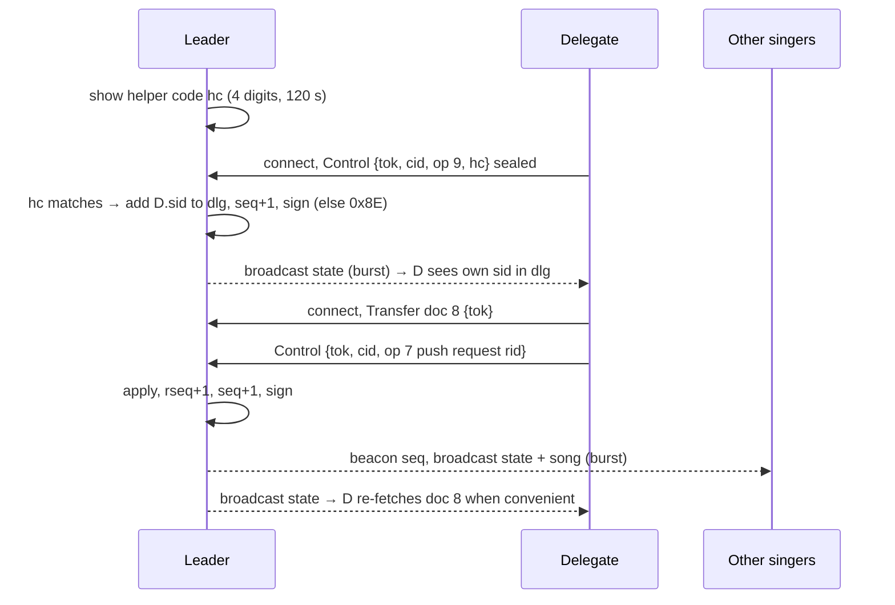

# Zangbundel – BLE Protocol Design

| Field | Value |
|---|---|
| Document | BLE protocol design |
| Project | Zangbundel – campfire songbook app |
| Protocol version | 1.0 (draft) |
| Document version | 0.45 (draft) |
| Date | 2026-10-28 |
| Author | Remko Welling |
| Status | Draft for review |
| Depends on | `design/functional-requirements.md` v0.21 |

| Version | Date | Change |
|---|---|---|
| 0.1 | 2026-10-18 | First draft: beacon-driven short-lived GATT connections; delegates; single gathering per area. |
| 0.2 | 2026-10-18 | Broadcast-first redesign: all leader-to-singer information goes out as a repeated broadcast carousel (section 7); connections are used only to register, send requests, act as delegate and recover missed data. Request statuses broadcast anonymously. Relays rebroadcast. |
| 0.3 | 2026-10-18 | `download.url` may name a release archive or release index (song-format section 12); no change to keys or encoding. Depends on FRD v0.4. |
| 0.4 | 2026-10-18 | Open question Q14: end-to-end encryption of the payloads carrying personal data, driven by Google Play's Data safety definitions. No normative change. |
| 0.5 | 2026-10-18 | Q14 adopted: sealed payloads (section 8.4). Leader X25519 key `ek` in the signed state; singer key `xk` in the Join; Join, Request, Control and document 8 end-to-end encrypted; write framing byte; `gid` binding; error `0x8D`. Satisfies FR-BLE-17 (FRD v0.5). |
| 0.6 | 2026-10-18 | Security table: row on fake or mistaken gatherings, join code inside the sealed Join, gathering fingerprint (assessment SP-04, SP-11). Depends on FRD v0.6. No wire change. |
| 0.7 | 2026-10-18 | Join QR code (section 6.5): payload with the leader's public key, join flow with key pinned from the code, QR-only joining. Depends on FRD v0.7. No change to what goes over the air. |
| 0.8 | 2026-10-18 | 6.5: link host is GitHub Pages (`pe1mew.github.io/Zangbundel/j`), scheme form `zangbundel://j/<payload>`, browser step with `intent://` button described. Q16 resolved. Depends on FRD v0.8. |
| 0.9 | 2026-10-18 | 6.5: canonical link carries the trailing slash (`/Zangbundel/j/#…`); Pages site verified live. |
| 0.10 | 2026-10-19 | Depends on FRD v0.9, which withdraws FR-LEAD-30 and 31 (no library download instruction in phase 1, `design/guiDesign.md` D-66). The `download` document (6) and the `libs` fields in Info and Join stay defined but are reserved: phase 1 apps do not send them and ignore them when received. No wire change. |
| 0.11 | 2026-10-19 | Two additive Control commands for any registered singer (9.8): op 9 *become delegate* with a helper code shown on the leader's screen (`design/guiDesign.md` D-73, Q22; FR-LEAD-40 as amended in FRD v0.9), and op 10 *leave*, so the leader's count drops at once (FR-GATH-07, FR-GATH-12). Error `0x8E`. Procedures 10.9, 10.11 and 10.12, security table and traceability updated. Protocol stays 1.0: new keys and ops only. |
| 0.12 | 2026-10-20 | Depends on FRD v0.10 (Q8 closed, no protocol impact). Dutch UI term for the helper code is *assistentcode* (`design/guiDesign.md` Q15). Nothing language-dependent goes over the air: labels are rendered by each phone (guiDesign D-75). No wire change. |
| 0.13 | 2026-10-22 | Depends on FRD v0.11. Q5 resolved: CBOR stays, encoded by the app's own bounded codec (`design/architecture.md` A-08). Fixes from architecture section 12: 10.1 step 2 and 10.9 persist and resume both key pairs with their secret keys and the delegate list `dlg`; 10.12 points at section 13 for the rate limits instead of 10.8; the 7.7 capacity table names its typical state record (15 frames) and gives the times for a maximum one (30 frames, 9.4); Q7 marked resolved by Control op 10. No wire change. |
| 0.14 | 2026-10-25 | Extended frame fits one manufacturer-data structure, decided by the owner after the first radio check (`design/test-results/2026-10-25-F-01.md`): a Samsung A52 on Android 14 refuses any single advertising data structure above 251 bytes although it reports 1650, and Android's `AdvertiseData` takes one manufacturer-data entry per company identifier, so the v0.13 frame of up to 1000 bytes could not be sent. Extended frame now at most 247 bytes with `fs` ≤ 235 (7.1, 7.2); the leader lowers `fs` at start if its stack refuses 247. The extended loop repeats the state record after every 8 document frames (7.4), its repair timers are longer (7.6), and the extended figures in 2.2, 4, 7.7 and 12.1 are recomputed. 15.1: the 100 ms interval is `INTERVAL_LOW` (160), not `INTERVAL_HIGH`; the measured update times are noted. Q2 notes the first sample. Wire change inside the draft protocol 1.0, which has no released implementation, so no major version bump. The architecture (v0.4), the song format (v0.5) and the test plan (v0.1) still name protocol v0.13; nothing they say depends on the extended frame size. |
| 0.15 | 2026-10-25 | Open questions Q17 to Q19, found while implementing the payloads and reassembly in `core/protocol`: the 440-byte state body can be exceeded by legal values (9.4), the end of a repair range for a last frame never seen (9.7), and the size limit of a decoded document (7.3, 9.5). No normative change. |
| 0.16 | 2026-10-25 | Corrections found while implementing the sealed payloads in `core/protocol`. Control op 8 carries at most **417** bytes of `data` per write, not 432 (8.4, 9.8): in the worst case, chunk 0 with `len` = 65 536, the other keys take 46 bytes, so 432 made a sealed write of 527 bytes against the 512-byte limit the same sentence promises. Error `0x8A` points at 9.8 op 8 instead of a non-existent 9.9. Open question Q20: section 5 and 8.4 disagree over which bytes document 8's `dh` covers. Wire change inside the draft protocol 1.0 (no released implementation), so no major version bump. |
| 0.17 | 2026-10-25 | Q17 to Q20 decided by the owner. 9.4: a body over 440 bytes loses `title`, then `rev` of `cur`, then `pt`, as far as needed; without them the largest body is 405 bytes. 9.7: singers end the last range at the manifest `len`, and the leader clamps every range at the document end; `0x8C` only for a range starting at or past it (8.3). 7.3: a document inflates to at most 67 584 bytes. 8.4: document 8's `dh` covers the compressed bytes, as section 5 says for every document, and is checked before inflating. Normative changes inside the draft protocol 1.0. |
| 0.18 | 2026-10-25 | Found while implementing the carousel in `core/protocol`: under rules 1 and 2 of 7.4 Set S carries no song, so with three legacy sets a pushed 2 kB song took 6.3 s, missing the 5 s of NFR-PERF-01, while 7.7 and 12.1 assumed all sets carry it. Decided by the owner: during a burst the legacy sets share the changed documents (rule 4), Set S sending the state first; the normal loop keeps the roles. Simulated without loss: 4.7 s with three sets, 7.0 s with two, 14.0 s with one, 1.1 s on the extended carrier. 7.7 notes the normal-loop pass times; 12.1's one-set figure is 14 s, not 13. Rule 3 no longer says the extended set behaves "as Set S does": Set S inserts one state frame, the extended set the whole record. |
| 0.19 | 2026-10-25 | 6.5: the size of the join link corrected from the encoder in `core/protocol` (`JoinLink`): 45 to 98 bytes of payload with ASCII names, 99 to 170 characters of URL, up to 223 with a 40-character accented name; QR versions 6 to 9 at level M, 11 in the worst case. v0.18 said 60–130 characters of URL, which was the length of the base64 part alone, and versions 5 or 6. No wire change. |
| 0.20 | 2026-10-25 | Depends on FRD v0.12. Open question Q21: erasure coding across frames on both carriers, GATT repair as the fallback and the library as the fast path, chosen in principle by the owner after `design/test-results/2026-10-25-D-05.md`; the detailed change is proposed in `design/proposals/2026-10-25-erasure-coding.md` and not yet part of this document. No wire change yet. |
| 0.21 | 2026-10-25 | Q21 resolved: the erasure-coding proposal (`design/proposals/2026-10-25-erasure-coding.md`) approved by the owner and moved in. 7.2: legacy frame of 26 bytes with `k`, `idx` and `len`; extended header of 14 bytes, `fs` ≤ 233. 7.3: systematic Reed–Solomon over GF(2⁸) with Cauchy coefficients, `r = min(2k, 256 − k)`, every broadcast document coded. 7.4: a pass is all `n` frames, sources before repairs in a burst, coded state frames cycled. 7.5: decode from any `k` distinct frames. 7.6: the fixed repair timers replaced by a rule on the singer's own rate (3 s without progress; `k` not expected within 10 s legacy, 4 s extended). 7.7, 12.1: figures with the code, simulated with the implementation at 40 % reception: 13.3 s on three legacy sets, 2.7 s extended. 9.7: a repair asks only for the source frames still needed. Wire change inside the draft protocol 1.0. |
| 0.22 | 2026-10-25 | Found while building GATT registration and repair in `core/protocol` and `platform/ble` and running it on three phones; accepted by the owner as written 2026-10-25, Q22 and Q23 left open. 7.6: a document named in the newest verified state's manifest that the singer lacks is watched from the moment that state is applied, so a singer that hears none of its frames (a leader whose extended set is not heard, D-05 runs 12–16) still repairs it; before, only a group with a frame received could ever be repaired. 9.7: DATA chunks are at most 509 bytes, because an attribute value is at most 512 bytes and Android cuts a longer notification (at MTU 517 every full chunk lost 2 bytes). Q22 (HEADER larger than MTU − 3 at MTU 23) and Q23 (a leader whose extended set is not heard) added. |
| 0.23 | 2026-10-25 | Q22 and Q23 resolved by the owner, and a third decision from D-05 run 17. 9.7: the HEADER spans as many `0x01` notifications as the MTU needs, so Transfer works at MTU 23 (Q22). 7.1: a singer on the extended carrier falls back to the legacy carrier when no extended frame of the gathering arrives within 3 s of selecting it (Q23). 10.2, 10.4: after reading or repairing the state over GATT, a singer fetches on the same connection every manifest document of which it holds no frame. 7.8: degraded mode implemented as written. Q24 to Q26 opened from the simulation scenarios S-01 to S-06 (`design/test-results/2026-10-25-S-01-06.md`). |
| 0.24 | 2026-10-25 | Q24 to Q26 resolved by the owner after the simulation scenarios (`design/test-results/2026-10-25-S-01-06.md`). 7.4: every burst pass opens with the whole state record, its repair frames included (Q24). 7.3: documents over 128 source frames keep the code as it is and rely on repair, the extended carrier and the library (Q25). 7.6: the repair limit is counted from the group's start and is 5 s on both carriers (Q26). |
| 0.25 | 2026-10-25 | Decided by the owner after D-05 run 18, where the Huawei fetched the song and the new state on two connections: 7.6 and 10.4, when a repair comes due the connection fetches every document the singer is still collecting, the state record first, not only those whose repair is due. |
| 0.26 | 2026-10-25 | Depends on FRD v0.13 (FR-SING-05, the singer's reception bar); no other change. |
| 0.27 | 2026-10-26 | Depends on FRD v0.14 (Q3 resolved: the default library is `github.com/pe1mew/Zangbundel-bibliotheek`); no other change. |
| 0.28 | 2026-10-26 | Depends on FRD v0.15 (FR-NET-01 and FR-NET-03 widened to setlist addresses); no other change. |
| 0.29 | 2026-10-26 | 10.11, from the phones (`design/test-results/2026-10-26-D-03-05-07.md`, D-07): the leave notice is sent in the background after the user is home, retried after a failed connection for up to 10 s, instead of one attempt within 2 s. Connect, MTU and write take 1.2–1.6 s on the Huawei when the connect is quick, and the 2 s budget missed 2 of 6 attempts. No wire change. |
| 0.30 | 2026-10-26 | 6.6 and appendix A: the gathering fingerprint [FR-GATH-18] is fixed as two Dutch words, one from each list of 256 at `gid[0]` and `gid[1]`, the same on every phone whatever its language; a reading aid, not a security mechanism. Nothing new goes over the air. Implemented in `core/protocol` with the join code and the key pinned from the QR code (6.5). 6.5: a test build marks its join link with `?app=debug` or `?app=fieldtest`, so the join page opens that build instead of looking for the release app (found in test D-04 with the camera app). |
| 0.31 | 2026-10-26 | 6.5, at the owner's request: the join code is fixed for a gathering, as guiDesign D-71 decided; the sentences saying the leader can rotate it and regenerates the QR code when it changes are replaced. No change on the air. |
| 0.32 | 2026-10-26 | Songs ahead (FRD v0.16 FR-BLE-18, approved by the owner as `design/proposals/2026-10-26-songs-ahead.md`): document 9 *ahead* carries every setlist song, framed byte for byte as document 3 would carry it, so the signed manifest verifies it when the song is pushed (7.3, 9.5); the large-document loop alternates the current song with one song ahead, and before the first push carries only songs ahead (7.4 rule 7); the singer keeps songs ahead hidden and bounded and never repairs them (7.5, 7.6); the setlist document lists the songs' `dh` in setlist order, without titles (9.5). Simplified against the proposal: the setlist vouches for nothing, because the manifest's `dh` at the push already proves the song, so no upcoming title or reference reaches a singer's phone. |
| 0.33 | 2026-10-26 | Approved by the owner as options A and C of `design/proposals/2026-10-26-state-after-push.md`, after both phones fetched the new state over GATT after every push (`design/test-results/2026-10-26-songs-ahead.md`). 7.1: a singer stays on the extended carrier only while it hears at least 3 extended frames of the gathering in the first 3 s and in every 10 s after; one frame in 3 s kept the S23 on a set it hears 0.05 times a second. 7.6: the state record is repaired after 1 s with nothing new instead of 3 s, because its frames come about 30 a second within a pass and stop when the pass moves on to the song. |
| 0.34 | 2026-10-26 | Approved by the owner as `design/proposals/2026-10-26-burst-state-first.md`, after per-frame timing on the Huawei showed the rate rule repairing the state at 2.5 s and every push costing each singer a setlist and an Info connection (`design/test-results/2026-10-26-state-after-push.md`). 7.2, 7.3: a frame index may go up to 255 for any document; frames above a document's usual `n` are the state's lead-in. 7.4 rule 4: a burst opens with the new state record's three passes as distinct frames (the lead-in), then the other changed documents three times, the setlist before the song. 7.6: the state record is judged first 1 s after the new `seq` against 3 s; a registered singer never repairs Info. A v0.33 singer drops lead-in frames above its usual `n`, so every phone must run v0.34. |
| 0.35 | 2026-10-26 | Approved by the owner as `design/proposals/2026-10-26-static-setlist.md`: the setlist document (9.5) carries only the order of the songs (key 2, their `dh` per position) and changes only when the setlist changes, not on a push; key 1 (`items`) is no longer sent. The state body (9.4) gains `cpos` (15), the current song's setlist position, and `sung` (16), a bitmap of the positions pushed so far, from which a singer derives what is current and what was sung; a late joiner shows earlier sung songs it holds ahead (7.5). A push bursts the state and, if it changed, the song (10.5). |
| 0.36 | 2026-10-26 | Depends on FRD v0.17 (FR-SING-05: the reception view is a hidden feature, opened by a long press only); no other change. |
| 0.37 | 2026-10-26 | Depends on FRD v0.18 (requests, likes and the delegate role moved to phase 2); no other change, the Request write, `reqstat`, document 8 and the delegate Control commands stay specified for phase 2. |
| 0.38 | 2026-10-26 | 10.9, the owner's choice of option B in `design/proposals/2026-10-26-singer-presence.md`: the leader no longer drops silent singers after 10 minutes (that expiry never ran, and with songs ahead a singer that hears well may never connect); the count is the registered singers minus those that left, an upper bound. A singer whose app is swiped away sends the leave notice first. |
| 0.39 | 2026-10-27 | 10.1 step 2 and 10.9, the owner's request with resume after a crash (guiDesign D-67): the resume record also holds `ts`, since 9.4 makes singers ignore a state whose `ts` is not above the last one and a resumed leader counting from 0 again would be ignored by all of them; and the setlist as started (per position its `library-id/song-id`, or its title), the positions pushed in order and the current position, so a resumed leader publishes the same current song, `cpos`, `sung` and songs ahead and singers carry on where they were. The record is rewritten on every push and at least every 30 s; its last write marks when the leader stopped. A resume more than 5 min after that finds its singers ended (10.11). |
| 0.40 | 2026-10-27 | `design/proposals/2026-10-27-setlist-during-campfire.md`, approved by the owner: the setlist may change during the gathering (songs added, removed or moved, FR-LEAD-03); 9.4 `cpos` and `sung` name positions in the setlist the same state's manifest names and are renumbered with it; 7.5: a singer reads them only against that setlist and remembers earlier songs by `dh`; 10.5: a setlist change is a new state with the same `cur`, and clearing the current song (FR-LEAD-06) leaves out `cur` and `cpos`. No wire change. |
| 0.41 | 2026-10-27 | Depends on FRD v0.19 (FR-DATA-09: the opt-in campfire statistics on the leader's device, export by hand only); no other change. |
| 0.42 | 2026-10-27 | 10.1 step 6 as built: the leader's app shows another gathering for as long as it is heard (`design/guiDesign.md` D-68) instead of warning once; no change on the air. |
| 0.43 | 2026-10-27 | Option B of `design/proposals/2026-10-26-state-after-push.md`, approved by the owner 2026-10-27: the beacon gets `cdv` (6.1–6.3), the `dv` of the current song, and a singer that keeps that song ahead from the signed setlist shows it at once, provisionally, until the verified state confirms or withdraws it (7.5, 10.3, 10.5; section 13; assessment SP-31). The gathering name in the beacon shrinks to 15 bytes on Android and 6 on iOS. Incompatible with earlier versions at the same `ver`; no release has gone out, so every phone must run this version. Built and tested the same day: on the phones every push was on screen from the beacon within 0.07–1.66 s (`design/test-results/2026-10-27-beacon-hint.md`). |
| 0.44 | 2026-10-28 | Depends on FRD v0.20 (Q2 and Q4 closed, Q11 further resolved: open questions the design had already answered); no other change. |
| 0.45 | 2026-10-28 | Depends on FRD v0.21 (Q9 closed, Q10 and Q12 deferred to phase 2); no change to the protocol. Open questions after the owner's decisions: Q1 decided (apply for a SIG company identifier before the public release), Q12 closed (answered by songs ahead), Q4, Q6, Q8, Q10 and Q15 deferred. |

---

## 1. Introduction

### 1.1 Purpose

This document specifies how the leader and the singers of a Zangbundel gathering communicate over Bluetooth Low Energy (BLE). It covers discovery (the beacon), the broadcast data channel, joining, song requests, delegate commands, recovery of missed data, reconnection, the end of a gathering, versioning and security. It is written so that an Android and an iOS implementation built from it interoperate in either role (FR-BLE-08).

### 1.2 Scope

In scope: everything that travels over the air during a gathering. Out of scope: the song file format (see `design/song-format.md`), library import over the internet, the UI, and the on-device storage model. Phase 2 (karaoke clock synchronisation) and phase 3 (notation) are only reserved for, not designed.

### 1.3 Conventions

- "Leader" and "singer" are the roles from the FRD. In BLE terms the leader is the **advertiser and GATT server** (peripheral role); a singer is the **scanner and GATT client** (central role).
- Byte orders are big-endian unless stated otherwise. `u8`, `u16`, `u32` are unsigned integers of that width. `bstr`/`tstr` are CBOR byte and text strings.
- Requirement IDs in brackets, e.g. [FR-BLE-12], point to the FRD requirement a design element satisfies.
- MUST / SHOULD / MAY follow RFC 2119 and bind implementations of this protocol.

---

## 2. Design goals and constraints

### 2.1 Goals taken from the FRD

| Goal | Source |
|---|---|
| Work with BLE only; no internet, Wi-Fi or hotspot | FR-BLE-01, FR-GEN-03 |
| No system pairing; join by tapping a gathering | FR-BLE-02 |
| New song visible on every singer within 5 s (25 singers, 10 m); 2 s when singers have the song locally | FR-BLE-03, NFR-PERF-01 |
| Complete-or-nothing delivery of lyrics; resend possible | FR-BLE-04, FR-LEAD-06 |
| Compact transfer of songs up to about 4 kB | FR-BLE-05 |
| At least 25, ideally 50 singers; graceful refusal beyond capacity | FR-BLE-10 |
| Optional relay through singer devices | FR-BLE-11 |
| Send identifier first, lyrics only to singers that lack the song | FR-BLE-12 |
| Leader text messages, setlist, requests and their status (download instructions reserved, FR-LEAD-30 withdrawn in FRD v0.9) | FR-BLE-06, FR-BLE-13, section 11 FRD |
| **Leader-to-singer information goes out by broadcast, repeated; connections only to register, request, delegate or recover** | **FR-BLE-15, FR-BLE-16** |
| Leader position for "follow the leader" | FR-LEAD-05, FR-SING-12 |
| Automatic reconnection; gathering treated as ended after a timeout | FR-GATH-10, FR-GATH-11 |
| Leader can resume a gathering after an app restart | FR-GATH-13 |
| No second gathering can be started within range of a running one; warn when one appears | FR-GATH-16, FR-GATH-17 |
| Delegates handle requests and push songs through the leader's device; leader-only actions stay leader-only | FR-LEAD-40 to FR-LEAD-46 |
| Nobody can impersonate the leader of a running gathering | NFR-SEC-02 |
| Versioned, platform-neutral protocol | FR-BLE-07, FR-BLE-08 |
| Only gathering data and the display name on the air | FR-BLE-14, NFR-PRIV-01 |
| Personal data (display name, request text, credentials) end-to-end encrypted to its recipient; broadcasts carry none | FR-BLE-17 |
| Testable with a simulated transport | NFR-TEST-01 |

### 2.2 Platform facts that shape the design

| Fact | Consequence |
|---|---|
| Legacy BLE advertising carries 31 bytes of advertisement data plus 31 bytes of scan response per advertising event. The minimum advertising interval an Android app can set is 100 ms. | A legacy broadcast carries at most a few hundred bytes per second per advertising set. Documents are split into small frames and repeated. |
| Android devices that support multiple advertising sets (API 26+, most phones since 2018) can run several independent advertisements at once; each set carries its own 31 + 31 bytes. | The leader runs one discovery beacon set plus one or more data sets. Throughput scales with the number of sets the chip allows. |
| Extended advertising (BLE 5) carries up to 1650 bytes per advertisement, but one advertising data structure holds at most 255 bytes, Android's `AdvertiseData` takes one manufacturer-data entry per company identifier, and at least one Android 14 phone refuses any single structure above 251 bytes (`design/test-results/2026-10-25-F-01.md`). Sending requires a BLE 5 chip and Android 8+; receiving requires Android 8+ or iOS 13+ with supporting hardware. It is not universal and an iOS app cannot send it. | Extended advertising is the preferred carrier when available; a legacy carrier MUST always run alongside it for singers that cannot receive it. An extended frame fits one manufacturer-data structure (7.1). |
| Android cannot put an app-chosen local name in an advertisement without renaming the user's Bluetooth adapter. It can send manufacturer-specific data. | Android leaders carry all beacon and data frames in manufacturer data. |
| An iOS app can advertise only a local name and service UUIDs, and only while in the foreground. | An iOS leader cannot run the broadcast data channel. It runs the discovery beacon in text form (encoding B) and serves everything over GATT (degraded mode, section 7.8). |
| The number of simultaneous GATT connections an Android device accepts as a server is set by its Bluetooth stack and is not exposed to apps. In practice it ranges from about 4 to 15. | Connections are the scarce resource. The protocol uses them only for upstream traffic and recovery, never for routine delivery. |
| A GATT characteristic value is at most 512 bytes; notifications carry at most MTU − 3 bytes (MTU typically 247 Android-to-Android, 185 with iOS, minimum 23). | Anything larger than a few hundred bytes goes through a chunked transfer when fetched over GATT. |
| BLE device addresses on modern phones are random and rotate roughly every 15 minutes; each advertising set may use its own address. | Gathering identity and frame identity are carried in the payload, never derived from the address. |
| Scan responses are sent only to scanners that send a scan request; link-layer backoff means a scanner does not get one on every event. | Data in scan responses is a bonus. Singers MUST NOT depend on receiving them. |

---

## 3. Architecture overview

### 3.1 Roles and channels

```
                  ┌──────────────────────────────────────────┐
                  │                 LEADER                   │
                  │  beacon set   data sets (1..n)   GATT    │
                  └────┬──────────────┬───────────────┬──────┘
   broadcast, repeated │              │               │ connections, short-lived
   (discovery, state,  ▼              ▼               ▼ (register, request, control,
    songs, setlist…)                                    recover missed frames)
             ┌───────────┐   ┌───────────┐   ┌───────────┐
             │  Singer   │   │  Singer   │   │ Delegate  │   … up to 50
             └───────────┘   └───────────┘   └───────────┘
```

- **Downstream** (leader → singers): the **discovery beacon** (section 6) and the **broadcast data channel** (section 7). Everything a singer needs to sing is carried here, more than once, to any number of singers at the same time.
- **Upstream and recovery** (singer → leader): short GATT connections (section 8) for registering, song requests, delegate commands, and fetching frames a singer missed.

### 3.2 Key ideas

1. **Broadcast first, repeated.** The leader transmits a *carousel* of documents: the signed state record, gathering info, the current song, the setlist, the leader's message, the download instruction and anonymous request statuses. A changed document is sent three times back-to-back, then keeps cycling at a lower rate as long as it is current. Singers receive without connecting, whatever their number [FR-BLE-15, FR-BLE-10].
2. **Connections only when they carry something upstream, or to recover.** A singer connects once to register (to be counted and get a token), when it sends a request, when it acts as delegate, and when the carousel has not completed a document for it in a reasonable time ("repair") [FR-BLE-16]. In a gathering where most singers have the library, a singer typically opens one connection for the whole evening.
3. **Content-addressed songs.** A song is identified by the hash of its file. A singer with that file, from any library revision, needs only the state record and never collects the song frames [FR-BLE-12].
4. **Signed state.** The leader generates a key pair per gathering. The gathering identifier is a fingerprint of the public key; the state record is signed and lists the hash of every other document. Nothing received by broadcast is used until it is verified against the signed state [NFR-SEC-02]. This makes broadcast, repair over GATT and relays equally trustworthy.
5. **Two carriers, one framing.** Documents are framed for legacy advertising (16 data bytes per frame) and, when the leader supports it, for extended advertising (up to 233 data bytes per frame, one manufacturer-data structure), with an erasure code across the frames of every document (7.3). Repair over GATT sends the same bytes by range, so there is one reassembly path.
6. **One encoding, CBOR.** All structured payloads are CBOR maps with small integer keys. Unknown keys are ignored, which gives minor-version extensibility for free [FR-BLE-07].
7. **Delegates act through the leader.** A delegate is a registered singer whose ID the leader lists in the signed state. It sends control commands over GATT; the leader applies them, re-signs the state and broadcasts it [FR-LEAD-43].
8. **One gathering per area.** A device scans before it starts a gathering and refuses to start while another running gathering is in range [FR-GATH-16].
9. **Personal data is sealed, everything else is public.** The broadcast carousel never carries a display name, request text or credential. The few GATT exchanges that do are end-to-end encrypted to their recipient with a per-gathering X25519 key that travels inside the signed state (section 8.4) [FR-BLE-17]. A sniffer at the fire gets the lyrics and nothing about the people.

### 3.3 Singer state machine

```
 IDLE ──scan──▶ DISCOVERED ──tap──▶ REGISTERING ──ok──▶ LISTENING
                                        │ busy/fail          │ ▲
                                        ▼ (retry in bg)      │ │
                                    LISTENING (unregistered) │ │
 LISTENING ──frames incomplete after wait──▶ REPAIRING ──────┘ │
 LISTENING ──no beacon 10 s──▶ RECONNECTING ──beacon──▶ LISTENING
 RECONNECTING ──no beacon 5 min──▶ ENDED
 any ──beacon ENDED flag or verified state status ENDED──▶ ENDED
 any ──user leaves──▶ IDLE
```

A singer is *listening* from the moment it has verified the gathering's public key; registration only adds the token and the head count. If registration fails because the leader is busy, the singer keeps listening and retries registration in the background with a long backoff.

---

## 4. Reaching 25–50 singers: options and recommendation

| Option | How it works | Pros | Cons |
|---|---|---|---|
| **A. Persistent GATT connections** | Every singer stays connected; leader notifies all. | Simple; instant push. | Hard limit of 4–15 connections; fails FR-BLE-10 on most phones. |
| **B. Beacon-driven short-lived connections** (document v0.1) | Beacon carries a sequence number; singers connect briefly on every change. | Works everywhere; a few slots serve dozens. | One connection per singer per change: with 50 singers every song push is a burst of 50 connections; latency grows with group size; iOS and busy leaders struggle. |
| **C. Broadcast carousel over legacy advertising sets** | Leader cycles document frames in 1–3 non-connectable advertising sets; singers reassemble; GATT only for upstream and repair. | Unlimited singers; zero connections for routine delivery; works on every Android leader with multiple-advertisement support. | 160–480 B/s per direction; a 2 kB song takes 4–12 s per pass; needs frame reassembly logic. |
| **D. Broadcast carousel over extended advertising** | Same as C with frames of up to 247 bytes. | A song in about ten frames; delivery in about a second to any number of singers. | Not on every device; never from an iOS leader. |
| **E. Relay rebroadcast** | Singers that have verified documents repeat the carousel. | Extends range and adds throughput without any leader involvement. | Peripheral mode and battery on relays. |

### 4.1 Why broadcast and not multicast

BLE offers a phone app exactly one one-to-many primitive: **advertising**, which is link-layer broadcast to every scanner in range. There is no group-addressed multicast in BLE:

| Mechanism | Nature | Usable here? |
|---|---|---|
| Advertising (legacy, extended) | Broadcast, connectionless, unacknowledged | Yes: this design. Android and iOS apps can send (Android) and receive (both) it. |
| Periodic advertising / PAwR | Broadcast train that receivers synchronise to; built-in repetition | No: the Android API for synchronising is hidden from apps; iOS has none. |
| LE Audio broadcast (BIS, "Auracast") | True broadcast stream with retransmissions | No: audio only, exposed through audio APIs, not for app data. |
| Bluetooth Mesh group addresses | Application-level multicast by flooding | No: phones have no Mesh stack for apps; the advertising bearer needs raw AD types Android cannot send; the GATT proxy bearer needs connections. |
| Notifications to each connected singer | Unicast repeated per receiver ("poor man's multicast") | Only as degraded mode (7.8): it is bounded by connection slots, which is the problem being solved. |

Multicast *semantics* (only the singers of this gathering act on the data) are provided at the application layer: every frame carries `gid16`, scanners filter on it in hardware (Android manufacturer-data filter) and discard the rest. Two gatherings in range therefore coexist on the same broadcast medium without interfering logically; they only share air time. Confidentiality is not a goal (lyrics are public), so broadcasting in clear is acceptable; authenticity is provided by the signed state.

**Recommendation:** **C is the mandatory baseline, D is used automatically when the leader supports it, B remains as the degraded mode** for leaders that cannot broadcast data (iOS leaders, Android devices with a single advertising instance), and **E is an optional extension** (section 11). GATT is kept for registration, requests, delegate control and repair only. Section 12 shows that C meets the 2-second target for singers with the library on any group size and that D meets the 5-second target for singers without it; with C alone the 5-second target for library-less singers depends on the number of advertising sets the leader's chip allows.

---

## 5. Identifiers, keys and hashes

| Name | Size | Definition |
|---|---|---|
| **Gathering key pair** | Ed25519 | Generated by the leader when a gathering starts; stored in app-private storage until the gathering ends, so the gathering can be resumed [FR-GATH-13]. Never reused. |
| **Gathering ID** `gid` | 5 bytes | First 5 bytes of SHA-256 of the 32-byte public key. Appears in the beacon and in every state record. `gid16` is its first 2 bytes, used in data frames. |
| **Public key** `pk` | 32 bytes | Broadcast in the Info document and readable over GATT. Pinned by the singer for the gathering. |
| **State sequence** `seq` | u16 | Incremented by the leader on every change to state or documents except the line position. Wraps around; singers compare for inequality only. |
| **Position** `pos` | u8 | 0 = no position; 1–254 = 1-based line index into the current song's canonical line list; 255 = line 255 or beyond. |
| **Singer ID** `sid` | 8 bytes | Random, generated by the singer app per gathering. Lets the leader recognise a singer that reconnects. Not persistent across gatherings [NFR-PRIV-01]. |
| **Session token** `tok` | 16 bytes | Random, issued by the leader at registration. Authenticates requests and delegate commands. Never travels in clear (8.4). |
| **Leader encryption key** `ek` | X25519, 32-byte public key | Generated per gathering next to the signing key; published in the signed state (9.4) and in Info. Recipient key for everything a singer seals to the leader. |
| **Singer encryption key** `xk` | X25519, 32-byte public key | Generated by the singer per gathering; sent inside the sealed Join request. Recipient key for the Join response and, for delegates, document 8. |
| **Sealed payload** | bytes | libsodium `crypto_box_seal` of a CBOR payload to a recipient public key (8.4). 48 bytes overhead. |
| **Song content hash** `hash` | 16 bytes | First 16 bytes of SHA-256 over the song file bytes exactly as stored in the library (canonicalised as defined by the song-format spec). |
| **Document hash** `dh` | 8 bytes | First 8 bytes of SHA-256 over the *framed bytes* of a document (the CBOR encoding, after optional DEFLATE). Listed in the signed state. |
| **Document version** `dv` | u16 | The first 2 bytes of `dh` for ordinary documents; `seq` for the state record. Carried in every frame so singers can group frames of the same document version. |
| **Song reference** `ref` | CBOR map | `{1: lib (tstr library id), 2: song (tstr song id), 3: hash (bstr 16), 4: rev (tstr, optional library revision, informational)}`. Matching between leader and singer is by `hash` alone [FR-LIB-17]. |

Hashing by content rather than by library revision is a deliberate reading of FR-BLE-12 ("exact song version"): two library revisions that did not touch a song still match, so fewer transfers are needed and the FRD's intent is met more often.

---

## 6. The discovery beacon

### 6.1 Content

The beacon carries 12 bytes of fields plus the gathering name (10 before v0.43):

| Offset | Field | Type | Meaning |
|---|---|---|---|
| 0 | `ver` | u8 | Protocol major version. `1` for this document. |
| 1–5 | `gid` | 5 bytes | Gathering ID. |
| 6–7 | `seq` | u16 | State sequence number. |
| 8 | `flags` | u8 | Bit 0 `CODE` join code required · bit 1 `REQ_OPEN` requests accepted · bit 2 `BUSY` no free connection slot · bit 3 `ENDED` gathering has ended · bit 4 `RELAY` sender is a relay, not the leader · bit 5 `KARAOKE` reserved for P2 · bit 6 `BCAST` broadcast data channel running (legacy carrier) · bit 7 `EXT` extended carrier also running. |
| 9 | `pos` | u8 | Leader line position (section 5). |
| 10–11 | `cdv` | u16 | v0.43: the `dv` of the current song's document 3 in the newest state; 0 when nothing is current or the song is not broadcast [FR-LIB-22]. Unsigned: a hint a singer may act on only as 7.5 allows. |
| 12… | `name` | UTF-8 | Gathering name, truncated at a character boundary to fit. The full name is in the Info document. |

### 6.2 Encoding A – Android leader (binary)

- **Advertisement (≤ 31 bytes):** Flags AD structure (3 bytes, set by the stack; connectable, general discoverable) + *Complete List of 128-bit Service UUIDs* containing the Zangbundel service UUID (18 bytes). Device name MUST NOT be included.
- **Scan response (≤ 31 bytes):** one *Manufacturer Specific Data* AD structure: length, type `0xFF`, company identifier `0xFFFF` (little-endian), then the 12 field bytes, then up to 15 bytes of `name` (17 before v0.43).

Company identifier `0xFFFF` is reserved by the Bluetooth SIG for internal use and testing; see open question Q1.

### 6.3 Encoding B – iOS leader (text)

- **Advertisement:** the Zangbundel service UUID as the only advertised service.
- **Scan response:** local name = `"ZB"` + Base32 (RFC 4648, no padding, upper case) of the 12 field bytes (20 characters) + `" "` + up to 6 bytes of `name` (16 characters and 10 bytes before v0.43). Total ≤ 29 bytes.

An iOS leader MUST restart advertising whenever `seq`, `flags`, `pos` or `cdv` change. `BCAST` and `EXT` are always 0 for an iOS leader.

### 6.4 Rules

- Singers MUST scan with a filter on the Zangbundel service UUID for discovery and MUST accept both encodings.
- Leaders MUST advertise the beacon connectable, at 100–250 ms interval, at high TX power, and MUST update it within 100 ms of a state change.
- Singers MUST request duplicate reports while in a gathering so `seq` and `pos` changes are seen promptly. Outside a gathering a lower duty cycle MAY be used.
- A change of `pos` alone MUST NOT increment `seq`. Singers apply `pos` directly from the beacon [FR-LEAD-05].
- A singer treats the beacon as *lost* when nothing from the gathering (beacon or data frame) has been received for 10 s, and the gathering as *ended* after a configurable 5 minutes [FR-GATH-10, FR-GATH-11]. A relay beacon counts.
- The gathering list [FR-GATH-03, FR-GATH-04] is built from beacons with `ENDED` = 0 and `RELAY` = 0, grouped by `gid`, with RSSI as the distance hint.

### 6.5 Join QR code [FR-GATH-19 to FR-GATH-23]

The beacon lets a singer find a gathering; the QR code on the leader's screen lets a singer find **the right one** and trust it. It is an out-of-band channel: whoever can see the leader's screen gets the leader's public key directly, so nothing received over the air afterwards can be forged.

**Content.** An HTTPS URL on the project's GitHub Pages site (FRD Q13, resolved) with the join data in the fragment, which browsers never send to the server:

```
https://pe1mew.github.io/Zangbundel/j/#<base64url(payload)>
```

The trailing slash is part of the canonical form: without it GitHub Pages answers with a redirect, which browsers follow with the fragment intact but which costs a round trip. The site is live since 2026-10-18. A test build (application id `nl.pe1mew.zangbundel.app.debug` or `….fieldtest`) puts `?app=debug` or `?app=fieldtest` before the fragment (`https://pe1mew.github.io/Zangbundel/j/?app=debug#<payload>`), so the join page's button opens that build; the app accepts the link with or without it, and a release build never adds it.

The app also accepts the same payload as a path segment of its own scheme, `zangbundel://j/<base64url(payload)>`; this is what the Pages button, an in-app scanner and the iOS camera use.

`payload` is the CBOR map:

| Key | Name | Type | Req. | Meaning |
|---|---|---|---|---|
| 1 | `ver` | uint | yes | Protocol major version (1). |
| 2 | `gid` | bstr 5 | yes | Gathering ID. |
| 3 | `pk` | bstr 32 | yes | The leader's Ed25519 public key. This is what makes the code unforgeable: a scanning phone pins `pk` before it listens to the air, and accepts only a state record signed by it. |
| 4 | `code` | tstr ≤ 8 | no | The join code, when the gathering requires one (`CODE` flag). In QR-only mode this is a random 8-character code that exists nowhere else [FR-GATH-21]. |
| 5 | `name` | tstr ≤ 40 | no | Gathering name, for the "joining …" screen. Optional; it is the only human-readable field and carries no personal data by FR-GATH-01. |

Size, as the encoder produces it: 45 bytes of payload without `code` and `name` (99 characters of URL, QR version 6 at error-correction level M), 98 bytes with an 8-character code and a 40-character ASCII name (170 characters, version 9); a 40-character name in accented letters takes twice the bytes (223 characters, version 11). Byte-mode capacity at level M is 106 characters for version 6, 152 for version 8 and 180 for version 9. Whether a phone camera reads versions 9 to 11 from arm's length at the size FR-DIST-02 prescribes is untested; the join test (F-07) will show it. Nothing in it changes during a gathering, the join code included (guiDesign D-71).

**Verification by the scanner.** `SHA-256(pk)[0..5]` MUST equal `gid`, else the code is rejected as malformed. The app then scans for a beacon with that `gid`; when found, it collects or reads the state record and verifies its signature with the `pk` from the code, **not** with a key from Info. A beacon with the right `gid` whose state does not verify is ignored, and the app keeps looking. After verification the normal registration follows (10.2) with `code` from the QR code when present. If no verified gathering appears within 30 s the app says the gathering is not in range and offers to retry.

**Phones without the app, and the browser step.** Opening the URL in a browser shows the static page `docs/j/index.html` from this repository: it decodes the fragment locally, shows the gathering name, and offers "Open in Zangbundel" and the store link [FR-DIST-01, FR-GATH-22]. The button is an `intent://j/<payload>#Intent;scheme=zangbundel;package=nl.pe1mew.zangbundel.app;S.browser_fallback_url=<Play URL>;end` link on Android (Chrome launches the app or falls back to Play; with `?app=debug` or `?app=fieldtest` the package is that test build's, and the fallback stays the release app on Play) and a `zangbundel://j/<payload>` link elsewhere. The page loads nothing external and sends nothing. Until the App Link is verified (`docs/RUNBOOK.md` Step 5c) Android 12 and later always take this browser step; with verification the camera app opens Zangbundel directly.

**What the code does not protect against.** Someone showing a code for their *own* gathering: the trust anchor is the leader's screen, which is what the scouts are told to scan. A photographed code reused later is useless once the gathering has ended, because the key is deleted (10.10). The code contains no secret except an optional join code, which is fixed for the gathering: a leader who wants another code ends the gathering and starts a new one, which also gives a new key and a new QR code (guiDesign D-71).

### 6.6 Gathering fingerprint [FR-GATH-18]

Two Dutch words from the gathering ID: the first from list 1 of appendix A at index `gid[0]`, the second from list 2 at index `gid[1]`, joined by a hyphen (`appel-vuur`). The words are the same on every phone whatever its UI language, so the leader can say them aloud and every singer sees the same pair (decided by the owner, 2026-10-26). Both lists have 256 words of 3 to 8 letters a–z, concrete and known to children, none rude or slang in Dutch, no word in both lists and no two words in one list that sound alike. The fingerprint is a reading aid, not a security measure: 65 536 pairs can be matched by a forger with a few thousand key generations, which is why the QR code (6.5) carries the key itself.

---

## 7. The broadcast data channel

### 7.1 Carriers

| Carrier | Advertising set(s) | Frame data size | When |
|---|---|---|---|
| **Legacy** | 1 to `n` non-connectable advertising sets (Android `startAdvertisingSet`, legacy mode), interval 100 ms, no service UUID, one manufacturer-data structure per advertisement; the scan response MAY carry the next frame of the same set. | 16 bytes | MUST run whenever the leader can start at least one extra advertising set. `BCAST` = 1. |
| **Extended** | 1 non-connectable extended advertising set (legacy mode off, 1M primary PHY, 2M or coded secondary PHY), interval 100 ms, advertising data one manufacturer-data structure of at most 251 bytes (length, type, company identifier, frame ≤ 247 bytes). | up to 233 bytes | SHOULD run in addition to the legacy carrier when `isLeExtendedAdvertisingSupported()`. `EXT` = 1. |
| **GATT repair** | Not a broadcast: section 9.7. | by byte range | Always available. |

The leader determines `n` at start by opening sets until the stack refuses (`ADVERTISE_FAILED_TOO_MANY_ADVERTISERS`), keeping one instance for the beacon and using at most 3 for data. Singers receiving the extended carrier ignore legacy data frames; singers that cannot receive it use legacy frames. Both carry the same documents. A singer that can receive the extended carrier and sees `EXT` in the beacon collects extended frames, but falls back to the legacy carrier for the rest of the gathering when fewer than **3** extended frames of the gathering arrive within **3 s** of selecting it, or, later, within any **10 s** (v0.33; v0.23 fell back only when none arrived in the first 3 s, Q23): a phone can open an extended set that nobody hears, and one that a singer hears only now and then (`design/test-results/2026-10-25-D-05.md`, runs 12–16; the S23 heard the A52's extended set 0.05 times a second and stayed on it, `design/test-results/2026-10-26-songs-ahead.md`).

An extended frame is one manufacturer-data structure because that is what Android can send reliably: the structure is limited to 255 bytes by the Bluetooth specification, `AdvertiseData` holds one manufacturer-data entry per company identifier, and the first measured phone refused any structure above 251 bytes (`design/test-results/2026-10-25-F-01.md`). The limit of 247 frame bytes comes from that one phone. A leader whose stack refuses a 247-byte frame (`ADVERTISE_FAILED_DATA_TOO_LARGE`) lowers `fs` at start until the frame is accepted; `fs` is carried in every extended frame (7.2), so singers need no other signal. The F-01 survey may show that a lower default is needed.

### 7.2 Frame formats

All frames are manufacturer-specific data with company identifier `0xFFFF`. The first payload byte distinguishes beacon (`0x01` = `ver`) from data frames.

**Legacy frame (26 bytes):**

| Offset | Field | Type | Meaning |
|---|---|---|---|
| 0 | `magic` | u8 | `0xD1` |
| 1–2 | `gid16` | 2 bytes | First 2 bytes of `gid`. |
| 3 | `doc` | u8 | Document type (section 7.3). |
| 4–5 | `dv` | u16 | Document version. |
| 6 | `k` | u8 | Number of source frames of this document version (1–255). |
| 7 | `idx` | u8 | Frame index: 0 … k − 1 source frames, k … 255 repair frames (7.3; above `n` − 1 only in the state's lead-in, 7.4 rule 4, v0.34). |
| 8–9 | `len` | u16 | Document length in bytes, to strip the padding of the last source frame. |
| 10–25 | `data` | 16 bytes | Source frame `idx`: document bytes `idx × 16 … idx × 16 + 15`, the last one padded with zero bytes; or a repair frame. Always 16 bytes. |

The 26 bytes fit the 27 a legacy manufacturer-data structure leaves after its length, type and company identifier. A document framed for the legacy carrier is at most 255 × 16 = 4080 bytes. A larger document is marked *GATT only* in the state (section 9.4) and fetched by repair.

**Extended frame (≤ 247 bytes):**

| Offset | Field | Type | Meaning |
|---|---|---|---|
| 0 | `magic` | u8 | `0xD2` |
| 1–2 | `gid16` | 2 bytes | |
| 3 | `doc` | u8 | |
| 4–5 | `dv` | u16 | |
| 6–7 | `k` | u16 | Number of source frames. |
| 8–9 | `idx` | u16 | Frame index, as on the legacy carrier. |
| 10–11 | `fs` | u16 | Frame data size for this document version (≤ 233); the same in every frame of it. |
| 12–13 | `len` | u16 | Document length in bytes. |
| 14… | `data` | `fs` bytes | Source frame `idx` (document bytes `idx × fs …`, the last padded) or a repair frame. |

Because every frame carries `len`, the state record and Info, which have no manifest entry, are coded like the rest.

### 7.3 Documents carried

| `doc` | Document | Signed? | Typical size (compressed) | Section |
|---|---|---|---|---|
| 1 | **state** | yes (Ed25519) | 230–300 B | 9.4 |
| 2 | **info** | no (pk verified by `gid`) | 120–200 B | 9.2 |
| 3 | **song** (current song only) | via `dh` in state | 1–2.5 kB | 9.5 |
| 4 | **setlist** | via `dh` | 0.3–1.5 kB | 9.5 |
| 5 | **message** | via `dh` | < 250 B | 9.5 |
| 6 | **download** | via `dh` | < 200 B | 9.5 |
| 7 | **reqstat** (anonymous request statuses) | via `dh` | < 500 B | 9.5 |
| 8 | **requests** (delegates only, contains names) | — | — | GATT only, never broadcast |
| 9 | **ahead** (a setlist song before it is pushed, v0.32) | via `dh` in state when pushed | 1–2.5 kB each | 9.5 |

Documents 3–7 and 9 are DEFLATE-compressed (raw, RFC 1951) before framing when that saves at least 10 %; the state manifest says which (section 9.4). The state record and info are never compressed. A framed document is at most 64 kB (the upload limit of 9.8, op 8); after inflating, a document is at most 67 584 bytes (64 KiB + 2 KiB, room for a 64 KiB song file with its reference and licence), and a receiver stops inflating and discards the document beyond that.

**Erasure code.** Every broadcast document (1–7 and 9) is framed as `k` source frames followed by `r` repair frames of a systematic Reed–Solomon code over GF(2⁸), so a singer that has any `k` distinct frames of the `n = k + r` reconstructs the document, and one that has all source frames needs no decoding. Approved by the owner 2026-10-25 after singers heard only 17–40 % of the advertising events (`design/test-results/2026-10-25-D-05.md`; the comparison of options is in `design/proposals/2026-10-25-erasure-coding.md`).

- Field: GF(2⁸) with the polynomial x⁸ + x⁴ + x³ + x² + 1 (`0x11D`).
- Repair frame `j` (0 ≤ j < r), byte position `b`: `R_j[b] = Σᵢ c(j, i) · S_i[b]` over the source frames `i` (0 ≤ i < k), with `c(j, i) = 1 / (x_j ⊕ y_i)`, `y_i = i`, `x_j = k + j`. Every square submatrix of a Cauchy matrix is invertible, so any `k` rows of the identity stacked on the Cauchy matrix decode. Test vector: source frames `010203` and `040506` give repair frames `79028d` and `f67902`.
- Redundancy `r = min(2k, 256 − k)`, so `n ≤ 256`; the state's lead-in in a burst (7.4 rule 4, v0.34) uses more, `3n − k` repair frames, at most `256 − k`, all distinct, and a receiver accepts any index below 256: a typical state record (`k` = 15) gets 30 repair frames, a 2 kB song on the legacy carrier (`k` = 125) 131, the same song on the extended carrier (`k` = 9) 18. A document with `k > 255` (only on the extended carrier, above about 59 kB) is sent uncoded and relies on repair.

### 7.4 Scheduling: burst, then carousel

The leader keeps one frame queue per data set and fills them by these rules [FR-BLE-15]:

1. **Set S (first legacy data set) – small documents.** Loops continuously: *state*, *info*, *reqstat*, *message*, *download*, state again, … The state record therefore repeats about once per second on a single set.
2. **Sets D1…D(n−1) – large documents.** Loop: *song*, *setlist*, *song*, … interleaved so that two sets send different frames of the same document (set D1 sends even frames, D2 odd frames); with songs ahead, rule 7. With only one data set, Set S carries everything and inserts one state frame after every 8 document frames, cycling through the state record's coded frames.
3. **Extended set.** Loops all documents 1–7 in order (with songs ahead, rule 7) and sends `k` frames of the state record again after every 8 document frames, cycling through its coded frames (two frames for a typical record). A typical cycle takes about 3 s; the state record recurs about once a second.
4. **Burst on change.** When `seq` increments, every set restarts its loop at the changed documents and sends each changed document **three complete passes** before resuming the normal loop; a pass of a document is all its `n` frames (7.3). Since v0.34 the burst opens with the state record's **lead-in**: its three passes sent at once as distinct frames, the `k` source frames on Set S and then `3n − k` repair frames (at most 256 frames in all) shared over the legacy sets, so that every frame a singer catches is new and a singer at a third of the frames or less completes the state by air instead of after the song. Then the other changed documents, three passes: the source frames of each, the setlist before the song, then their repair frames. (v0.24 to v0.33 opened every pass with the whole state record, which a singer had to complete in that one pass, with the next copy about 12 s later behind the song.) On the legacy carrier the data sets **share** the burst, whatever their roles in the normal loop: Set S sends the state's source frames first, and every other frame goes to the set with the fewest frames queued, so that all sets finish together. With three sets the lead-in of a typical state record (`k` = 15, 135 frames) takes 45 advertising events, 4.5 s, and a singer at 13 % has its 15 frames after about 3.9 s, at 20 % after about 2.5 s; a 2 kB song's 125 source frames follow in about 4.2 s, 8.7 s after the push (v0.24 to v0.33: the whole state record and then the song's source frames, 57 events, 5.7 s). The price: a singer that does not hold the song ahead hears none of it for 4.5 s, so by 7.6 it usually fetches the song over GATT, whatever its reception; with songs ahead [FR-BLE-18] that is the exception (a singer that just joined, a song added late).
5. **Position changes** (`pos`) go only to the beacon; the carousel is not restarted.
6. **Advertising interval** is 100 ms on all data sets (Android minimum). Each set therefore delivers 10 frames/s; a scan response, when it is received, doubles that for the scanner that asked.
7. **Songs ahead** (v0.32) [FR-BLE-18]. From the start of the gathering every song of the setlist that may be broadcast [FR-LIB-22] is a document 9, each distinct song once. The normal loop of the large-document sets becomes *current song*, *setlist*, *ahead₁*, *current song*, *setlist*, *ahead₂*, …, one complete pass (`n` frames) each, so songs ahead get about half of the large-document time; without a current song it is *setlist*, *ahead₁*, *setlist*, *ahead₂*, …. The round starts with the song after the current one in setlist order and wraps around, so the next song goes out first; a push or a setlist change restarts the round there. Set S alone appends one song ahead after each round of its other documents. The extended set appends one song ahead after each of its loops of documents 1–7. Bursts (rule 4) never contain songs ahead.

The leader publishes the *pass time* (the time one full pass of the current song's `n` frames takes on the legacy carrier) in the state record. Since v0.21 the repair rule of 7.6 no longer uses it; it stays informational.

### 7.5 Receiving and reassembly (singer)

- While in a gathering the singer scans continuously in the foreground (Android `SCAN_MODE_LOW_LATENCY`, `CALLBACK_TYPE_ALL_MATCHES`, a `ScanFilter` on manufacturer data with a mask selecting company `0xFFFF` + `magic` + `gid16`; iOS `scanForPeripherals(withServices: nil)` with duplicates allowed, which is permitted in the foreground). Singers that support extended scanning enable it (`setLegacy(false)`).
- Frames are grouped by (`doc`, `dv`). The singer keeps the distinct frames received per group; at most two versions per `doc` are kept (the two seen most recently, since `dv` has no order, section 5), older groups are dropped.
- When a group has `k` distinct frames, source or repair, the singer decodes it (7.3), strips the padding to `len`, and verifies it: *state* by signature with the pinned `pk`; *info* by `SHA-256(pk)[0..5] == gid`; every other document by its `dh` against the manifest in the newest verified state. A document that fails verification is discarded and the group is reset.
- A verified state record is applied only if its `ts` is newer than the last applied one (section 9.4). A verified song is shown only if its `ref.hash` equals `cur.hash` in the applied state [FR-BLE-04].
- The singer MUST NOT connect for anything it can still expect from the carousel; section 7.6 defines when the expectation lapses.
- **Beacon hint (v0.43).** The beacon's `cdv` (6.1) names the `dv` of the current song's document 3. When a singer with an applied state sees a beacon of its gathering whose `cdv` is not 0, differs from the `dv` its applied state's manifest gives the song, and comes with a `seq` other than the applied state's, it looks for that song among the songs it keeps ahead: a kept song qualifies when its `dh` starts with `cdv` **and** is listed in the newest verified setlist that the applied state's manifest names (9.5 key 2), and when its file's SHA-256 matches its `ref.hash` (decoded as for earlier songs above). If exactly one distinct `dh` qualifies, the singer shows that song as the current one at once, without waiting for the state; if none or more than one qualifies, it does nothing and waits for the state as before. The hint is **provisional** and unsigned: the next verified state confirms it when its manifest names the same `dh` (and the singer takes the kept bytes as document 3 as usual), and withdraws it otherwise; it is also withdrawn when a beacon's `cdv` returns to the applied state's song, and when no state confirms it within 10 s. A withdrawn hint leaves the page as the applied state has it, without the hinted song unless the state names it. Only a song of the leader's own signed setlist can be shown this way, so a forged beacon can at worst show another genuine song of that setlist until the next state, at most 10 s (section 13, assessment SP-31). A song from the singer's own library, or one not kept ahead, is not hinted.
- **Songs ahead** (document 9, v0.32). Groups are per `dv` as for every document, with up to 64 versions and at most 1 MiB in incomplete groups, the oldest dropped first. A completed song ahead is kept as its framed bytes, unverified and **never shown** [FR-BLE-18], keyed by its `dh` (section 5) and checked only for `dv` = the first two bytes of that `dh`; at most 1 MiB is kept, oldest dropped first. When a verified state names in its manifest a song (document 3) whose `dh` equals a kept song ahead, the singer takes those bytes as that document 3 version at once: the manifest's `dh` is the verification, and the song is shown as in the bullet above. Everything kept ahead is discarded with the gathering [FR-DATA-01]. **Earlier sung songs (v0.35):** for every position the verified state's `sung` names, other than `cpos`, whose `dh` in the newest verified setlist matches a song kept ahead, the singer may show that song as sung before it arrived: the signed setlist's `dh` is the verification, and the song was pushed in this gathering. Its encoding is not in any manifest, so the singer tries DEFLATE and then raw, and keeps the result only if the song file's SHA-256 matches its `ref.hash`. **Since v0.40** the setlist can change during the gathering (FR-LEAD-03), so positions are read only against the setlist whose `dh` the applied state's manifest names: until that version has arrived, the singer shows no earlier songs and draws no setlist rows (D-81), and it remembers the earlier songs it showed by their `dh`, not by position.

### 7.6 Repair: requesting what was missed [FR-BLE-16]

A singer watches every (`doc`, `dv`) group from its first frame (or, for the state, from the beacon's new `seq`; for a document named in the newest verified state's manifest that the singer lacks, from the moment that state is applied, v0.22) and repairs it when either holds:

- nothing new has arrived for the group for **3 s**, or for **1 s** for the state record (v0.33): within a burst its frames come about 30 a second and stop when the pass moves on to the song, so a second of silence means its pass has gone by short of `k`; or
- from its own rate of new distinct frames over the last **2 s**, it does not expect to reach `k` within **5 s of the group's start**, for the state record within **3 s**, judged from **1 s** after the new `seq` (v0.34) (the beacon's new `seq` for the state, the state's application for a document its manifest names, the first frame otherwise) on either carrier, NFR-PERF-01's own target (v0.24, Q26; before, 10 s legacy and 4 s extended counted from the moment of the estimate). The estimate is first made 2 s after the group's first frame.

The rule replaces the fixed timers of v0.20, which at the measured reception rates would have sent nearly every singer to GATT. A singer that hears 40 % of the legacy frames reaches `k` for a 2 kB song in about 13 s, by simulation; the Huawei, hearing about 13 % with Wi-Fi on, took 38–40 s on the phones (`design/test-results/2026-10-25-D-05.md`, run 11). Under the rule of v0.21 the first would wait for the broadcast and the second would go to GATT after 2 s; under v0.24 both go to GATT after 2 s, and so does a singer receiving a 4 kB song at a steady 27 frames a second, which before never repaired and waited 12–23 s (`design/test-results/2026-10-25-S-01-06.md`).

When the rule calls for repair, the singer waits a random 0–400 ms (longer, 0–2 s, while the beacon shows `BUSY`), connects, and fetches **only as many missing source frames as it still needs to reach `k`**, as byte ranges with a Transfer request (section 9.7). The same connection fetches the missing ranges of **every** document the singer is still collecting, whether or not its own repair is due yet, the state record first (v0.25): once a connection is open, waiting for the rest of a document by broadcast saves nothing and may cost a second connection. It then disconnects. The repair connection is also used to flush any queued request. Singers that just registered fetch anything incomplete on the registration connection, so late joiners never wait for the carousel [FR-GATH-06].

Songs ahead (document 9) are never repaired: they cost no connection, and a song still missing when it is pushed comes as document 3 like any other. A registered singer never repairs Info (v0.34): it holds the leader's key, and Info changes with the singer count. A singer with the current song in its local library never repairs the song; a singer whose user is not looking at the lyric view (browsing the library) SHOULD let the carousel finish instead of repairing.

### 7.7 Capacity of the legacy carrier

| Data sets | Frames/s | Bytes/s (adv only) | State record, typical (about 240 B, 15 frames) | 2 kB song (125 frames), one pass |
|---|---|---|---|---|
| 1 | 10 | 160 | 1.5 s | 12.5 s |
| 2 | 20 | 320 | 0.8 s | 6.3 s |
| 3 | 30 | 480 | 0.5 s | 4.2 s |
| Extended | 10 × 233 B | ~2 330 | 0.2 s (2 frames) | 0.9 s (9 frames) |

The song column is for a burst, in which all legacy sets share the frames (7.4 rule 4). In the normal loop Set S carries no song, so one pass takes 6.3 s with three sets and 12.5 s with two; that is the pass time `pt` of 7.6. With the erasure code a pass is all `n` frames (256 for this song); the table gives the time for the source frames, which is all a singer needs without loss. Scan responses, when received, roughly halve these times for that singer. The figures assume no loss, and the first phones heard far less: 17–40 % of the advertising events (`design/test-results/2026-10-25-D-05.md`). With the erasure code, the implementation in `core/protocol` simulated at 40 % reception delivers the state and a 2 kB song in a median of 13.3 s on three legacy sets and 2.7 s on the extended carrier. **Songs ahead (rule 7).** A round of 9 songs of this size, all `n` frames each, takes about 2 minutes before the first push and about 4 while a song is current on three legacy sets, 4 and 8 minutes on two, 5 and 10 minutes on one, and under a minute on the extended carrier; at 40 % reception a singer holds every song after about 1.3 rounds. The state column is for a typical record; a maximum-size record (440-byte body plus signature, 30 legacy frames, 9.4) takes twice as long on the legacy carrier (3 s, 1.5 s and 1 s for one, two and three sets) and three extended frames (0.3 s).

### 7.8 Degraded mode (no broadcast data channel)

A leader that cannot run any data set (iOS, or an Android device with a single advertising instance) sets `BCAST` = 0 and `EXT` = 0. Singers then behave as in document v0.1: on every beacon `seq` change they connect after a random delay, read State, fetch changed documents by Transfer, and disconnect. The leader manages its slots with `BUSY` (section 10.8). This mode meets the FRD only for small groups and is reported to the leader as "limited capacity on this device".

---

## 8. GATT service (upstream and repair channel)

### 8.1 UUIDs

Base UUID `7e2bXXXX-9f1c-4a7d-b2d4-5a4e47424c45` (provisional; the last group spells "ZNGBLE"). `XXXX` identifies the attribute:

| XXXX | Attribute | Properties | Max value | Purpose |
|---|---|---|---|---|
| `0001` | **Zangbundel service** | primary | | Advertised in the discovery beacon. |
| `0002` | **Info** | read | 512 | The info document (9.2), for singers that have not yet collected it by broadcast. |
| `0003` | **Join** | write (with response), read | 512 | Registration: singer writes a sealed join request, then reads the join response sealed to its own key (8.4). |
| `0004` | **State** | read, notify | 512 | The signed state record (9.4). |
| `0005` | **Transfer** | write (with response) | 128 | Starts a document transfer or repair (9.7). |
| `0006` | **Data** | notify | MTU − 3 | Bytes of the document being transferred. |
| `0007` | **Request** | write (with response) | 256 | Add or withdraw a song request (9.8). |
| `0008` | *Time* | reserved | | Phase 2 clock synchronisation. Not present in 1.0. |
| `0009` | **Control** | write (with response) | 512 | Singer and delegate commands (9.8): delegate actions, become delegate with a helper code, leave. |

Clients MUST tolerate additional characteristics they do not know. Servers MUST implement all of `0002`–`0007` and `0009`.

### 8.2 Connection rules

- The singer (central) MUST request the largest MTU it supports immediately after connecting and MUST wait for the result before using Transfer. Implementations MUST work at MTU 23.
- The singer SHOULD request a high connection priority for the duration of a transfer and release it afterwards. 2M PHY SHOULD be used when both sides support it.
- The singer MUST disconnect as soon as it has finished. A connection idle for 3 s MAY be dropped by the leader. `stay` connections (9.3) are the only exception and are granted sparingly, mainly to delegates.
- Info, State and Transfer of documents 1–7 need no token and travel in clear, so that repair works for any singer and for relays. Join, Request, Control and the Transfer of document 8 carry a token or personal data and are sealed to their recipient (8.4).

### 8.3 Application error codes

| Code | Meaning |
|---|---|
| `0x80` | Unknown or expired token |
| `0x81` | Requests are closed [FR-LEAD-13] |
| `0x82` | Too many pending requests for this singer [FR-REQ-06] |
| `0x83` | Malformed payload |
| `0x84` | Busy; retry later |
| `0x85` | Not served here (relay); go to the leader |
| `0x86` | Unknown document, hash or version |
| `0x87` | Protocol version not supported |
| `0x88` | Gathering has ended |
| `0x89` | Not a delegate |
| `0x8A` | Leader does not have this song; upload it first (9.8, op 8) |
| `0x8B` | Upload rejected (hash mismatch or size limit) |
| `0x8C` | Requested range starts at or past the end of the document (9.7) |
| `0x8D` | Sealed payload cannot be opened (wrong key, truncated, bad authentication tag) or unknown framing byte |
| `0x8E` | Helper code wrong, expired, or locked after too many wrong tries (9.8 op 9, 10.12) |

### 8.4 Sealed payloads: end-to-end encryption of personal data [FR-BLE-17]

The display name, the text of a request, and every session token travel only inside *sealed* payloads that one recipient can open. The broadcast carousel carries none of them.

**Keys.**

- The leader generates, per gathering and next to its Ed25519 signing key, an **X25519 key pair**. The public key `ek` is carried in the signed state body (9.4, key 14) and, for convenience, in Info (9.2, key 14). A singer MUST take `ek` from a verified state record only; the copy in Info is unauthenticated.
- Each singer generates an X25519 key pair per gathering. Its public key `xk` goes inside the sealed Join request (9.3, key 10). The leader stores `xk` with the `sid` and uses it to seal the Join response and, for a delegate, document 8.
- Keys are discarded when the gathering ends, together with the singer table.

**Construction.** A sealed payload is libsodium's `crypto_box_seal` (X25519 key agreement, XSalsa20-Poly1305): for plaintext `m` and recipient public key `rk`, generate an ephemeral key pair (`epk`, `esk`), nonce = BLAKE2b-24(`epk` ‖ `rk`), output `epk` ‖ `crypto_box(m, nonce, rk, esk)`. Overhead is 48 bytes (32-byte ephemeral key, 16-byte authentication tag). The recipient opens it with its secret key; anyone else, a relay or a sniffer included, learns only the length. Any library producing byte-identical results is acceptable; libsodium on both platforms is the reference (15.1, 15.2).

**Write framing.** The first byte of every value written to Join (`0003`), Request (`0007`), Control (`0009`) or Transfer (`0005`) says how the rest is encoded:

| Byte | Meaning |
|---|---|
| `0x00` | Plaintext CBOR follows. |
| `0x01` | A sealed payload to `ek` follows; the plaintext is the CBOR payload of that characteristic. |

Join, Request and Control MUST use `0x01`. A Transfer request MUST use `0x01` when it names document 8 and MUST use `0x00` otherwise, since relays serve Transfer and cannot open sealed payloads. A relay answers any `0x01` write with `0x85`.

**Sealed reads.** The Join response read value is `0x01` ‖ (sealed payload to the singer's `xk`). Document 8 is delivered through Transfer with `enc` = 2 in the HEADER (9.7): the stream is the compressed document sealed to the requester's `xk`; the singer opens it, verifies `dh` over the compressed bytes (as section 5 defines `dh` for every document), and only then inflates it.

**Binding and replay.** Every sealed plaintext carries the `gid` (Join key 9, Request key 6, Control key 9, Transfer key 6); the leader rejects a mismatch with `0x83`. A captured sealed write replayed later is harmless: Join with a known `sid` returns the same token, unreadable to the replayer; Request is idempotent by `rid`; Control by `cid`.

**Sizes.** A Join request plaintext is at most about 250 bytes, so the sealed value stays well inside the 512-byte limit. Control op 8 (song upload) carries at most 417 bytes of `data` per write for the same reason (9.8): a framing byte, 48 bytes of seal and, in the worst case, 46 bytes of the other keys leave that much of 512.

**What stays in clear**, and why that is acceptable: the beacon (gathering name, flags, position), the carousel (state, info, lyrics, setlist, message, download instruction, anonymous request statuses) and Transfer of documents 1–7. None of it is personal data (section 13), which is what lets the Play Data safety form say "no data collected" (`docs/RUNBOOK.md` Step 4). The leader UI asks not to put a person's name in the gathering name.

---

## 9. Payloads

### 9.1 CBOR conventions

- Every payload is a CBOR map with unsigned-integer keys unless stated otherwise. Encoders MUST use definite lengths and the shortest integer encodings (RFC 8949 preferred serialization). Decoders MUST ignore unknown keys and MUST reject a payload missing a key marked *required*.
- Text is UTF-8. Lengths given for text are in characters; implementations truncate at character boundaries.

### 9.2 Info (document 2; also read `0002`)

| Key | Name | Type | Req. | Meaning |
|---|---|---|---|---|
| 1 | `major` | uint | yes | Protocol major version (1). |
| 2 | `minor` | uint | yes | Protocol minor version (0). |
| 3 | `gid` | bstr 5 | yes | Gathering ID. |
| 4 | `name` | tstr ≤ 40 | yes | Full gathering name. |
| 5 | `flags` | uint | yes | Same bits as the beacon. |
| 6 | `singers` | uint | yes | Number of registered singers. |
| 7 | `pk` | bstr 32 | yes | Gathering public key. |
| 8 | `relay` | bool | no | `true` on a relay. |
| 9 | `hops` | uint | no | Distance from the leader; 0 on the leader. |
| 10 | `app` | tstr | no | Leader app name and version [FR-GEN-07]. |
| 11 | `libs` | array | no | Reserved (FR-LEAD-31 withdrawn in FRD v0.9; not sent in phase 1): libraries the leader has: `[{1: lib, 2: rev, 3: url}]`. |
| 12 | `nsets` | uint | no | Number of legacy data sets in use (0 in degraded mode). |
| 13 | `ext` | bool | no | Extended carrier running. |
| 14 | `ek` | bstr 32 | no | Leader's X25519 public key, informational copy; the authoritative value is in the signed state (9.4). |

A singer MUST verify `SHA-256(pk)[0..5] == gid` before pinning `pk`; otherwise it ignores the document and reports the gathering as unverifiable.

### 9.3 Join (write then read `0003`) – registration

The Join request is sealed to the leader's `ek` and the Join response to the singer's `xk` (8.4). A singer MUST hold a verified state record, and therefore `ek`, before it writes Join.

**Join request (written by the singer, sealed):**

| Key | Name | Type | Req. | Meaning |
|---|---|---|---|---|
| 1 | `major` | uint | yes | Singer's protocol major version. |
| 2 | `minor` | uint | yes | Singer's protocol minor version. |
| 3 | `sid` | bstr 8 | yes | Singer ID for this gathering. |
| 4 | `name` | tstr ≤ 24 | no | Display name [FR-SING-01]. |
| 5 | `code` | tstr ≤ 8 | no | Join code if `CODE` flag is set [FR-GATH-05]. |
| 6 | `libs` | array | no | Reserved (FR-LEAD-31 withdrawn in FRD v0.9; not sent in phase 1): libraries the singer has: `[{1: lib, 2: rev}]`. |
| 7 | `caps` | uint | no | Capability bits: bit 0 can act as relay; bit 1 receives extended advertising; bit 2 receives legacy data frames. |
| 8 | `app` | tstr | no | Singer app version. |
| 9 | `gid` | bstr 5 | yes | Gathering ID; binds the sealed payload (8.4). |
| 10 | `xk` | bstr 32 | yes | Singer's X25519 public key for this gathering. |

**Join response (read on the same connection, within 2 s; sealed to `xk`):**

| Key | Name | Type | Req. | Meaning |
|---|---|---|---|---|
| 1 | `result` | uint | yes | 0 accepted · 1 wrong join code · 2 gathering full [FR-BLE-10] · 3 protocol version not supported [FR-BLE-07] · 4 gathering ended · 5 try again later. |
| 2 | `tok` | bstr 16 | if 0 | Session token. |
| 3 | `seq` | uint | if 0 | Current state sequence. |
| 4 | `stay` | bool | no | `true`: the singer may keep this connection and receives State notifications. Default `false`. |
| 5 | `relay` | bool | no | `true`: the leader asks this singer to act as a relay (section 11). |
| 6 | `max_pending` | uint | no | Maximum pending requests per singer; default 3 [FR-REQ-06]. |
| 7 | `msg` | tstr | no | Human-readable reason, e.g. "Update the app to join this gathering". |
| 8 | `role` | uint | no | 0 singer (default) · 1 delegate; set on a rejoin [FR-LEAD-46]. |

If a singer with a known `sid` registers again (reconnection), the leader MUST return the same token and MUST NOT count it twice. Result 2 ("full") refers to the leader's singer table (default limit 100), not to connection slots; a singer refused for capacity still listens to the broadcast but is not counted and cannot send requests.

### 9.4 State (document 1; also read/notify `0004`)

The value is a CBOR array `[body (bstr), sig (bstr 64)]`. `sig` is the Ed25519 signature over `body`. `body` is the CBOR encoding of:

| Key | Name | Type | Req. | Meaning |
|---|---|---|---|---|
| 1 | `gid` | bstr 5 | yes | Gathering ID. |
| 2 | `seq` | uint | yes | State sequence number. |
| 3 | `ts` | uint | yes | Milliseconds since the gathering started (leader monotonic clock). MUST increase with every new state. |
| 4 | `status` | uint | yes | 0 running · 1 ended [FR-GATH-09]. |
| 5 | `flags` | uint | yes | Same bits as the beacon. |
| 6 | `cur` | ref | no | Current song reference. Absent = no current song [FR-LEAD-06]. |
| 7 | `title` | tstr ≤ 60 | no | Title of the current song, for singers still collecting it. |
| 8 | `pos` | uint | no | Leader line position; the beacon value wins when newer. |
| 9 | `singers` | uint | no | Number of registered singers. |
| 10 | `docs` | map | yes | Manifest: `{doc: [dh (bstr 8), enc (0 raw · 1 DEFLATE), len (uint, framed length), gatt (bool, optional: true = too large for the legacy carrier, fetch by repair)]}` for documents 3–7 that exist. A missing entry means the document does not exist. |
| 11 | `rseq` | uint | yes | Request sequence; increments whenever any request status changes. |
| 12 | `dlg` | array of bstr 8 | no | Singer IDs of the current delegates [FR-LEAD-40]; at most 8. |
| 13 | `pt` | uint | no | Pass time of the current song's `n` frames on the legacy carrier, ms (7.4); informational since v0.21. |
| 14 | `ek` | bstr 32 | yes | Leader's X25519 public key for sealed payloads (8.4). Signed with the rest of the body, so it cannot be substituted. |
| 15 | `cpos` | uint | no | v0.35: the setlist position of the current song, 1-based (9.5 key 2); absent when there is none or the current song is not on the setlist. v0.40: a position in the setlist this state's manifest names (key 10, document 4). |
| 16 | `sung` | bstr ≤ 32 | no | v0.35: the setlist positions pushed in this gathering so far, current included, as a bitmap: bit *i* of byte *i* / 8 (least significant first) for position *i* + 1. v0.40: positions in the setlist this state's manifest names; when the setlist changes, the leader renumbers `cpos` and `sung` in the same state. |

The signed body MUST stay ≤ 440 bytes so the whole record fits a 512-byte characteristic and 30 legacy frames. When a body would be larger, the leader leaves out, in this order and each only if still needed: `title` (7), the library revision `rev` inside `cur` (6), then `pt` (13). Without those three the largest body the other limits allow is 405 bytes, so every state fits. Singers MUST verify `sig` with the pinned `pk`, MUST verify `gid`, and MUST discard a state whose `ts` is not greater than the last accepted one unless `status` is 1.

### 9.5 Documents 3–7

Each is a CBOR map; `dh` is over the framed (compressed) bytes.

**song** (document 3, the current song) [FR-BLE-12, FR-BLE-05]

| Key | Name | Type | Meaning |
|---|---|---|---|
| 1 | `ref` | ref | Song reference (includes `hash`). |
| 2 | `file` | bstr | The song file bytes exactly as in the library. The singer MUST verify SHA-256 of `file` against `ref.hash` before showing it [FR-BLE-04]. |
| 3 | `lic` | tstr ≤ 200 | Licence/attribution summary for singers without the library [FR-LIB-20]. |

A song marked "do not redistribute" in the library [FR-LIB-22] is never broadcast nor served; the state carries `cur` and `title` only, and singers without that library show "available only with library X installed".

**setlist** (document 4) [FR-LEAD-03, FR-SING-03]

| Key | Name | Type | Meaning |
|---|---|---|---|
| 1 | `items` | array, optional | `[{1: ref, 2: title (tstr ≤ 60), 3: status (0 upcoming · 1 current · 2 sung · 3 skipped), 4: votes (uint, optional)}]` in setlist order. **Not sent since v0.35**: what is current and sung is in the state (9.4 `cpos`, `sung`), so the setlist does not change with every push; a receiver ignores it. |
| 2 | `ahead` | array, optional | v0.32: one `bstr` per setlist position in setlist order: the `dh` (8 bytes) of that song as a document 9, or an empty `bstr` for a song not broadcast [FR-LIB-22]. It names no title or reference; the singer uses it to lay out the reception view by position (guiDesign D-81) [FR-BLE-18] and, since v0.35, to verify a song held ahead for a position the state's `sung` names (7.5). Since v0.35 this is the whole document: it is published at the start and changes only when the setlist itself changes (FR-LEAD-03), so a push does not burst it. |

**ahead** (document 9, v0.32) [FR-BLE-18]: a song of the setlist before it is pushed, the same CBOR map as document 3 and framed exactly as document 3 would frame it (the same encoding and the same DEFLATE decision, 7.3), so its framed bytes, `dh` and `dv` are those of the document 3 that will carry the song when it is pushed. It is in no manifest and is not verified on arrival; a singer takes it as document 3 only when a verified state's manifest names the same `dh` (7.5), and never shows it before.

**message** (document 5) [FR-BLE-13]: `{1: text (tstr ≤ 200), 2: ts (uint)}`.

**download** (document 6) [FR-LEAD-30, withdrawn in FRD v0.9; reserved, not sent in phase 1, ignored when received]: `{1: lib, 2: url (HTTPS), 3: branch, 4: rev, 5: size (uint, optional) [FR-NET-04]}`. `url` names the library's git repository, a release archive (`.zbl`, song-format section 12) or its release index; `rev` is the git revision, which for an archive is the manifest's `revision`. A singer that already has that revision installed downloads nothing.

**reqstat** (document 7) [FR-REQ-05]

| Key | Name | Type | Meaning |
|---|---|---|---|
| 1 | `items` | array | `[{1: rid (bstr 4), 2: status (0 pending · 1 accepted · 2 declined · 3 sung · 4 withdrawn), 3: setpos (uint, optional)}]` for every request that changed status in the last 10 minutes or is still pending. |
| 2 | `rseq` | uint | The `rseq` this snapshot corresponds to. |

Request IDs are random values chosen by the requesting singer and carry no identity, so this document is broadcast and every singer learns the outcome of its own requests without connecting. The leader keeps `reqstat` under 4 kB by dropping the oldest settled entries.

**requests** (document 8, GATT only, delegate token) [FR-LEAD-41]

| Key | Name | Type | Meaning |
|---|---|---|---|
| 1 | `items` | array | `[{1: rid, 2: sid, 3: name (requester's display name), 4: ref (optional), 5: text (optional), 6: status, 7: ts, 8: count (optional, identical requests grouped)}]`, pending first, newest first. |
| 2 | `rseq` | uint | |
| 3 | `open` | bool | Whether requests are accepted [FR-LEAD-13]. |

Only singers listed in `dlg` may fetch document 8; others get `0x89`. Because it carries display names it is delivered sealed to the delegate's `xk` (Transfer `enc` = 2, section 8.4) and is never broadcast or relayed.

### 9.6 Request (write `0007`, sealed)

| Key | Name | Type | Req. | Meaning |
|---|---|---|---|---|
| 1 | `tok` | bstr 16 | yes | Session token. |
| 2 | `op` | uint | yes | 1 add · 2 withdraw [FR-REQ-04]. |
| 3 | `rid` | bstr 4 | yes | Request ID chosen by the singer; repeated `rid` is idempotent. |
| 4 | `ref` | ref | op 1, one of 4/5 | Song from the singer's library [FR-REQ-01]. |
| 5 | `text` | tstr ≤ 100 | op 1, one of 4/5 | Free-text title [FR-REQ-02]. |
| 6 | `gid` | bstr 5 | yes | Gathering ID; binds the sealed payload (8.4). |

Success is the GATT write response; failures use the codes in 8.3. The leader increments `rseq` and `seq` when it accepts, declines, marks sung or sees a withdrawal, and broadcasts the new `reqstat`.

### 9.7 Transfer and repair (write `0005`, notifications on `0006`)

The singer MUST subscribe to Data notifications before writing Transfer. One transfer at a time per connection.

**Transfer request:**

| Key | Name | Type | Req. | Meaning |
|---|---|---|---|---|
| 1 | `doc` | uint | yes | Document type 1–8 (section 7.3). |
| 2 | `dv` | uint | no | Document version the singer is collecting; `0x86` if the leader no longer has it. Omit to get the current version. |
| 3 | `hash` | bstr 16 | doc 3 | Song content hash (safety check against `dv` collisions). |
| 4 | `ranges` | array | no | `[[off, len], …]` byte ranges of the *framed* document still missing, in ascending order, at most 32; a singer asks only for as many source frames as it still needs to reach `k` (7.3). Omit for the whole document. |
| 5 | `tok` | bstr 16 | doc 8 | Delegate token. A request for document 8 is sealed (framing byte `0x01`, section 8.4); every other Transfer request is plaintext (`0x00`). |
| 6 | `gid` | bstr 5 | doc 8 | Gathering ID; binds the sealed request. |

**Data notifications** (first byte is the frame type):

| Type | Layout | Meaning |
|---|---|---|
| `0x01` HEADER | `0x01` + CBOR `{1: dv, 2: len (stream length), 3: enc (0 raw · 1 DEFLATE · 2 DEFLATE then sealed to the requester's `xk`, document 8 only), 4: dh (bstr 8), 5: ranges (echo, or `[[0, len]]`)}` | Once per transfer, in as many `0x01` notifications as the MTU needs (at most MTU − 4 and 511 bytes of CBOR each); the singer appends the bytes after each type byte until the map is complete, and a DATA or END before that fails the transfer (v0.23, Q22). |
| `0x02` DATA | `0x02` + `u16 chunk index` + bytes | Bytes of the requested ranges, concatenated in order, in chunks of MTU − 6 and at most 509 bytes (an attribute value is at most 512; v0.22), sent in order without waiting. |
| `0x03` END | `0x03` + `u16 count` | Number of DATA chunks sent. |
| `0x7F` ERROR | `0x7F` + `u8 code` | Ends the transfer. |

- A singer that never received a document's last frame ends its last range at the framed length `len` from the verified state's manifest (9.4) where the document has one (documents 3–7); for documents 1 and 2, which have no manifest entry, the leader's clamping covers it. The leader MUST clamp every requested range to the document's length and answers `0x8C` only for a range that starts at or past the end.
- The leader MUST pace notifications to the connection (wait for the stack's "sent" callback). If the connection drops, the singer recomputes its missing ranges from the frames it has and repairs again later.
- Repaired bytes fill the same reassembly buffer as broadcast frames; verification is identical (section 7.5).

### 9.8 Control (write `0009`, sealed)

Every Control write is sealed to the leader's `ek` (8.4) and carries the writer's session token. Ops 1–8 are **delegate commands**: the leader checks that the token's `sid` is in `dlg`, otherwise `0x89`. Ops 9 and 10 are **singer commands**, open to any registered singer. On success the leader applies the command as if done in its own UI, increments `seq`, re-signs the state and broadcasts (section 10.5). Commands are idempotent per `cid`.

| Key | Name | Type | Req. | Meaning |
|---|---|---|---|---|
| 1 | `tok` | bstr 16 | yes | Writer's session token. |
| 2 | `cid` | bstr 4 | yes | Command ID; a repeated `cid` is answered with success and ignored. |
| 3 | `op` | uint | yes | See below. |
| 4 | `ref` | ref | op 1, 4 | Song reference. |
| 5 | `rid` | bstr 4 | op 5, 6, 7 | Request ID from document 8. |
| 6 | `idx` | uint | op 8 | Upload chunk index, from 0. |
| 7 | `data` | bstr | op 8 | Upload chunk bytes (framed song document bytes). |
| 8 | `len` | uint | op 8, idx 0 | Total length of the upload. |
| 9 | `gid` | bstr 5 | yes | Gathering ID; binds the sealed payload (8.4). |
| 10 | `hc` | tstr 4 | op 9 | Helper code (*assistentcode*): the four digits shown on the leader's screen (10.12). |

| `op` | Command | Effect on the leader | FRD |
|---|---|---|---|
| 1 | Push song | `ref` becomes the current song. `0x8A` if the leader has no file with `ref.hash` and no completed upload of it. | FR-LEAD-42 |
| 2 | Clear current song | `cur` removed. | FR-LEAD-06 |
| 3 | Next in setlist | Next upcoming item becomes current; the previous one is marked sung. | FR-LEAD-03 |
| 4 | Add to setlist | `ref` appended as upcoming. Same `0x8A` rule. | FR-LEAD-03, 42 |
| 5 | Accept request | Request `rid` → accepted, appended to the setlist. | FR-LEAD-41 |
| 6 | Decline request | Request `rid` → declined. | FR-LEAD-41 |
| 7 | Push request now | Request `rid` → accepted and current. | FR-LEAD-41 |
| 8 | Upload song chunk | Delegate → leader transfer of a song the leader lacks, in writes of ≤ 417 bytes of `data`, in order (the sealed write stays within 512 bytes; 8.4 shows the sum). The bytes are the framed song document (section 9.5, DEFLATE), so the leader can broadcast them unchanged. The leader verifies `ref.hash` after the last chunk; `0x8B` on mismatch or if `len` > 64 kB. Then the delegate sends op 1 or 4. | FR-LEAD-42 (SHOULD) |
| 9 | Become delegate (any registered singer) | `hc` is compared with the helper code the leader is currently showing (10.12). Match: the writer's `sid` is added to `dlg`, `seq` + 1, sign, broadcast; the write succeeds. No match, expired, or code locked: `0x8E`. | FR-LEAD-40, 45 |
| 10 | Leave (any registered singer) | The writer's `sid` is removed from the singer table and from `dlg` if present, its token is invalidated, `singers` − 1, `seq` + 1, sign, broadcast. A later Join from the same device registers anew. The write succeeds; an unknown token (`0x80`) is treated by the singer as already left. | FR-GATH-07, FR-GATH-12 |

Op 8 is optional in 1.0; a leader without it answers `0x8A` and the delegate shows "the leader does not have this song". Leader-only actions have no Control op by design [FR-LEAD-44]: ending, the join code, revoking delegates and hand-over stay on the leader's screen; op 9 only lets a singer *ask* with a code the leader chose to show.

---

## 10. Procedures

### 10.1 Start a gathering (leader)

1. **Pre-start scan** [FR-GATH-16]. Scan with the service UUID filter for at least 5 s. If any beacon with `ENDED` = 0 and `RELAY` = 0 is received, regardless of `gid`, do not start: show the gathering name(s) found and offer to join. A beacon with `ENDED` = 1 does not block. A device that cannot scan MUST NOT start a gathering.
2. Generate the Ed25519 key pair, derive `gid`, set `seq` = random u16, `ts` = 0, `status` = 0; persist both key pairs with their secret keys (the Ed25519 signing key and the X25519 key behind `ek`, 8.4), `gid`, name, join code, `seq`, `ts`, the singer table, the delegate list `dlg`, and (v0.39) the setlist as it stands (it may change during the gathering, v0.40), the positions pushed in order and the current position, until the gathering ends [FR-GATH-13]; the record is rewritten on every push and at least every 30 s, so its last write tells when the leader stopped; without the X25519 secret a resumed leader cannot open sealed writes, and without `dlg` it loses its delegates. The record is app-private and deleted as FR-DATA-08 requires.
3. Build the state, info and initial documents (an empty or prepared setlist [FR-LEAD-02]).
4. Start the GATT server; start the beacon set; open legacy data sets until the stack refuses (max 3); start the extended set if supported. Set `BCAST`/`EXT` accordingly [FR-GATH-02].
5. Start the carousel (section 7.4).
6. **Keep scanning while leading** [FR-GATH-17] at a low duty cycle (2 s every 30 s). A beacon with another `gid`, `ENDED` = 0 and `RELAY` = 0 triggers a one-time warning naming the other gathering. Resuming a gathering repeats step 1 but ignores beacons carrying the resumed `gid`. *(As built, v0.42:)* the app keeps another gathering as near while it was heard within the last 65 s, about two listens, and shows it quietly as `design/guiDesign.md` D-68 describes, rather than warning once; the scan is started and stopped for each listen, two starts per 30 s, under Android's limit of five (15.1).

### 10.2 Discover, verify and register (singer)

```mermaid
sequenceDiagram
  participant S as Singer
  participant L as Leader
  S->>S: scan: beacons → gathering list; user taps one
  S->>S: collect info frames (doc 2), verify SHA-256(pk)[0..5] == gid, pin pk
  S->>S: collect state (doc 1), verify sig; collect song unless local
  Note over S: already able to sing — registration follows
  S->>L: connect, MTU
  S->>L: write Join {major, minor, sid, name, code, libs, caps, gid, xk} sealed to ek
  S->>L: read Join → {result, tok, seq} sealed to xk
  S->>L: Transfer anything still incomplete (ranges)
  S-->>L: disconnect
```

- If the info document has not been collected within 1.5 s (legacy) the singer reads Info over the registration connection instead. The state record, however, MUST be verified before Join is written, because `ek` comes from it (8.4); read State over the connection if the carousel has not delivered it yet.
- If `result` ≠ 0 the singer shows the reason; results 2 and 5 leave it listening and retrying registration every 30–60 s in the background [FR-BLE-10].
- If Info reports a protocol `major` the singer does not implement, it MUST NOT register and MUST show the update message [FR-BLE-07].
- After registration the singer has the current song and setlist [FR-GATH-06]. When it read the state on the registration connection, it also fetches there every document the manifest names of which it holds no frame (v0.23); partly collected documents follow 7.6.
- **Joining by QR code** (6.5) replaces the first two steps: the user's camera app opens the link, the app has `gid` and `pk` from the code, pins `pk` without consulting Info, and only accepts a state record that verifies against it. The `code` from the QR code goes into the Join request. Everything from the Join onward is identical.

### 10.3 Follow the carousel (singer)

Routine operation never opens a connection:

1. The beacon `seq` changes → the singer expects a new state record and starts watching it for repair (7.6). If the beacon's `cdv` names a song it keeps ahead from the current setlist, it shows that song at once, provisionally (7.5, v0.43).
2. State frames arrive (first pass within 0.5–1.5 s on the legacy carrier); the record is verified and applied. `cur`, `title`, `docs`, `dlg`, `rseq` are compared with what the singer has.
3. For the current song: local library file with `cur.hash` → use it, ignore song frames. Otherwise collect song frames; show "receiving…" with the title meanwhile.
4. Other documents are collected as their frames come round; the user sees the setlist or message update when the group completes and verifies.
5. Only when the repair rule calls for it does the singer connect (section 7.6).

### 10.4 Repair (singer)

Connect after the random delay, request the missing ranges of every document still being collected, the state record first (one Transfer per document, v0.25), send any queued request, disconnect. When the state arrives on this connection, the singer also fetches, on the same connection, every document its manifest names of which the singer holds no frame (v0.23); a singer that had to repair the state is unlikely to collect those soon by broadcast. Retry with exponential backoff starting at 300 ms, doubling, capped at 2 s, with ±25 % jitter, on connection failure (Android status 133, timeout) or `0x84`. While repairing, keep listening: frames that arrive by broadcast reduce the ranges still needed.

### 10.5 Push a song, message, setlist or download instruction (leader)

1. Update the document(s), compress and frame them, compute `dh`/`dv`. A push changes the song document and the state's `cur`, `cpos` and `sung`, not the setlist (v0.35). A setlist change during the gathering (v0.40, FR-LEAD-03: a song added, removed or moved) changes the setlist document, the songs ahead (7.4 rule 7) and the positions in `cpos` and `sung`, with the same `cur`; the song is not in the burst, since its `dv` did not change. A song pushed from the songbook is first added to the setlist after the current song, then pushed in the same state. Clearing the current song (FR-LEAD-06) leaves `cur`, `title` and `cpos` out and keeps `sung`.
2. Build the new state body with `seq` + 1 and a larger `ts`, sign it.
3. Update the beacon [FR-BLE-03], with the new `seq` and the new song's `cdv` (v0.43), and restart the carousel in burst mode (section 7.4).
4. Notify State on any `stay` connection.
5. A "re-push" [FR-LEAD-06] increments `seq` without changing the song: the burst repeats the song three more times, and singers that already have it do nothing.

### 10.6 Leader position (follow the leader)

The leader writes `pos` into the beacon only; `seq` and the carousel are unchanged. Singers in follow mode scroll on the next beacon, normally within 250–500 ms [FR-LEAD-05, FR-SING-12].

### 10.7 Send a request (singer)

Connect (or use the next repair connection within 5 s if one is pending), write Request, disconnect. If the leader cannot be reached the request is queued and sent with the next connection, or dropped with a message when the gathering ends [FR-REQ-03]. The outcome arrives by broadcast in `reqstat` [FR-REQ-05].

### 10.8 Connection slots (leader)

Connections now occur for registration, requests, delegate commands and repair. The leader still protects its stack:

- `max_conn` starts at 6, is raised by 1 after 10 consecutive successful cycles at the maximum, lowered by 1 on a stack failure that looks like exhaustion, and remembered per device.
- `BUSY` is set in the beacon while open connections ≥ `max_conn` − 1 and cleared when a slot frees up. Singers seeing `BUSY` lengthen their random delay (section 7.6).
- A connection arriving at `max_conn` is disconnected immediately; the singer retries with backoff.
- `stay` is granted to delegates first and otherwise only while open connections ≤ `max_conn` / 2. The leader MAY revoke it by disconnecting.

### 10.9 Loss of contact and reconnection

- **Singer side.** Nothing received for 10 s → "reconnecting", keep the current lyrics [FR-GATH-10]. Beacon or frames return with the same `gid` → compare `seq`, continue; the carousel delivers whatever was missed, so normally no connection is needed. 5 min without anything → ended (10.11) [FR-GATH-11].
- **Leader side.** A singer that leaves on purpose sends Control op 10 (9.8) and is removed from the count at once [FR-GATH-07, FR-GATH-12]. Since v0.38 a singer that falls silent without it (a crash, a flat battery, walked out of range) stays counted until the end: singers send nothing on a schedule, and one that hears the broadcast well may never connect, so silence says nothing about presence. The count is therefore the registered singers minus those that left, an upper bound, and the leader's drawer labels it *aangemeld*. A singer whose app is swiped away sends the leave notice before the app goes (v0.38). (v0.11 to v0.37 removed silent singers after 10 minutes without GATT activity; that was never built, and option A of `design/proposals/2026-10-26-singer-presence.md`, a presence notice every 4 minutes, is the way back to it.)
- **Leader app restart.** On start, a persisted running gathering whose record was last written less than the resume window ago (default 10 min) is offered for resumption [FR-GATH-13]. Resuming reuses both key pairs, `gid`, name, join code, the singer table with its tokens, the delegate list `dlg`, `seq` (+1, so a burst follows) and `ts` (continuing above the last value, 9.4), all from the record persisted in 10.1 step 2. Since v0.39 it also publishes again what the singers had: the setlist's songs ahead, the current song with its `cpos`, and `sung`, resolved anew against the leader's songbook; a song no longer installed is skipped as at a start (D-59). Registered singers need no connection: they hear the same `gid` again within the 5 minutes of the singer side and continue. After those 5 minutes they show the gathering ended (10.11) and join again from the list.

### 10.10 End a gathering (leader)

1. Set `status` = 1 and the `ENDED` flag, `seq` + 1, sign; broadcast the final state in a burst; notify `stay` connections.
2. Keep the beacon and the state in the carousel for 60 s, then stop all advertising sets and the GATT server, and delete the key pair and singer table.
3. Reject all writes with `0x88` during the 60 s.

### 10.11 Ended, on the singer

On `ENDED` in the beacon, `status` 1 in a verified state, or the 5-minute timeout: show "gathering ended", delete all documents received during the gathering [FR-DATA-01, FR-DATA-06], write the gathering memory from the last verified setlist [FR-DATA-03].

**Leaving voluntarily** [FR-GATH-07] has the same local effect, preceded by a best-effort notice to the leader: after the user confirms, the singer stops listening, cleans up and returns the user to the start at once; in the background it connects, writes Control op 10 (9.8) and disconnects. A connection that fails is retried after 300 ms, for at most 10 s in all *(v0.29; was one attempt within 2 s)*; if the leader answers `0x80` or `0x88`, or 10 s pass, the singer gives up and the leader's 10-minute rule (10.9) catches up. The singer discards its token, `sid`, `xk` and the pinned `pk` afterwards; rejoining later is a fresh registration.

### 10.12 Delegates

**Appoint with a helper code** [FR-LEAD-40, as amended in FRD v0.9]: the leader has no list of singers to pick from (`design/guiDesign.md` D-73). To appoint, the leader opens *Assistent toevoegen*; the leader's app generates a **helper code** `hc` of four decimal digits from a cryptographic random source, shows it large on the leader's screen and keeps it valid for **120 s** or until used, whichever is first; at most one code is valid at a time. The intended helper, a registered singer standing next to the leader, types the code; the singer app connects and writes Control op 9 `{tok, cid, op 9, hc, gid}` sealed to `ek` (9.8). The leader compares `hc` with the valid code: on a match it adds the writer's `sid` to `dlg`, `seq` + 1, signs and broadcasts; the code is consumed. On a mismatch it answers `0x8E` and counts a wrong try; after **3 wrong tries** against one code, or when the 120 s have passed, the code is invalid and every further op 9 gets `0x8E` until the leader shows a new code. A singer is limited to one op 9 per 2 s per connection, alongside the other per-connection rate limits of section 13. The new delegate learns of its role from the next verified state (one carousel pass), shows the delegate UI and fetches document 8 over GATT [FR-LEAD-45]; the leader's drawer lists it by the display name from its Join.

**Revoke** [FR-LEAD-40, FR-LEAD-44]: leader-only, on the leader's screen: the leader removes the `sid` from `dlg`, `seq` + 1, sign, broadcast. After revocation a Control write with that token gets `0x89`. A delegate that leaves (op 10) is removed from `dlg` by the leave itself.

**Act**: a delegate connects (delegates are the main users of `stay`), writes Control, handles the response. The leader's screen updates from the same state change [FR-LEAD-45]. If the leader cannot be reached, the delegate UI reports that the action could not be sent and does not queue it [FR-LEAD-43].

**Request queue**: document 8 is GATT-only and sealed to the delegate's `xk` because it contains display names (8.4). A delegate re-fetches it whenever a verified state shows a new `rseq`; with `stay` this is immediate, otherwise on the next connection.

**Songs the leader lacks** [FR-LEAD-42]: op 1 or 4 answers `0x8A`; the delegate uploads with op 8 and retries. Uploads are hash-verified and bounded (64 kB), so a delegate cannot plant a song under a false identity.



---

## 11. Relay extension (optional, protocol 1.x)

Relays implement FR-BLE-11 and fit the broadcast design naturally: a relay **repeats verified frames**.

- A singer with multiple-advertisement support, a battery above 30 % and the current documents MAY accept the leader's `relay` request (Join response). It then (a) advertises a beacon copying `ver`, `gid`, `seq`, `flags`, `pos` from the leader's latest beacon with `RELAY` = 1, and (b) runs its own legacy data set(s) rebroadcasting, unchanged, the frames of every document it has verified, in the same burst-then-carousel order. A relay that has not received the leader for 10 s MUST stop.
- Because every document is verified against the signed state and the state against `pk`, singers treat relayed frames exactly like the leader's; a relay cannot inject content [NFR-SEC-02]. Frames of a document version the singer has already completed are ignored, so overlap between leader and relays costs nothing.
- A relay MAY also serve Info, State and Transfer for documents 1–7 over GATT (repair) with `relay` = true and `hops` = 1; it answers Join, Request, Control and document 8 with `0x85`. It accepts at most 3 connections.
- The leader limits the number of relays (default 4), choosing singers with the best RSSI history. iOS devices cannot relay (no manufacturer data in advertisements).
- Relays are a 1.x feature: a 1.0 singer ignores beacons with `RELAY` set but already accepts data frames from any address, so it benefits from relayed frames without knowing.

---

## 12. Reliability and performance budget

### 12.1 Target: NFR-PERF-01 (25 singers, 10 m, open air)

| Step | Singers with the song locally | Singers without the song |
|---|---|---|
| Beacon change seen | ≤ 0.5 s | ≤ 0.5 s |
| State record complete (legacy, 1 / 3 data sets) | 1.5 / 0.5 s | 1.5 / 0.5 s |
| State record complete (extended) | 0.2 s | 0.2 s |
| Song complete (legacy, 1 / 3 data sets, no loss) | – | 12.5 / 4.2 s |
| Song complete (extended, 2 kB) | – | 0.9 s |
| **Total, legacy 3 sets** | **≈ 1.0 s, no connection** (target 2 s) | **≈ 5.7 s by broadcast without loss** (v0.24: the whole state first), so the 5 s deadline of 7.6 sends singers to GATT at about 2 s: ≈ 3.5 s for one singer, a median of 3.8 s for 25 singers at 10 % loss with a 4 kB song (S-02, simulated) |
| **Total, legacy 1 set** | **≈ 2.0 s, no connection** | ≈ 17 s by broadcast; by GATT a median of 6.5 s for 50 singers at 10 % loss with a 4 kB song (S-04, simulated) |
| **Total, extended** | **≈ 0.7 s** | **≈ 1.5 s** without loss; a median of 2.6 s for 50 and 100 singers at 10 % loss, no connection (S-04, simulated) |
| **At the measured 40 % reception, with the erasure code** (simulated with the implementation, median) | beacon about 1 s (measured), then the state record | by broadcast alone **≈ 14.6 s, legacy 3 sets; ≈ 3.2 s, extended**; with GATT repair (v0.24) a median of 5.4 s for 20 singers at 13–40 % |

All rows but the last assume every frame arrives; the last uses the reception measured on the first phones (`design/test-results/2026-10-25-D-05.md`) and shows that NFR-PERF-01's 5 s holds only for singers with the song or on the extended carrier (FRD Q14). With the repair deadline of v0.24, GATT carries the song on the legacy carrier and the simulations come close to 5 s for 25 singers and miss it at 50 to 100 (`design/test-results/2026-10-25-S-01-06.md`); the field tests decide. These figures do not depend on the number of singers except in the repair path. Connections per song push: zero for singers with the song; zero on the extended carrier; a repair connection only for legacy singers that lost frames. With document v0.1 every push cost one connection per singer.

### 12.2 Loss handling

| Failure | Handling |
|---|---|
| Frames lost at the fire (bodies, distance) | Erasure code: any `k` distinct frames complete a document (7.3); three-pass burst, then the background carousel; repair of the source frames still needed when the rule of 7.6 calls for it. |
| Scan responses not received | Never relied on. |
| Repair connection dropped | Ranges recomputed from what arrived; repair repeated with backoff. |
| Corrupt or truncated document | `dh`/`hash` mismatch → group reset; the carousel refills it; repair if the rule of 7.6 calls for it again; after two failures "reception failed, tap to retry" [FR-BLE-04]. |
| State older than current (relay lag, replay) | `ts` check → ignored. |
| Impostor beacon or frames with the same `gid` | Signature or `dh` fails → ignored. |
| Leader stack exhausted | `BUSY` + immediate disconnect + singer backoff; routine delivery is unaffected because it is broadcast. |
| Singer app in background | Scanning continues at the platform's reduced rate; groups complete later or are repaired when foregrounded. The lyric view keeps the screen on [FR-DISP-07]. |

### 12.3 Battery

Singers scan continuously in the foreground; this costs more than the v0.1 design's intermittent scanning but removes connection churn. The leader runs up to five advertising sets at 100 ms; measured cost on a mid-range phone is to be confirmed against NFR-PERF-02 (open question Q3).

---

## 13. Security considerations

| Threat | Mitigation | Residual risk |
|---|---|---|
| Impersonating the leader (fake song, fake "ended") | `gid` is a fingerprint of the gathering public key; state is signed; every other document is bound to the state by `dh`; singers pin `pk`. | 5-byte fingerprint ≈ 2^40 key generations to forge: hours on a desktop, not feasible at the fire. Q4 considers 6 bytes. |
| Injecting frames into a document group | Frames are grouped by `dv`; a completed group must match `dh`. An attacker can at most cause a group to fail verification, after which the carousel refills it. | A persistent jammer can delay delivery; out of scope. |
| Filling a singer's memory with forged songs ahead (document 9) | Songs ahead are never shown or parsed before a signed manifest names their `dh`; incomplete groups and kept songs are each capped at 1 MiB and 64 versions, oldest dropped first (7.5). | A forger in range can push genuine songs ahead out of the cap, so they come by the normal push instead; nothing wrong is ever shown. See `design/security-privacy-assessment.md` SP-26. |
| Replaying an old state | `seq` and strictly increasing `ts` inside the signed body. | None of note. |
| Forged requests in another singer's name | Token required; tokens are random 16 bytes and travel only inside sealed payloads (8.4). | A compromised singer phone can misuse its own token; the leader can ignore that singer. |
| Stolen delegate token | Tokens never appear in clear; only `sid`s in the signed `dlg` are accepted; the leader sees every delegate action and can revoke at once; uploads are hash-verified and bounded. | A replayed sealed Control write is a no-op (idempotent `cid`). |
| Reading display names or request text off the air | Sealed end-to-end to the leader (or to the delegate for document 8); the carousel carries no personal data [FR-BLE-17]. | A sniffer learns that a device registered and the length of its name. The gathering name is public by design. |
| Substituting the leader's encryption key | `ek` is inside the signed state; singers take it from no other place. | A 5-byte `gid` forgery (above) would also forge `ek`; same mitigation. |
| Flooding the leader with joins or requests | Per-connection rate limits (1 Join per 2 s, 5 Requests per minute), `max_pending`, `0x84`. | Radio-level jamming is out of scope. |
| Reading lyrics without joining | Lyrics are broadcast in clear by design; "do not redistribute" songs are never sent. | By design. |
| Learning who requested what | `reqstat` carries only random request IDs; names are only in document 8, sealed to a delegate. | A sniffer can link a `rid` to the device address that wrote a sealed request, not to a name. Accepted. |
| Tracking a person across gatherings | `sid`, token and `xk` are per gathering; the OS randomises addresses; nothing persistent is sent [NFR-PRIV-01]. | None of note. |
| A forged beacon `cdv` (v0.43) | A singer acts on it only for a song kept ahead whose `dh` is in the leader's signed setlist and whose file matches its reference; the next verified state confirms or withdraws it, and it lapses after 10 s. | For up to 10 s a singer in range of the forger can show another genuine song of the same setlist (assessment SP-31). |
| A second gathering started in range | Pre-start scan refuses [FR-GATH-16]; singers pick by name and RSSI. | A modified app can ignore it; the leader is warned [FR-GATH-17]. |
| Guessing the helper code to become a delegate | Four digits, valid 120 s or until used, one code at a time, locked after 3 wrong tries, one try per 2 s per connection, only from a registered singer's sealed Control write, and only while the leader has chosen to show a code (10.12). The leader sees every delegate in the drawer and revokes with one tap. | A child who reads the code over the leader's shoulder within those two minutes becomes a delegate until revoked; the leader's screen is the trust anchor, as with the QR code. Accepted. |
| A singer leaving in another singer's name | Leave (op 10) needs the token, which travels only sealed. | A compromised phone can only remove itself. |
| Luring singers into a fake or mistaken gathering | The join QR code (6.5) carries the leader's public key, so a phone that scans it can only end up in the gathering signed by that key; in QR-only mode [FR-GATH-21] the list cannot be used to join at all. For singers who join from the list: the join code travels inside the sealed Join (8.4), the gathering fingerprint [FR-GATH-18] lets the leader say which gathering to join, and leaving is one tap [FR-GATH-07]. | A leader-pushed text cannot be filtered; the leader is an adult by role. A spoken join code is no secret against people present. See `design/security-privacy-assessment.md` SP-04. |

Link-layer encryption is deliberately not used: it would require system pairing, which FR-BLE-02 forbids, and would make broadcast impossible. Application-layer sealing (8.4) protects exactly the payloads that carry personal data and leaves the broadcast public.

---

## 14. Versioning and extensibility

- **Major version** (`ver`, `major`): changes a 1.x implementation cannot handle. A singer MUST NOT register with a gathering whose `ver` it does not implement and MUST show the update message [FR-BLE-07].
- **Minor version** (`minor`): additive only: new CBOR keys, new document types (frame `doc` values 9–127), new flag bits, new characteristics, new `caps` bits. Unknown frames are ignored.
- Frame `magic` values `0xD1`/`0xD2` identify framing version 1; a new framing gets a new magic.
- Reserved for **phase 2**: `KARAOKE` flag; `ts` as the leader clock; characteristic `0008` Time; a broadcast *tick* document carrying the current karaoke timeline position, which fits the carousel model without a connection.
- Reserved for **phase 3**: a `variant` field in `ref`; the song file carries chords and notation.
- The protocol version this document specifies is **1.0**; the relay extension is planned as **1.1**. Document v0.11 added Control ops 9 and 10, key 10 and error `0x8E` within 1.0, which is additive: a 1.0 leader that does not implement them answers `0x83` (malformed) and the singer shows that the leader's app is older.

---

## 15. Platform notes

### 15.1 Android

- Permissions: Android 12+ `BLUETOOTH_SCAN` (with `neverForLocation`), `BLUETOOTH_ADVERTISE`, `BLUETOOTH_CONNECT`; Android 6–11 `ACCESS_FINE_LOCATION` for scanning plus legacy `BLUETOOTH`/`BLUETOOTH_ADMIN` [FR-GEN-05].
- Leader capability: `getBluetoothLeAdvertiser()` non-null and `isMultipleAdvertisementSupported()` for the broadcast channel; `isLeExtendedAdvertisingSupported()` and `getLeMaximumAdvertisingDataLength()` for the extended carrier. Without multiple-advertisement support the device leads in degraded mode (7.8).
- Advertising sets: `BluetoothLeAdvertiser.startAdvertisingSet` with `AdvertisingSetParameters` (`setLegacyMode(true)`, `setConnectable(false)`, `setScannable(true)` for legacy data sets; `setLegacyMode(false)`, `setPrimaryPhy(LE_1M)`, `setSecondaryPhy(LE_2M)` for the extended set; `setInterval(INTERVAL_LOW)` = 160 units = 100 ms; `INTERVAL_HIGH` is 1 s). Frame content is replaced with `AdvertisingSet.setAdvertisingData` / `setScanResponseData` every 100 ms per set; the first radio check measured 6–17 ms per update on two phones (`design/test-results/2026-10-25-F-01.md`), and battery cost remains open (Q3).
- Extended frames: one `addManufacturerData(0xFFFF, frame)` entry and nothing else in the `AdvertiseData`; no device name, no TX power level. On `ADVERTISE_FAILED_DATA_TOO_LARGE` lower `fs` (7.1).
- Scanning: one continuous scan with `ScanFilter.setManufacturerData(0xFFFF, data, mask)` (two filters: beacon and data frames) plus the service UUID filter; `SCAN_MODE_LOW_LATENCY`, `CALLBACK_TYPE_ALL_MATCHES`, `setLegacy(false)` where supported. Do not restart scans (Android throttles more than 5 starts in 30 s).
- GATT server: notifications serialised on `onNotificationSent`; `cancelConnection` to shed load; expect status 133 on singers when saturated.
- Foreground service with the "connected device" type on the leader so advertising survives screen-off [FR-GATH-15].
- Libraries: CBOR via `jackson-dataformat-cbor` or `cbor-java`; Ed25519 signatures and sealed boxes via libsodium (`lazysodium-android`), which gives both primitives from one audited library; DEFLATE via `java.util.zip`.

### 15.2 iOS (future)

- Leader: `CBPeripheralManager`, encoding B, foreground only, degraded mode (no manufacturer data, no extended advertising): all delivery over GATT as in document v0.1.
- Singer: `CBCentralManager`; foreground scanning without a service filter and with duplicates allowed receives manufacturer data of non-connectable advertisements; background scanning requires a service UUID filter and therefore only sees the beacon, so a backgrounded iOS singer repairs over GATT when foregrounded. Extended advertising reception on iOS 13+ with supporting hardware (`CBCentralManager.supports(.extendedScanAndConnect)`).
- MTU typically 185; Ed25519 and sealed boxes via Swift-Sodium (libsodium), so the bytes match Android; CryptoKit covers Ed25519 and X25519 but has no sealed box, and the BLAKE2b nonce derivation would have to be hand-written. DEFLATE via the `Compression` framework; CBOR via SwiftCBOR.

### 15.3 Simulated transport (NFR-TEST-01)

The protocol layer is implemented against four primitives: *advertise(setId, bytes)*, *scanResult(bytes, rssi)*, *connect/disconnect*, *read/write/notify(uuid, bytes)*. A simulated transport with configurable frame loss, scan duty cycle, connection-slot limit and latency runs 50 virtual singers against one leader in unit tests: carousel completion times, repair behaviour, slot exhaustion, corrupted frames, relay overlap.

---

## 16. Requirements traceability

| Requirement | Where satisfied |
|---|---|
| FR-GATH-02, 03, 04 | Beacon (6), gathering list rules (6.4) |
| FR-GATH-05 | `CODE` flag, Join `code` (9.3) |
| FR-GATH-06 | Registration fetches anything incomplete (7.6, 10.2) |
| FR-GATH-07 | Leave: Control op 10 (9.8), best-effort notice then local clean-up (10.11) |
| FR-GATH-08, 09 | End procedure (10.10), `ENDED` flag |
| FR-GATH-10, 11 | Timers (6.4), reconnection (10.9) |
| FR-GATH-12 | `singers` in Info/State, explicit leave (9.8 op 10) and inactivity rule (10.9) |
| FR-GATH-13 | Persisted key and resume (10.1, 10.9) |
| FR-GATH-15 | Foreground service (15.1), iOS limits (15.2) |
| FR-GATH-16, 17 | Pre-start scan and scanning while leading (10.1) |
| FR-GATH-18 | Gathering fingerprint derived from `gid` (security table, 13) |
| FR-GATH-19, 20, 21, 22, 23 | Join QR code: payload with `pk`, verification, QR-only mode, install page, no camera permission (6.5, 10.2) |
| FR-BLE-01, 02 | Architecture (3), no pairing (13) |
| FR-BLE-03 | Burst on change (7.4), budget (12.1) |
| FR-BLE-04 | Group verification (7.5), hash checks (9.5), loss handling (12.2) |
| FR-BLE-05 | DEFLATE and framing (7.2, 7.3) |
| FR-BLE-06 | Documents (9.5), Request (9.6), Control (9.8) |
| FR-BLE-07 | Versioning (14), Join result 3, `0x87` |
| FR-BLE-08 | Two beacon encodings (6.2, 6.3), degraded mode (7.8), CBOR |
| FR-BLE-10 | Broadcast delivery independent of group size (3.2, 7, 12.1); slots (10.8) |
| FR-BLE-11 | Relay rebroadcast (11) |
| FR-BLE-12 | Content hash matching (5, 10.3) |
| FR-BLE-13 | `message` document |
| FR-BLE-14, NFR-PRIV-01 | Payload inventory (9), anonymous `reqstat`, privacy rows (13) |
| **FR-BLE-15** | Carousel, burst and repetition (7.4); connections only upstream and repair (3.1, 8) |
| **FR-BLE-16** | Repair by byte range (7.6, 9.7, 10.4) |
| **FR-BLE-18** | Songs ahead: document 9, the loop of 7.4 rule 7, kept hidden by the singer (7.3, 7.4, 7.5, 9.5) |
| **FR-BLE-17** | Sealed payloads (8.4): `ek` in signed state (9.4), `xk` in Join (9.3), sealed Join, Request, Control, document 8; no personal data in the carousel (7.3, 13) |
| FR-LEAD-05, FR-SING-12 | `pos` in beacon (6.1, 10.6) |
| FR-LEAD-06 | Re-push (10.5), `cur` absent |
| FR-LEAD-32 | Lyrics broadcast to every singer (7, 9.5); `download` document and `libs` in Info/Join reserved since FR-LEAD-30 and 31 were withdrawn (FRD v0.9) |
| FR-LEAD-40, 45, 46 | `dlg` in State (9.4), `role` in Join (9.3), helper code and Control op 9 (9.8, 10.12), revoke (10.12) |
| FR-LEAD-41 | Document 8 (9.5), Control ops 5–7 (9.8) |
| FR-LEAD-42 | Control ops 1, 3, 4 and upload op 8 (9.8) |
| FR-LEAD-43, 44 | Leader as single authority (3.2, 9.8, 10.12) |
| FR-LIB-22 | Song never broadcast or served (9.5) |
| FR-REQ-01…06 | Request (9.6), `reqstat` broadcast (9.5), `rseq` (9.4) |
| FR-DATA-01, 03, 06 | Ended on singer (10.11) |
| NFR-PERF-01 | Budget (12.1) |
| NFR-SEC-02 | Signed state, `dh` binding, key fingerprint (5, 9.4, 13) |
| NFR-TEST-01 | Simulated transport (15.3) |

---

## 17. Open questions

| # | Question | Impact |
|---|---|---|
| Q1 | *Decided 2026-10-28, by the owner:* apply for a Bluetooth SIG company identifier before the public release and put it in place of `0xFFFF`; the format stays. Open until the identifier is assigned. Company identifier `0xFFFF` is for testing only. Register a Bluetooth SIG company identifier before public release, or use a Service Data AD type with a 16-bit UUID? | Beacon and frame encoding |
| Q2 | How many advertising sets, and what advertising-data update rate, do the Android phones scouting groups actually own support? This decides whether the legacy carrier alone meets the 5-second target for singers without the library. First sample 2026-10-25 (`design/test-results/2026-10-25-F-01.md`): 16 sets on a Samsung A52 (Android 14), one on a Huawei Mate 20 Lite (Android 10, degraded mode); advertising-data updates 6–17 ms. Open until the survey of scout phones. | 7.1, 7.7, 12.1 |
| Q3 | Battery cost of continuous foreground scanning on singers and of 3–5 advertising sets at 100 ms on the leader, against NFR-PERF-02. | 12.3 |
| Q4 | *Deferred 2026-10-28 to a later protocol version:* Use a 6-byte `gid` (2^48 forgery work) and move `pos` to a broadcast tick document, or keep 5 bytes + `pos` in the beacon? | Beacon layout, security margin |
| Q5 | *Resolved 2026-10-22:* CBOR stays; the app encodes and decodes it with its own bounded codec for the subset section 9 uses (`design/architecture.md` A-08). | Resolved |
| Q6 | *Deferred 2026-10-28 to a later protocol version:* Should the leader's display name travel in Info so the gathering memory can record it (FR-DATA-03)? | Info payload, privacy |
| Q7 | *Resolved in v0.11:* yes. Control op 10 (9.8) is the explicit leave, one best-effort attempt when the singer leaves (10.11); the inactivity rule of 10.9 stays for singers that vanish without it. | Resolved |
| Q8 | *Deferred 2026-10-28 to a later protocol version:* A shared static DEFLATE dictionary of common Dutch/English lyric words could cut song frames by 20–30 %. Worth the versioning cost? | 7.3 |
| Q9 | Resume window (10 min) and inactivity rule (10 min) are guesses; confirm with field use. | 10.9 |
| Q10 | *Deferred 2026-10-28 to phase 2, where delegates are (FRD v0.18):* Is the delegate upload (Control op 8) worth implementing in 1.0? | 9.8, FR-LEAD-42 |
| Q11 | Pre-start scan: is 5 s enough, and should a faint gathering (low RSSI) far away block a start? | 10.1, FR-GATH-16 |
| Q12 | *Answered by v0.32, closed 2026-10-28:* songs ahead (FR-BLE-18) broadcast every setlist song as document 9 from the start of the gathering, not only the next one. | 7.3, 7.4 |
| Q13 | Should the leader lower its scan-response usage when many singers are present, since 50 scan requests per advertising event may stress some controllers? | 7.1 |
| Q14 | *Adopted 2026-10-18 as section 8.4 and FR-BLE-17.* A separate X25519 key published in the signed state was chosen over deriving it from the Ed25519 key, because iOS CryptoKit has no Ed25519-to-X25519 conversion. | Resolved |
| Q15 | *Deferred 2026-10-28 to a later protocol version:* libsodium sealed box (chosen, one library on both platforms) versus HPKE (RFC 9180, native in CryptoKit on iOS 17+ and in Tink on Android). Revisit if libsodium becomes a problem on either platform. | 8.4, 15 |
| Q16 | *Resolved 2026-10-18 with FRD Q13:* GitHub Pages hosts the page in this repository; App Links verification is prepared for a `pe1mew.github.io` repository (`docs/RUNBOOK.md` Step 5b, 5c). | Resolved |
| Q17 | *Resolved 2026-10-25 (owner):* a body over 440 bytes loses `title`, then `rev` of `cur`, then `pt`, as far as needed; the largest body without them is 405 bytes (9.4). | 9.4 |
| Q18 | *Resolved 2026-10-25 (owner):* both sides. Singers end the last range at the manifest `len`; the leader clamps every range and answers `0x8C` only for a range starting at or past the end (9.7, 8.3). | 9.7, 8.3 |
| Q19 | *Resolved 2026-10-25 (owner):* a document inflates to at most 67 584 bytes (64 KiB + 2 KiB) (7.3). | 7.3 |
| Q20 | *Resolved 2026-10-25 (owner):* document 8's `dh` covers the compressed bytes, as for every document, and is checked before inflating (8.4). | 8.4, 5 |
| Q21 | *Resolved 2026-10-25 (owner):* erasure coding across frames on both carriers, GATT repair as the fallback, the library as the fast path; approved as proposed in `design/proposals/2026-10-25-erasure-coding.md` and moved into 7.2–7.7, 9.7 and 12.1 (v0.21). NFR-PERF-01 remains FRD Q14. | 7.2–7.7, 9.7, 12.1 |
| Q22 | *Resolved 2026-10-25 (owner):* the HEADER spans as many `0x01` notifications as the MTU needs (9.7), so Transfer works at MTU 23. | 8.2, 9.7 |
| Q23 | *Resolved 2026-10-25 (owner):* a singer on the extended carrier falls back to the legacy carrier when no extended frame of the gathering arrives within 3 s of selecting it (7.1). The leader keeps sending its extended set. | 7.1, 7.5 |
| Q24 | *Resolved 2026-10-25 (owner):* every burst pass opens with the whole state record, repair frames included (7.4). | 7.4, 7.6 |
| Q25 | *Resolved 2026-10-25 (owner):* no change to the code; documents over 128 source frames rely on repair, the extended carrier and the library. Revisit with field data: real lyrics compress to about 1–2 kB, within the full code. | 7.3 |
| Q26 | *Resolved 2026-10-25 (owner):* the 7.6 limit is counted from the group's start and is 5 s on both carriers. | 7.6, NFR-PERF-01 |

## Appendix A. Fingerprint word lists (6.6)

List 1, indexed by `gid[0]` from 0:

aap arend baars bever bij bizon buffel cavia das dolfijn duif eend egel eland ezel fazant flamingo forel fret gans
gazelle geit gekko giraf gorilla haai haan haas hamster havik hert hommel hond hyena ibis jaguar kalf kameel kanarie kat
kever kikker kip koala koe konijn kraai krab kreeft krekel kwal lam lama leeuw libel lijster marmot meeuw mees merel
mier mol mus muis oehoe okapi olifant orka otter panda panter pauw pelikaan pinguin pony poema ree reiger rog rups
schaap slak specht spin spreeuw steur stier tapir tijger tonijn uil valk varken veulen vink vis vlinder vos walrus
walvis wezel wolf worm wouw zalm zebra zeehond zwaan zwaluw alpaca adder bunzing gier gnoe kievit koekoek kolibrie lynx
mammoet narwal ooievaar pad papegaai rendier tor wombat yak zeekoe hagedis inktvis abrikoos amandel ananas appel avocado
banaan bes boon bosbes braam brood citroen dadel druif erwt framboos gember honing kaas kers kiwi kokos koek krent
limoen mais mango meloen noot olijf peer perzik pompoen radijs rozijn sla soep taart tomaat vijg wafel aardbei broccoli
kool prei paprika spinazie suiker thee cacao kaneel stroop drop snoep toffee karamel chocola biscuit beschuit muesli
pasta rijst pizza friet saus jam melk sap limonade popcorn pinda walnoot kastanje pudding yoghurt bagel taco wortel
bonbon gebak koekje ijsje lolly muffin oliebol pistache rabarber spruit tuinboon venkel dille munt salie tijm laurier
knoflook kerrie mosterd azijn bok buizerd condor dodo ekster emoe fuut gaai garnaal hinde karper kluut lepelaar meerkat
nandoe ocelot oester paling poedel puma raaf sardine snoek tarbot wisent mossel sprot

List 2, indexed by `gid[1]` from 0:

vuur maan ster zon wolk regen sneeuw wind storm mist ijs dauw bliksem donder hagel berg dal rivier beek meer zee golf
strand duin eiland bos boom blad tak bloem gras mos varen riet eik den spar berk wilg linde esdoorn hazel roos tulp
lelie madelief klaver distel heide kei steen rots zand klei kristal parel goud zilver koper ijzer tent kamp hut vlot
boot kano zeil anker roer mast kompas kaart lamp lantaarn kaars fakkel vlam vonk rook hout touw knoop fluit trom gitaar
viool harp bel hoorn banjo lied toon maat ritme dans kring sjaal laars jas hoed pet want sok deken kussen mand tas emmer
ketel pan beker kom lepel vork bord fles kruik sleutel slot deur raam poort brug weg spoor trein fiets kar wagen ballon
vlieger tol knikker pop puzzel boek pen potlood krijt verf kwast papier schelp veer nest web korf molen toren kasteel
sluis dijk haven planeet komeet raket avond nacht ochtend middag lente zomer herfst winter feest spel lach droom wens
hart kroon schild pijl boog vlag wimpel kaap baai grot bron poel plas vijver moeras akker weide veld heuvel top klif rif
ijsberg gletsjer vulkaan woestijn oase prairie jungle savanne akkoord atlas bank beitel bezem borstel bus camera cirkel
dak dobber draak duikbril fluitje gong hamer hangmat helm hek iglo jacht kabel ketting klok koffer kokkel kraan kruimel
lasso ladder lint lus magneet mantel matras muziek orgel paleis pijler pluim radar riem robot rugzak schaats schep schip
schoen schommel slee spiegel stoel tafel tandem tegel telefoon tractor
