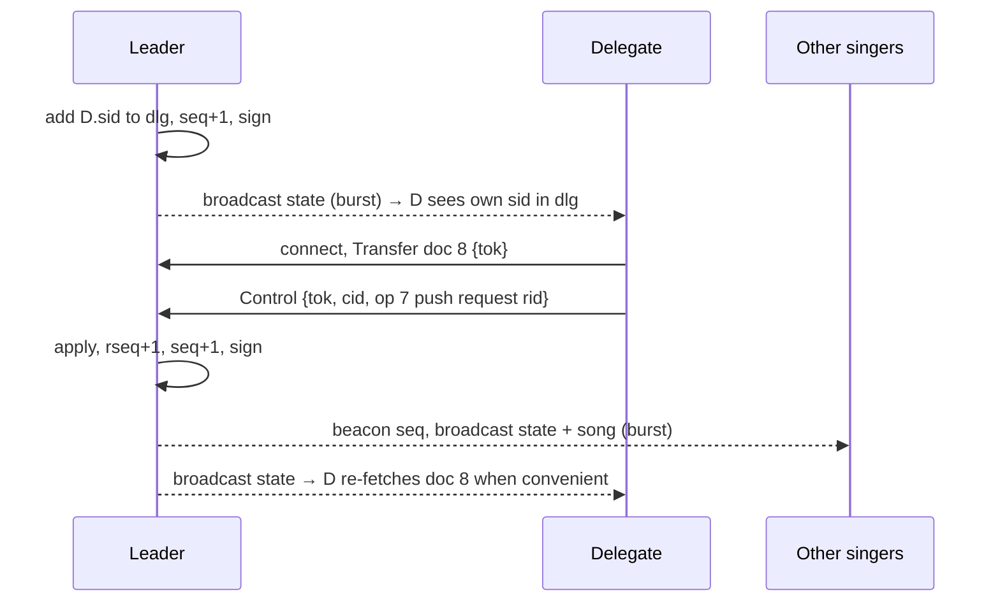

# Zangbundel – BLE Protocol Design

| Field | Value |
|---|---|
| Document | BLE protocol design |
| Project | Zangbundel – campfire songbook app |
| Protocol version | 1.0 (draft) |
| Document version | 0.3 (draft) |
| Date | 2026-10-18 |
| Author | Remko Welling |
| Status | Draft for review |
| Depends on | `design/functional-requirements.md` v0.4 |

| Version | Date | Change |
|---|---|---|
| 0.1 | 2026-10-18 | First draft: beacon-driven short-lived GATT connections; delegates; single gathering per area. |
| 0.2 | 2026-10-18 | Broadcast-first redesign: all leader-to-singer information goes out as a repeated broadcast carousel (section 7); connections are used only to register, send requests, act as delegate and recover missed data. Request statuses broadcast anonymously. Relays rebroadcast. |
| 0.3 | 2026-10-18 | `download.url` may name a release archive or release index (song-format section 12); no change to keys or encoding. Depends on FRD v0.4. |

---

## 1. Introduction

### 1.1 Purpose

This document specifies how the leader and the singers of a Zangbundel gathering communicate over Bluetooth Low Energy (BLE). It covers discovery (the beacon), the broadcast data channel, joining, song requests, delegate commands, recovery of missed data, reconnection, the end of a gathering, versioning and security. It is written so that an Android and an iOS implementation built from it interoperate in either role (FR-BLE-08).

### 1.2 Scope

In scope: everything that travels over the air during a gathering. Out of scope: the song file format (see `design/song-format.md`), library import over the internet, the UI, and the on-device storage model. Phase 2 (karaoke clock synchronisation) and phase 3 (notation) are only reserved for, not designed.

### 1.3 Conventions

- "Leader" and "singer" are the roles from the FRD. In BLE terms the leader is the **advertiser and GATT server** (peripheral role); a singer is the **scanner and GATT client** (central role).
- Byte orders are big-endian unless stated otherwise. `u8`, `u16`, `u32` are unsigned integers of that width. `bstr`/`tstr` are CBOR byte and text strings.
- Requirement IDs in brackets, e.g. [FR-BLE-12], point to the FRD requirement a design element satisfies.
- MUST / SHOULD / MAY follow RFC 2119 and bind implementations of this protocol.

---

## 2. Design goals and constraints

### 2.1 Goals taken from the FRD

| Goal | Source |
|---|---|
| Work with BLE only; no internet, Wi-Fi or hotspot | FR-BLE-01, FR-GEN-03 |
| No system pairing; join by tapping a gathering | FR-BLE-02 |
| New song visible on every singer within 5 s (25 singers, 10 m); 2 s when singers have the song locally | FR-BLE-03, NFR-PERF-01 |
| Complete-or-nothing delivery of lyrics; resend possible | FR-BLE-04, FR-LEAD-06 |
| Compact transfer of songs up to about 4 kB | FR-BLE-05 |
| At least 25, ideally 50 singers; graceful refusal beyond capacity | FR-BLE-10 |
| Optional relay through singer devices | FR-BLE-11 |
| Send identifier first, lyrics only to singers that lack the song | FR-BLE-12 |
| Leader text messages, download instructions, setlist, requests and their status | FR-BLE-06, FR-BLE-13, FR-LEAD-30, section 11 FRD |
| **Leader-to-singer information goes out by broadcast, repeated; connections only to register, request, delegate or recover** | **FR-BLE-15, FR-BLE-16** |
| Leader position for "follow the leader" | FR-LEAD-05, FR-SING-12 |
| Automatic reconnection; gathering treated as ended after a timeout | FR-GATH-10, FR-GATH-11 |
| Leader can resume a gathering after an app restart | FR-GATH-13 |
| No second gathering can be started within range of a running one; warn when one appears | FR-GATH-16, FR-GATH-17 |
| Delegates handle requests and push songs through the leader's device; leader-only actions stay leader-only | FR-LEAD-40 to FR-LEAD-46 |
| Nobody can impersonate the leader of a running gathering | NFR-SEC-02 |
| Versioned, platform-neutral protocol | FR-BLE-07, FR-BLE-08 |
| Only gathering data and the display name on the air | FR-BLE-14, NFR-PRIV-01 |
| Testable with a simulated transport | NFR-TEST-01 |

### 2.2 Platform facts that shape the design

| Fact | Consequence |
|---|---|
| Legacy BLE advertising carries 31 bytes of advertisement data plus 31 bytes of scan response per advertising event. The minimum advertising interval an Android app can set is 100 ms. | A legacy broadcast carries at most a few hundred bytes per second per advertising set. Documents are split into small frames and repeated. |
| Android devices that support multiple advertising sets (API 26+, most phones since 2018) can run several independent advertisements at once; each set carries its own 31 + 31 bytes. | The leader runs one discovery beacon set plus one or more data sets. Throughput scales with the number of sets the chip allows. |
| Extended advertising (BLE 5) carries up to 1650 bytes per advertisement. Sending requires a BLE 5 chip and Android 8+; receiving requires Android 8+ or iOS 13+ with supporting hardware. It is not universal and an iOS app cannot send it. | Extended advertising is the preferred carrier when available; a legacy carrier MUST always run alongside it for singers that cannot receive it. |
| Android cannot put an app-chosen local name in an advertisement without renaming the user's Bluetooth adapter. It can send manufacturer-specific data. | Android leaders carry all beacon and data frames in manufacturer data. |
| An iOS app can advertise only a local name and service UUIDs, and only while in the foreground. | An iOS leader cannot run the broadcast data channel. It runs the discovery beacon in text form (encoding B) and serves everything over GATT (degraded mode, section 7.8). |
| The number of simultaneous GATT connections an Android device accepts as a server is set by its Bluetooth stack and is not exposed to apps. In practice it ranges from about 4 to 15. | Connections are the scarce resource. The protocol uses them only for upstream traffic and recovery, never for routine delivery. |
| A GATT characteristic value is at most 512 bytes; notifications carry at most MTU − 3 bytes (MTU typically 247 Android-to-Android, 185 with iOS, minimum 23). | Anything larger than a few hundred bytes goes through a chunked transfer when fetched over GATT. |
| BLE device addresses on modern phones are random and rotate roughly every 15 minutes; each advertising set may use its own address. | Gathering identity and frame identity are carried in the payload, never derived from the address. |
| Scan responses are sent only to scanners that send a scan request; link-layer backoff means a scanner does not get one on every event. | Data in scan responses is a bonus. Singers MUST NOT depend on receiving them. |

---

## 3. Architecture overview

### 3.1 Roles and channels

```
                  ┌──────────────────────────────────────────┐
                  │                 LEADER                   │
                  │  beacon set   data sets (1..n)   GATT    │
                  └────┬──────────────┬───────────────┬──────┘
   broadcast, repeated │              │               │ connections, short-lived
   (discovery, state,  ▼              ▼               ▼ (register, request, control,
    songs, setlist…)                                    recover missed frames)
             ┌───────────┐   ┌───────────┐   ┌───────────┐
             │  Singer   │   │  Singer   │   │ Delegate  │   … up to 50
             └───────────┘   └───────────┘   └───────────┘
```

- **Downstream** (leader → singers): the **discovery beacon** (section 6) and the **broadcast data channel** (section 7). Everything a singer needs to sing is carried here, more than once, to any number of singers at the same time.
- **Upstream and recovery** (singer → leader): short GATT connections (section 8) for registering, song requests, delegate commands, and fetching frames a singer missed.

### 3.2 Key ideas

1. **Broadcast first, repeated.** The leader transmits a *carousel* of documents: the signed state record, gathering info, the current song, the setlist, the leader's message, the download instruction and anonymous request statuses. A changed document is sent three times back-to-back, then keeps cycling at a lower rate as long as it is current. Singers receive without connecting, whatever their number [FR-BLE-15, FR-BLE-10].
2. **Connections only when they carry something upstream, or to recover.** A singer connects once to register (to be counted and get a token), when it sends a request, when it acts as delegate, and when the carousel has not completed a document for it in a reasonable time ("repair") [FR-BLE-16]. In a gathering where most singers have the library, a singer typically opens one connection for the whole evening.
3. **Content-addressed songs.** A song is identified by the hash of its file. A singer with that file, from any library revision, needs only the state record and never collects the song frames [FR-BLE-12].
4. **Signed state.** The leader generates a key pair per gathering. The gathering identifier is a fingerprint of the public key; the state record is signed and lists the hash of every other document. Nothing received by broadcast is used until it is verified against the signed state [NFR-SEC-02]. This makes broadcast, repair over GATT and relays equally trustworthy.
5. **Two carriers, one framing.** Documents are framed for legacy advertising (16 data bytes per frame) and, when the leader supports it, for extended advertising (up to about 1 kB per frame). Repair over GATT sends the same bytes by range, so there is one reassembly path.
6. **One encoding, CBOR.** All structured payloads are CBOR maps with small integer keys. Unknown keys are ignored, which gives minor-version extensibility for free [FR-BLE-07].
7. **Delegates act through the leader.** A delegate is a registered singer whose ID the leader lists in the signed state. It sends control commands over GATT; the leader applies them, re-signs the state and broadcasts it [FR-LEAD-43].
8. **One gathering per area.** A device scans before it starts a gathering and refuses to start while another running gathering is in range [FR-GATH-16].

### 3.3 Singer state machine

```
 IDLE ──scan──▶ DISCOVERED ──tap──▶ REGISTERING ──ok──▶ LISTENING
                                        │ busy/fail          │ ▲
                                        ▼ (retry in bg)      │ │
                                    LISTENING (unregistered) │ │
 LISTENING ──frames incomplete after wait──▶ REPAIRING ──────┘ │
 LISTENING ──no beacon 10 s──▶ RECONNECTING ──beacon──▶ LISTENING
 RECONNECTING ──no beacon 5 min──▶ ENDED
 any ──beacon ENDED flag or verified state status ENDED──▶ ENDED
 any ──user leaves──▶ IDLE
```

A singer is *listening* from the moment it has verified the gathering's public key; registration only adds the token and the head count. If registration fails because the leader is busy, the singer keeps listening and retries registration in the background with a long backoff.

---

## 4. Reaching 25–50 singers: options and recommendation

| Option | How it works | Pros | Cons |
|---|---|---|---|
| **A. Persistent GATT connections** | Every singer stays connected; leader notifies all. | Simple; instant push. | Hard limit of 4–15 connections; fails FR-BLE-10 on most phones. |
| **B. Beacon-driven short-lived connections** (document v0.1) | Beacon carries a sequence number; singers connect briefly on every change. | Works everywhere; a few slots serve dozens. | One connection per singer per change: with 50 singers every song push is a burst of 50 connections; latency grows with group size; iOS and busy leaders struggle. |
| **C. Broadcast carousel over legacy advertising sets** | Leader cycles document frames in 1–3 non-connectable advertising sets; singers reassemble; GATT only for upstream and repair. | Unlimited singers; zero connections for routine delivery; works on every Android leader with multiple-advertisement support. | 160–480 B/s per direction; a 2 kB song takes 4–12 s per pass; needs frame reassembly logic. |
| **D. Broadcast carousel over extended advertising** | Same as C with ~1 kB frames. | A whole song in one or two frames; sub-second delivery to any number of singers. | Not on every device; never from an iOS leader. |
| **E. Relay rebroadcast** | Singers that have verified documents repeat the carousel. | Extends range and adds throughput without any leader involvement. | Peripheral mode and battery on relays. |

### 4.1 Why broadcast and not multicast

BLE offers a phone app exactly one one-to-many primitive: **advertising**, which is link-layer broadcast to every scanner in range. There is no group-addressed multicast in BLE:

| Mechanism | Nature | Usable here? |
|---|---|---|
| Advertising (legacy, extended) | Broadcast, connectionless, unacknowledged | Yes: this design. Android and iOS apps can send (Android) and receive (both) it. |
| Periodic advertising / PAwR | Broadcast train that receivers synchronise to; built-in repetition | No: the Android API for synchronising is hidden from apps; iOS has none. |
| LE Audio broadcast (BIS, "Auracast") | True broadcast stream with retransmissions | No: audio only, exposed through audio APIs, not for app data. |
| Bluetooth Mesh group addresses | Application-level multicast by flooding | No: phones have no Mesh stack for apps; the advertising bearer needs raw AD types Android cannot send; the GATT proxy bearer needs connections. |
| Notifications to each connected singer | Unicast repeated per receiver ("poor man's multicast") | Only as degraded mode (7.8): it is bounded by connection slots, which is the problem being solved. |

Multicast *semantics* (only the singers of this gathering act on the data) are provided at the application layer: every frame carries `gid16`, scanners filter on it in hardware (Android manufacturer-data filter) and discard the rest. Two gatherings in range therefore coexist on the same broadcast medium without interfering logically; they only share air time. Confidentiality is not a goal (lyrics are public), so broadcasting in clear is acceptable; authenticity is provided by the signed state.

**Recommendation:** **C is the mandatory baseline, D is used automatically when the leader supports it, B remains as the degraded mode** for leaders that cannot broadcast data (iOS leaders, Android devices with a single advertising instance), and **E is an optional extension** (section 11). GATT is kept for registration, requests, delegate control and repair only. Section 12 shows that C meets the 2-second target for singers with the library on any group size and that D meets the 5-second target for singers without it; with C alone the 5-second target for library-less singers depends on the number of advertising sets the leader's chip allows.

---

## 5. Identifiers, keys and hashes

| Name | Size | Definition |
|---|---|---|
| **Gathering key pair** | Ed25519 | Generated by the leader when a gathering starts; stored in app-private storage until the gathering ends, so the gathering can be resumed [FR-GATH-13]. Never reused. |
| **Gathering ID** `gid` | 5 bytes | First 5 bytes of SHA-256 of the 32-byte public key. Appears in the beacon and in every state record. `gid16` is its first 2 bytes, used in data frames. |
| **Public key** `pk` | 32 bytes | Broadcast in the Info document and readable over GATT. Pinned by the singer for the gathering. |
| **State sequence** `seq` | u16 | Incremented by the leader on every change to state or documents except the line position. Wraps around; singers compare for inequality only. |
| **Position** `pos` | u8 | 0 = no position; 1–254 = 1-based line index into the current song's canonical line list; 255 = line 255 or beyond. |
| **Singer ID** `sid` | 8 bytes | Random, generated by the singer app per gathering. Lets the leader recognise a singer that reconnects. Not persistent across gatherings [NFR-PRIV-01]. |
| **Session token** `tok` | 16 bytes | Random, issued by the leader at registration. Authenticates requests and delegate commands. |
| **Song content hash** `hash` | 16 bytes | First 16 bytes of SHA-256 over the song file bytes exactly as stored in the library (canonicalised as defined by the song-format spec). |
| **Document hash** `dh` | 8 bytes | First 8 bytes of SHA-256 over the *framed bytes* of a document (the CBOR encoding, after optional DEFLATE). Listed in the signed state. |
| **Document version** `dv` | u16 | The first 2 bytes of `dh` for ordinary documents; `seq` for the state record. Carried in every frame so singers can group frames of the same document version. |
| **Song reference** `ref` | CBOR map | `{1: lib (tstr library id), 2: song (tstr song id), 3: hash (bstr 16), 4: rev (tstr, optional library revision, informational)}`. Matching between leader and singer is by `hash` alone [FR-LIB-17]. |

Hashing by content rather than by library revision is a deliberate reading of FR-BLE-12 ("exact song version"): two library revisions that did not touch a song still match, so fewer transfers are needed and the FRD's intent is met more often.

---

## 6. The discovery beacon

### 6.1 Content

The beacon carries 10 bytes of fields plus the gathering name:

| Offset | Field | Type | Meaning |
|---|---|---|---|
| 0 | `ver` | u8 | Protocol major version. `1` for this document. |
| 1–5 | `gid` | 5 bytes | Gathering ID. |
| 6–7 | `seq` | u16 | State sequence number. |
| 8 | `flags` | u8 | Bit 0 `CODE` join code required · bit 1 `REQ_OPEN` requests accepted · bit 2 `BUSY` no free connection slot · bit 3 `ENDED` gathering has ended · bit 4 `RELAY` sender is a relay, not the leader · bit 5 `KARAOKE` reserved for P2 · bit 6 `BCAST` broadcast data channel running (legacy carrier) · bit 7 `EXT` extended carrier also running. |
| 9 | `pos` | u8 | Leader line position (section 5). |
| 10… | `name` | UTF-8 | Gathering name, truncated at a character boundary to fit. The full name is in the Info document. |

### 6.2 Encoding A – Android leader (binary)

- **Advertisement (≤ 31 bytes):** Flags AD structure (3 bytes, set by the stack; connectable, general discoverable) + *Complete List of 128-bit Service UUIDs* containing the Zangbundel service UUID (18 bytes). Device name MUST NOT be included.
- **Scan response (≤ 31 bytes):** one *Manufacturer Specific Data* AD structure: length, type `0xFF`, company identifier `0xFFFF` (little-endian), then the 10 field bytes, then up to 17 bytes of `name`.

Company identifier `0xFFFF` is reserved by the Bluetooth SIG for internal use and testing; see open question Q1.

### 6.3 Encoding B – iOS leader (text)

- **Advertisement:** the Zangbundel service UUID as the only advertised service.
- **Scan response:** local name = `"ZB"` + Base32 (RFC 4648, no padding, upper case) of the 10 field bytes (16 characters) + `" "` + up to 10 bytes of `name`. Total ≤ 29 bytes.

An iOS leader MUST restart advertising whenever `seq`, `flags` or `pos` change. `BCAST` and `EXT` are always 0 for an iOS leader.

### 6.4 Rules

- Singers MUST scan with a filter on the Zangbundel service UUID for discovery and MUST accept both encodings.
- Leaders MUST advertise the beacon connectable, at 100–250 ms interval, at high TX power, and MUST update it within 100 ms of a state change.
- Singers MUST request duplicate reports while in a gathering so `seq` and `pos` changes are seen promptly. Outside a gathering a lower duty cycle MAY be used.
- A change of `pos` alone MUST NOT increment `seq`. Singers apply `pos` directly from the beacon [FR-LEAD-05].
- A singer treats the beacon as *lost* when nothing from the gathering (beacon or data frame) has been received for 10 s, and the gathering as *ended* after a configurable 5 minutes [FR-GATH-10, FR-GATH-11]. A relay beacon counts.
- The gathering list [FR-GATH-03, FR-GATH-04] is built from beacons with `ENDED` = 0 and `RELAY` = 0, grouped by `gid`, with RSSI as the distance hint.

---

## 7. The broadcast data channel

### 7.1 Carriers

| Carrier | Advertising set(s) | Frame data size | When |
|---|---|---|---|
| **Legacy** | 1 to `n` non-connectable advertising sets (Android `startAdvertisingSet`, legacy mode), interval 100 ms, no service UUID, one manufacturer-data structure per advertisement; the scan response MAY carry the next frame of the same set. | 16 bytes | MUST run whenever the leader can start at least one extra advertising set. `BCAST` = 1. |
| **Extended** | 1 non-connectable extended advertising set (legacy mode off, 1M primary PHY, 2M or coded secondary PHY), interval 100 ms, advertising data ≤ 1000 bytes. | up to 984 bytes | SHOULD run in addition to the legacy carrier when `isLeExtendedAdvertisingSupported()`. `EXT` = 1. |
| **GATT repair** | Not a broadcast: section 9.7. | by byte range | Always available. |

The leader determines `n` at start by opening sets until the stack refuses (`ADVERTISE_FAILED_TOO_MANY_ADVERTISERS`), keeping one instance for the beacon and using at most 3 for data. Singers receiving the extended carrier ignore legacy data frames; singers that cannot receive it use legacy frames. Both carry the same documents.

### 7.2 Frame formats

All frames are manufacturer-specific data with company identifier `0xFFFF`. The first payload byte distinguishes beacon (`0x01` = `ver`) from data frames.

**Legacy frame (24 bytes):**

| Offset | Field | Type | Meaning |
|---|---|---|---|
| 0 | `magic` | u8 | `0xD1` |
| 1–2 | `gid16` | 2 bytes | First 2 bytes of `gid`. |
| 3 | `doc` | u8 | Document type (section 7.3). |
| 4–5 | `dv` | u16 | Document version. |
| 6 | `total` | u8 | Number of frames in this document version (1–255). |
| 7 | `idx` | u8 | Frame index, 0-based. |
| 8–23 | `data` | 16 bytes | Document bytes `idx × 16 … idx × 16 + 15`. The last frame carries the remainder and is shorter. |

A document framed for the legacy carrier is at most 255 × 16 = 4080 bytes. A larger document is marked *GATT only* in the state (section 9.4) and fetched by repair.

**Extended frame (≤ 1000 bytes):**

| Offset | Field | Type | Meaning |
|---|---|---|---|
| 0 | `magic` | u8 | `0xD2` |
| 1–2 | `gid16` | 2 bytes | |
| 3 | `doc` | u8 | |
| 4–5 | `dv` | u16 | |
| 6–7 | `total` | u16 | Number of frames. |
| 8–9 | `idx` | u16 | Frame index. |
| 10–11 | `fs` | u16 | Frame data size used for this document version (≤ 984); the same in every frame of it. |
| 12… | `data` | ≤ `fs` bytes | Document bytes `idx × fs …`. |

### 7.3 Documents carried

| `doc` | Document | Signed? | Typical size (compressed) | Section |
|---|---|---|---|---|
| 1 | **state** | yes (Ed25519) | 230–300 B | 9.4 |
| 2 | **info** | no (pk verified by `gid`) | 120–200 B | 9.2 |
| 3 | **song** (current song only) | via `dh` in state | 1–2.5 kB | 9.5 |
| 4 | **setlist** | via `dh` | 0.3–1.5 kB | 9.5 |
| 5 | **message** | via `dh` | < 250 B | 9.5 |
| 6 | **download** | via `dh` | < 200 B | 9.5 |
| 7 | **reqstat** (anonymous request statuses) | via `dh` | < 500 B | 9.5 |
| 8 | **requests** (delegates only, contains names) | — | — | GATT only, never broadcast |

Documents 3–7 are DEFLATE-compressed (raw, RFC 1951) before framing when that saves at least 10 %; the state manifest says which (section 9.4). The state record and info are never compressed.

### 7.4 Scheduling: burst, then carousel

The leader keeps one frame queue per data set and fills them by these rules [FR-BLE-15]:

1. **Set S (first legacy data set) – small documents.** Loops continuously: *state*, *info*, *reqstat*, *message*, *download*, state again, … The state record therefore repeats about once per second on a single set.
2. **Sets D1…D(n−1) – large documents.** Loop: *song*, *setlist*, *song*, … interleaved so that two sets send different frames of the same document (set D1 sends even frames, D2 odd frames). With only one data set, Set S carries everything and inserts a state frame after every 8 document frames.
3. **Extended set.** Loops all documents 1–7 in order; a 1 kB frame each, so one full cycle takes under a second.
4. **Burst on change.** When `seq` increments, every set restarts its loop at the changed documents and sends each changed document **three complete passes** before resuming the normal loop. The new state record is always first.
5. **Position changes** (`pos`) go only to the beacon; the carousel is not restarted.
6. **Advertising interval** is 100 ms on all data sets (Android minimum). Each set therefore delivers 10 frames/s; a scan response, when it is received, doubles that for the scanner that asked.

The leader publishes the measured *pass time* (the time one full pass of the current song takes on the legacy carrier) in the state record so singers know how long to wait before repairing (section 7.6).

### 7.5 Receiving and reassembly (singer)

- While in a gathering the singer scans continuously in the foreground (Android `SCAN_MODE_LOW_LATENCY`, `CALLBACK_TYPE_ALL_MATCHES`, a `ScanFilter` on manufacturer data with a mask selecting company `0xFFFF` + `magic` + `gid16`; iOS `scanForPeripherals(withServices: nil)` with duplicates allowed, which is permitted in the foreground). Singers that support extended scanning enable it (`setLegacy(false)`).
- Frames are grouped by (`doc`, `dv`). The singer keeps a bitmap of received indices and the data per group; at most two versions per `doc` are kept (the newest and the one before), older groups are dropped.
- When a group is complete, the singer verifies it: *state* by signature with the pinned `pk`; *info* by `SHA-256(pk)[0..5] == gid`; every other document by its `dh` against the manifest in the newest verified state. A document that fails verification is discarded and the group is reset.
- A verified state record is applied only if its `ts` is newer than the last applied one (section 9.4). A verified song is shown only if its `ref.hash` equals `cur.hash` in the applied state [FR-BLE-04].
- The singer MUST NOT connect for anything it can still expect from the carousel; section 7.6 defines when the expectation lapses.

### 7.6 Repair: requesting what was missed [FR-BLE-16]

A singer starts a *repair timer* for a (`doc`, `dv`) group when it first sees a frame of it (or, for the state, when the beacon `seq` changes). The timer expires after:

| Document | Legacy carrier | Extended carrier |
|---|---|---|
| state, info | 1.5 s | 0.5 s |
| song (needed to sing now) | min(1.5 × pass time, 3 s) | 1 s |
| setlist, reqstat, message, download | 2 × pass time, max 20 s | 2 s |

When the timer expires with frames still missing, the singer waits a random 0–400 ms (longer, 0–2 s, while the beacon shows `BUSY`), connects, and fetches **only the missing byte ranges** with a Transfer request (section 9.7). It then disconnects. The repair connection is also used to flush any queued request. Singers that just registered fetch anything incomplete on the registration connection, so late joiners never wait for the carousel [FR-GATH-06].

A singer with the current song in its local library never starts a song repair timer; a singer whose user is not looking at the lyric view (browsing the library) SHOULD let the carousel finish instead of repairing.

### 7.7 Capacity of the legacy carrier

| Data sets | Frames/s | Bytes/s (adv only) | State record (15 frames) | 2 kB song (125 frames), one pass |
|---|---|---|---|---|
| 1 | 10 | 160 | 1.5 s | 12.5 s |
| 2 | 20 | 320 | 0.8 s | 6.3 s |
| 3 | 30 | 480 | 0.5 s | 4.2 s |
| Extended | 10 × ~1 kB | ~10 000 | 0.1 s | 0.2–0.3 s |

Scan responses, when received, roughly halve these times for that singer. The figures assume no loss; the three-pass burst covers typical loss at the fire.

### 7.8 Degraded mode (no broadcast data channel)

A leader that cannot run any data set (iOS, or an Android device with a single advertising instance) sets `BCAST` = 0 and `EXT` = 0. Singers then behave as in document v0.1: on every beacon `seq` change they connect after a random delay, read State, fetch changed documents by Transfer, and disconnect. The leader manages its slots with `BUSY` (section 10.8). This mode meets the FRD only for small groups and is reported to the leader as "limited capacity on this device".

---

## 8. GATT service (upstream and repair channel)

### 8.1 UUIDs

Base UUID `7e2bXXXX-9f1c-4a7d-b2d4-5a4e47424c45` (provisional; the last group spells "ZNGBLE"). `XXXX` identifies the attribute:

| XXXX | Attribute | Properties | Max value | Purpose |
|---|---|---|---|---|
| `0001` | **Zangbundel service** | primary | | Advertised in the discovery beacon. |
| `0002` | **Info** | read | 512 | The info document (9.2), for singers that have not yet collected it by broadcast. |
| `0003` | **Join** | write (with response), read | 512 | Registration: singer writes a join request, then reads the join response. |
| `0004` | **State** | read, notify | 512 | The signed state record (9.4). |
| `0005` | **Transfer** | write (with response) | 128 | Starts a document transfer or repair (9.7). |
| `0006` | **Data** | notify | MTU − 3 | Bytes of the document being transferred. |
| `0007` | **Request** | write (with response) | 256 | Add or withdraw a song request (9.8). |
| `0008` | *Time* | reserved | | Phase 2 clock synchronisation. Not present in 1.0. |
| `0009` | **Control** | write (with response) | 512 | Delegate commands (9.9). |

Clients MUST tolerate additional characteristics they do not know. Servers MUST implement all of `0002`–`0007` and `0009`.

### 8.2 Connection rules

- The singer (central) MUST request the largest MTU it supports immediately after connecting and MUST wait for the result before using Transfer. Implementations MUST work at MTU 23.
- The singer SHOULD request a high connection priority for the duration of a transfer and release it afterwards. 2M PHY SHOULD be used when both sides support it.
- The singer MUST disconnect as soon as it has finished. A connection idle for 3 s MAY be dropped by the leader. `stay` connections (9.3) are the only exception and are granted sparingly, mainly to delegates.
- Info, State and Transfer of documents 1–7 need no token so that repair works for any singer and for relays. Request, Control and document 8 need a token.

### 8.3 Application error codes

| Code | Meaning |
|---|---|
| `0x80` | Unknown or expired token |
| `0x81` | Requests are closed [FR-LEAD-13] |
| `0x82` | Too many pending requests for this singer [FR-REQ-06] |
| `0x83` | Malformed payload |
| `0x84` | Busy; retry later |
| `0x85` | Not served here (relay); go to the leader |
| `0x86` | Unknown document, hash or version |
| `0x87` | Protocol version not supported |
| `0x88` | Gathering has ended |
| `0x89` | Not a delegate |
| `0x8A` | Leader does not have this song; upload it first (9.9) |
| `0x8B` | Upload rejected (hash mismatch or size limit) |
| `0x8C` | Requested range outside the document |

---

## 9. Payloads

### 9.1 CBOR conventions

- Every payload is a CBOR map with unsigned-integer keys unless stated otherwise. Encoders MUST use definite lengths and the shortest integer encodings (RFC 8949 preferred serialization). Decoders MUST ignore unknown keys and MUST reject a payload missing a key marked *required*.
- Text is UTF-8. Lengths given for text are in characters; implementations truncate at character boundaries.

### 9.2 Info (document 2; also read `0002`)

| Key | Name | Type | Req. | Meaning |
|---|---|---|---|---|
| 1 | `major` | uint | yes | Protocol major version (1). |
| 2 | `minor` | uint | yes | Protocol minor version (0). |
| 3 | `gid` | bstr 5 | yes | Gathering ID. |
| 4 | `name` | tstr ≤ 40 | yes | Full gathering name. |
| 5 | `flags` | uint | yes | Same bits as the beacon. |
| 6 | `singers` | uint | yes | Number of registered singers. |
| 7 | `pk` | bstr 32 | yes | Gathering public key. |
| 8 | `relay` | bool | no | `true` on a relay. |
| 9 | `hops` | uint | no | Distance from the leader; 0 on the leader. |
| 10 | `app` | tstr | no | Leader app name and version [FR-GEN-07]. |
| 11 | `libs` | array | no | Libraries the leader has: `[{1: lib, 2: rev, 3: url}]` [FR-LEAD-31]. |
| 12 | `nsets` | uint | no | Number of legacy data sets in use (0 in degraded mode). |
| 13 | `ext` | bool | no | Extended carrier running. |

A singer MUST verify `SHA-256(pk)[0..5] == gid` before pinning `pk`; otherwise it ignores the document and reports the gathering as unverifiable.

### 9.3 Join (write then read `0003`) – registration

**Join request (written by the singer):**

| Key | Name | Type | Req. | Meaning |
|---|---|---|---|---|
| 1 | `major` | uint | yes | Singer's protocol major version. |
| 2 | `minor` | uint | yes | Singer's protocol minor version. |
| 3 | `sid` | bstr 8 | yes | Singer ID for this gathering. |
| 4 | `name` | tstr ≤ 24 | no | Display name [FR-SING-01]. |
| 5 | `code` | tstr ≤ 8 | no | Join code if `CODE` flag is set [FR-GATH-05]. |
| 6 | `libs` | array | no | Libraries the singer has: `[{1: lib, 2: rev}]` [FR-LEAD-31]. |
| 7 | `caps` | uint | no | Capability bits: bit 0 can act as relay; bit 1 receives extended advertising; bit 2 receives legacy data frames. |
| 8 | `app` | tstr | no | Singer app version. |

**Join response (read on the same connection, within 2 s):**

| Key | Name | Type | Req. | Meaning |
|---|---|---|---|---|
| 1 | `result` | uint | yes | 0 accepted · 1 wrong join code · 2 gathering full [FR-BLE-10] · 3 protocol version not supported [FR-BLE-07] · 4 gathering ended · 5 try again later. |
| 2 | `tok` | bstr 16 | if 0 | Session token. |
| 3 | `seq` | uint | if 0 | Current state sequence. |
| 4 | `stay` | bool | no | `true`: the singer may keep this connection and receives State notifications. Default `false`. |
| 5 | `relay` | bool | no | `true`: the leader asks this singer to act as a relay (section 11). |
| 6 | `max_pending` | uint | no | Maximum pending requests per singer; default 3 [FR-REQ-06]. |
| 7 | `msg` | tstr | no | Human-readable reason, e.g. "Update the app to join this gathering". |
| 8 | `role` | uint | no | 0 singer (default) · 1 delegate; set on a rejoin [FR-LEAD-46]. |

If a singer with a known `sid` registers again (reconnection), the leader MUST return the same token and MUST NOT count it twice. Result 2 ("full") refers to the leader's singer table (default limit 100), not to connection slots; a singer refused for capacity still listens to the broadcast but is not counted and cannot send requests.

### 9.4 State (document 1; also read/notify `0004`)

The value is a CBOR array `[body (bstr), sig (bstr 64)]`. `sig` is the Ed25519 signature over `body`. `body` is the CBOR encoding of:

| Key | Name | Type | Req. | Meaning |
|---|---|---|---|---|
| 1 | `gid` | bstr 5 | yes | Gathering ID. |
| 2 | `seq` | uint | yes | State sequence number. |
| 3 | `ts` | uint | yes | Milliseconds since the gathering started (leader monotonic clock). MUST increase with every new state. |
| 4 | `status` | uint | yes | 0 running · 1 ended [FR-GATH-09]. |
| 5 | `flags` | uint | yes | Same bits as the beacon. |
| 6 | `cur` | ref | no | Current song reference. Absent = no current song [FR-LEAD-06]. |
| 7 | `title` | tstr ≤ 60 | no | Title of the current song, for singers still collecting it. |
| 8 | `pos` | uint | no | Leader line position; the beacon value wins when newer. |
| 9 | `singers` | uint | no | Number of registered singers. |
| 10 | `docs` | map | yes | Manifest: `{doc: [dh (bstr 8), enc (0 raw · 1 DEFLATE), len (uint, framed length), gatt (bool, optional: true = too large for the legacy carrier, fetch by repair)]}` for documents 3–7 that exist. A missing entry means the document does not exist. |
| 11 | `rseq` | uint | yes | Request sequence; increments whenever any request status changes. |
| 12 | `dlg` | array of bstr 8 | no | Singer IDs of the current delegates [FR-LEAD-40]; at most 8. |
| 13 | `pt` | uint | no | Measured pass time of the current song on the legacy carrier, ms (section 7.6). |

The signed body MUST stay ≤ 440 bytes so the whole record fits a 512-byte characteristic and 30 legacy frames. Singers MUST verify `sig` with the pinned `pk`, MUST verify `gid`, and MUST discard a state whose `ts` is not greater than the last accepted one unless `status` is 1.

### 9.5 Documents 3–7

Each is a CBOR map; `dh` is over the framed (compressed) bytes.

**song** (document 3, the current song) [FR-BLE-12, FR-BLE-05]

| Key | Name | Type | Meaning |
|---|---|---|---|
| 1 | `ref` | ref | Song reference (includes `hash`). |
| 2 | `file` | bstr | The song file bytes exactly as in the library. The singer MUST verify SHA-256 of `file` against `ref.hash` before showing it [FR-BLE-04]. |
| 3 | `lic` | tstr ≤ 200 | Licence/attribution summary for singers without the library [FR-LIB-20]. |

A song marked "do not redistribute" in the library [FR-LIB-22] is never broadcast nor served; the state carries `cur` and `title` only, and singers without that library show "available only with library X installed".

**setlist** (document 4) [FR-LEAD-03, FR-SING-03]

| Key | Name | Type | Meaning |
|---|---|---|---|
| 1 | `items` | array | `[{1: ref, 2: title (tstr ≤ 60), 3: status (0 upcoming · 1 current · 2 sung · 3 skipped), 4: votes (uint, optional)}]` in setlist order. Upcoming items MAY be omitted (FRD Q2). |

**message** (document 5) [FR-BLE-13]: `{1: text (tstr ≤ 200), 2: ts (uint)}`.

**download** (document 6) [FR-LEAD-30]: `{1: lib, 2: url (HTTPS), 3: branch, 4: rev, 5: size (uint, optional) [FR-NET-04]}`. `url` names the library's git repository, a release archive (`.zbl`, song-format section 12) or its release index; `rev` is the git revision, which for an archive is the manifest's `revision`. A singer that already has that revision installed downloads nothing.

**reqstat** (document 7) [FR-REQ-05]

| Key | Name | Type | Meaning |
|---|---|---|---|
| 1 | `items` | array | `[{1: rid (bstr 4), 2: status (0 pending · 1 accepted · 2 declined · 3 sung · 4 withdrawn), 3: setpos (uint, optional)}]` for every request that changed status in the last 10 minutes or is still pending. |
| 2 | `rseq` | uint | The `rseq` this snapshot corresponds to. |

Request IDs are random values chosen by the requesting singer and carry no identity, so this document is broadcast and every singer learns the outcome of its own requests without connecting. The leader keeps `reqstat` under 4 kB by dropping the oldest settled entries.

**requests** (document 8, GATT only, delegate token) [FR-LEAD-41]

| Key | Name | Type | Meaning |
|---|---|---|---|
| 1 | `items` | array | `[{1: rid, 2: sid, 3: name (requester's display name), 4: ref (optional), 5: text (optional), 6: status, 7: ts, 8: count (optional, identical requests grouped)}]`, pending first, newest first. |
| 2 | `rseq` | uint | |
| 3 | `open` | bool | Whether requests are accepted [FR-LEAD-13]. |

### 9.6 Request (write `0007`)

| Key | Name | Type | Req. | Meaning |
|---|---|---|---|---|
| 1 | `tok` | bstr 16 | yes | Session token. |
| 2 | `op` | uint | yes | 1 add · 2 withdraw [FR-REQ-04]. |
| 3 | `rid` | bstr 4 | yes | Request ID chosen by the singer; repeated `rid` is idempotent. |
| 4 | `ref` | ref | op 1, one of 4/5 | Song from the singer's library [FR-REQ-01]. |
| 5 | `text` | tstr ≤ 100 | op 1, one of 4/5 | Free-text title [FR-REQ-02]. |

Success is the GATT write response; failures use the codes in 8.3. The leader increments `rseq` and `seq` when it accepts, declines, marks sung or sees a withdrawal, and broadcasts the new `reqstat`.

### 9.7 Transfer and repair (write `0005`, notifications on `0006`)

The singer MUST subscribe to Data notifications before writing Transfer. One transfer at a time per connection.

**Transfer request:**

| Key | Name | Type | Req. | Meaning |
|---|---|---|---|---|
| 1 | `doc` | uint | yes | Document type 1–8 (section 7.3). |
| 2 | `dv` | uint | no | Document version the singer is collecting; `0x86` if the leader no longer has it. Omit to get the current version. |
| 3 | `hash` | bstr 16 | doc 3 | Song content hash (safety check against `dv` collisions). |
| 4 | `ranges` | array | no | `[[off, len], …]` byte ranges of the *framed* document still missing, in ascending order, at most 32. Omit for the whole document. |
| 5 | `tok` | bstr 16 | doc 8 | Delegate token. |

**Data notifications** (first byte is the frame type):

| Type | Layout | Meaning |
|---|---|---|
| `0x01` HEADER | `0x01` + CBOR `{1: dv, 2: len (framed length), 3: enc, 4: dh (bstr 8), 5: ranges (echo, or `[[0, len]]`)}` | Once per transfer. |
| `0x02` DATA | `0x02` + `u16 chunk index` + bytes | Bytes of the requested ranges, concatenated in order, in chunks of MTU − 6, sent in order without waiting. |
| `0x03` END | `0x03` + `u16 count` | Number of DATA chunks sent. |
| `0x7F` ERROR | `0x7F` + `u8 code` | Ends the transfer. |

- The leader MUST pace notifications to the connection (wait for the stack's "sent" callback). If the connection drops, the singer recomputes its missing ranges from the frames it has and repairs again later.
- Repaired bytes fill the same reassembly buffer as broadcast frames; verification is identical (section 7.5).

### 9.8 Control (write `0009`, delegates only)

Every Control write carries the delegate's token. The leader checks that the token's `sid` is in `dlg`; otherwise `0x89`. On success the leader applies the command as if done in its own UI, increments `seq`, re-signs the state and broadcasts (section 10.5). Commands are idempotent per `cid`.

| Key | Name | Type | Req. | Meaning |
|---|---|---|---|---|
| 1 | `tok` | bstr 16 | yes | Delegate's session token. |
| 2 | `cid` | bstr 4 | yes | Command ID; a repeated `cid` is answered with success and ignored. |
| 3 | `op` | uint | yes | See below. |
| 4 | `ref` | ref | op 1, 4 | Song reference. |
| 5 | `rid` | bstr 4 | op 5, 6, 7 | Request ID from document 8. |
| 6 | `idx` | uint | op 8 | Upload chunk index, from 0. |
| 7 | `data` | bstr | op 8 | Upload chunk bytes (framed song document bytes). |
| 8 | `len` | uint | op 8, idx 0 | Total length of the upload. |

| `op` | Command | Effect on the leader | FRD |
|---|---|---|---|
| 1 | Push song | `ref` becomes the current song. `0x8A` if the leader has no file with `ref.hash` and no completed upload of it. | FR-LEAD-42 |
| 2 | Clear current song | `cur` removed. | FR-LEAD-06 |
| 3 | Next in setlist | Next upcoming item becomes current; the previous one is marked sung. | FR-LEAD-03 |
| 4 | Add to setlist | `ref` appended as upcoming. Same `0x8A` rule. | FR-LEAD-03, 42 |
| 5 | Accept request | Request `rid` → accepted, appended to the setlist. | FR-LEAD-41 |
| 6 | Decline request | Request `rid` → declined. | FR-LEAD-41 |
| 7 | Push request now | Request `rid` → accepted and current. | FR-LEAD-41 |
| 8 | Upload song chunk | Delegate → leader transfer of a song the leader lacks, in writes of ≤ 480 bytes, in order. The bytes are the framed song document (section 9.5, DEFLATE), so the leader can broadcast them unchanged. The leader verifies `ref.hash` after the last chunk; `0x8B` on mismatch or if `len` > 64 kB. Then the delegate sends op 1 or 4. | FR-LEAD-42 (SHOULD) |

Op 8 is optional in 1.0; a leader without it answers `0x8A` and the delegate shows "the leader does not have this song". Leader-only actions have no Control op by design [FR-LEAD-44].

---

## 10. Procedures

### 10.1 Start a gathering (leader)

1. **Pre-start scan** [FR-GATH-16]. Scan with the service UUID filter for at least 5 s. If any beacon with `ENDED` = 0 and `RELAY` = 0 is received, regardless of `gid`, do not start: show the gathering name(s) found and offer to join. A beacon with `ENDED` = 1 does not block. A device that cannot scan MUST NOT start a gathering.
2. Generate the Ed25519 key pair, derive `gid`, set `seq` = random u16, `ts` = 0, `status` = 0; persist key, `gid`, name, join code, `seq` and the singer table until the gathering ends [FR-GATH-13].
3. Build the state, info and initial documents (an empty or prepared setlist [FR-LEAD-02]).
4. Start the GATT server; start the beacon set; open legacy data sets until the stack refuses (max 3); start the extended set if supported. Set `BCAST`/`EXT` accordingly [FR-GATH-02].
5. Start the carousel (section 7.4).
6. **Keep scanning while leading** [FR-GATH-17] at a low duty cycle (2 s every 30 s). A beacon with another `gid`, `ENDED` = 0 and `RELAY` = 0 triggers a one-time warning naming the other gathering. Resuming a gathering repeats step 1 but ignores beacons carrying the resumed `gid`.

### 10.2 Discover, verify and register (singer)

```mermaid
sequenceDiagram
  participant S as Singer
  participant L as Leader
  S->>S: scan: beacons → gathering list; user taps one
  S->>S: collect info frames (doc 2), verify SHA-256(pk)[0..5] == gid, pin pk
  S->>S: collect state (doc 1), verify sig; collect song unless local
  Note over S: already able to sing — registration follows
  S->>L: connect, MTU
  S->>L: write Join {major, minor, sid, name, code, libs, caps}
  S->>L: read Join → {result, tok, seq}
  S->>L: Transfer anything still incomplete (ranges)
  S-->>L: disconnect
```

- If the info document has not been collected within 1.5 s (legacy) the singer reads Info over the registration connection instead; the order of the two halves does not matter.
- If `result` ≠ 0 the singer shows the reason; results 2 and 5 leave it listening and retrying registration every 30–60 s in the background [FR-BLE-10].
- If Info reports a protocol `major` the singer does not implement, it MUST NOT register and MUST show the update message [FR-BLE-07].
- After registration the singer has the current song and setlist [FR-GATH-06].

### 10.3 Follow the carousel (singer)

Routine operation never opens a connection:

1. The beacon `seq` changes → the singer expects a new state record and starts its repair timer.
2. State frames arrive (first pass within 0.5–1.5 s on the legacy carrier); the record is verified and applied. `cur`, `title`, `docs`, `dlg`, `rseq` are compared with what the singer has.
3. For the current song: local library file with `cur.hash` → use it, ignore song frames. Otherwise collect song frames; show "receiving…" with the title meanwhile.
4. Other documents are collected as their frames come round; the user sees the setlist or message update when the group completes and verifies.
5. Only when a repair timer expires does the singer connect (section 7.6).

### 10.4 Repair (singer)

Connect after the random delay, request the missing ranges of one or more documents (one Transfer per document), send any queued request, disconnect. Retry with exponential backoff starting at 300 ms, doubling, capped at 2 s, with ±25 % jitter, on connection failure (Android status 133, timeout) or `0x84`. While repairing, keep listening: frames that arrive by broadcast reduce the ranges still needed.

### 10.5 Push a song, message, setlist or download instruction (leader)

1. Update the document(s), compress and frame them, compute `dh`/`dv`.
2. Build the new state body with `seq` + 1 and a larger `ts`, sign it.
3. Update the beacon [FR-BLE-03] and restart the carousel in burst mode (section 7.4).
4. Notify State on any `stay` connection.
5. A "re-push" [FR-LEAD-06] increments `seq` without changing the song: the burst repeats the song three more times, and singers that already have it do nothing.

### 10.6 Leader position (follow the leader)

The leader writes `pos` into the beacon only; `seq` and the carousel are unchanged. Singers in follow mode scroll on the next beacon, normally within 250–500 ms [FR-LEAD-05, FR-SING-12].

### 10.7 Send a request (singer)

Connect (or use the next repair connection within 5 s if one is pending), write Request, disconnect. If the leader cannot be reached the request is queued and sent with the next connection, or dropped with a message when the gathering ends [FR-REQ-03]. The outcome arrives by broadcast in `reqstat` [FR-REQ-05].

### 10.8 Connection slots (leader)

Connections now occur for registration, requests, delegate commands and repair. The leader still protects its stack:

- `max_conn` starts at 6, is raised by 1 after 10 consecutive successful cycles at the maximum, lowered by 1 on a stack failure that looks like exhaustion, and remembered per device.
- `BUSY` is set in the beacon while open connections ≥ `max_conn` − 1 and cleared when a slot frees up. Singers seeing `BUSY` lengthen their random delay (section 7.6).
- A connection arriving at `max_conn` is disconnected immediately; the singer retries with backoff.
- `stay` is granted to delegates first and otherwise only while open connections ≤ `max_conn` / 2. The leader MAY revoke it by disconnecting.

### 10.9 Loss of contact and reconnection

- **Singer side.** Nothing received for 10 s → "reconnecting", keep the current lyrics [FR-GATH-10]. Beacon or frames return with the same `gid` → compare `seq`, continue; the carousel delivers whatever was missed, so normally no connection is needed. 5 min without anything → ended (10.11) [FR-GATH-11].
- **Leader side.** Singers not seen for 10 min are removed from the count [FR-GATH-12]; because registered singers rarely connect, "seen" includes any GATT activity; the count is therefore an upper bound (FRD Q7 asks for an explicit *leave*).
- **Leader app restart.** On start, a persisted running gathering younger than the resume window (default 10 min) is offered for resumption [FR-GATH-13]. Resuming reuses key, `gid`, name, tokens and `seq` (+1, so a burst follows).

### 10.10 End a gathering (leader)

1. Set `status` = 1 and the `ENDED` flag, `seq` + 1, sign; broadcast the final state in a burst; notify `stay` connections.
2. Keep the beacon and the state in the carousel for 60 s, then stop all advertising sets and the GATT server, and delete the key pair and singer table.
3. Reject all writes with `0x88` during the 60 s.

### 10.11 Ended, on the singer

On `ENDED` in the beacon, `status` 1 in a verified state, or the 5-minute timeout: show "gathering ended", delete all documents received during the gathering [FR-DATA-01, FR-DATA-06], write the gathering memory from the last verified setlist [FR-DATA-03]. Leaving voluntarily [FR-GATH-07] has the same local effect.

### 10.12 Delegates

**Appoint / revoke** [FR-LEAD-40]: the leader adds or removes the `sid` in `dlg`, `seq` + 1, sign, broadcast. The delegate learns of its role from the next verified state (one carousel pass), shows the delegate UI and fetches document 8 over GATT [FR-LEAD-45]. After revocation a Control write with that token gets `0x89`.

**Act**: a delegate connects (delegates are the main users of `stay`), writes Control, handles the response. The leader's screen updates from the same state change [FR-LEAD-45]. If the leader cannot be reached, the delegate UI reports that the action could not be sent and does not queue it [FR-LEAD-43].

**Request queue**: document 8 is GATT-only because it contains display names. A delegate re-fetches it whenever a verified state shows a new `rseq`; with `stay` this is immediate, otherwise on the next connection.

**Songs the leader lacks** [FR-LEAD-42]: op 1 or 4 answers `0x8A`; the delegate uploads with op 8 and retries. Uploads are hash-verified and bounded (64 kB), so a delegate cannot plant a song under a false identity.



---

## 11. Relay extension (optional, protocol 1.x)

Relays implement FR-BLE-11 and fit the broadcast design naturally: a relay **repeats verified frames**.

- A singer with multiple-advertisement support, a battery above 30 % and the current documents MAY accept the leader's `relay` request (Join response). It then (a) advertises a beacon copying `ver`, `gid`, `seq`, `flags`, `pos` from the leader's latest beacon with `RELAY` = 1, and (b) runs its own legacy data set(s) rebroadcasting, unchanged, the frames of every document it has verified, in the same burst-then-carousel order. A relay that has not received the leader for 10 s MUST stop.
- Because every document is verified against the signed state and the state against `pk`, singers treat relayed frames exactly like the leader's; a relay cannot inject content [NFR-SEC-02]. Frames of a document version the singer has already completed are ignored, so overlap between leader and relays costs nothing.
- A relay MAY also serve Info, State and Transfer for documents 1–7 over GATT (repair) with `relay` = true and `hops` = 1; it answers Join, Request, Control and document 8 with `0x85`. It accepts at most 3 connections.
- The leader limits the number of relays (default 4), choosing singers with the best RSSI history. iOS devices cannot relay (no manufacturer data in advertisements).
- Relays are a 1.x feature: a 1.0 singer ignores beacons with `RELAY` set but already accepts data frames from any address, so it benefits from relayed frames without knowing.

---

## 12. Reliability and performance budget

### 12.1 Target: NFR-PERF-01 (25 singers, 10 m, open air)

| Step | Singers with the song locally | Singers without the song |
|---|---|---|
| Beacon change seen | ≤ 0.5 s | ≤ 0.5 s |
| State record complete (legacy, 1 / 3 data sets) | 1.5 / 0.5 s | 1.5 / 0.5 s |
| State record complete (extended) | 0.1 s | 0.1 s |
| Song complete (legacy, 1 / 3 data sets, no loss) | – | 12.5 / 4.2 s |
| Song complete (extended) | – | 0.3 s |
| **Total, legacy 3 sets** | **≈ 1.0 s, no connection** (target 2 s) | **≈ 4.7 s, no connection** (target 5 s, borderline) |
| **Total, legacy 1 set** | **≈ 2.0 s, no connection** | ≈ 13 s by broadcast; the 3-second repair cap makes singers fetch over GATT instead: ≈ 4–6 s for 25 singers over 6 slots |
| **Total, extended** | **≈ 0.6 s** | **≈ 0.9 s** |

These figures do not depend on the number of singers except in the last row's repair path. Connections per song push: zero for singers with the song; zero on the extended carrier; a repair connection only for legacy singers that lost frames. With document v0.1 every push cost one connection per singer.

### 12.2 Loss handling

| Failure | Handling |
|---|---|
| Frames lost at the fire (bodies, distance) | Three-pass burst, then the background carousel; repair by byte range after the timer. |
| Scan responses not received | Never relied on. |
| Repair connection dropped | Ranges recomputed from what arrived; repair repeated with backoff. |
| Corrupt or truncated document | `dh`/`hash` mismatch → group reset; the carousel refills it; repair if the timer expires again; after two failures "reception failed, tap to retry" [FR-BLE-04]. |
| State older than current (relay lag, replay) | `ts` check → ignored. |
| Impostor beacon or frames with the same `gid` | Signature or `dh` fails → ignored. |
| Leader stack exhausted | `BUSY` + immediate disconnect + singer backoff; routine delivery is unaffected because it is broadcast. |
| Singer app in background | Scanning continues at the platform's reduced rate; groups complete later or are repaired when foregrounded. The lyric view keeps the screen on [FR-DISP-07]. |

### 12.3 Battery

Singers scan continuously in the foreground; this costs more than the v0.1 design's intermittent scanning but removes connection churn. The leader runs up to five advertising sets at 100 ms; measured cost on a mid-range phone is to be confirmed against NFR-PERF-02 (open question Q3).

---

## 13. Security considerations

| Threat | Mitigation | Residual risk |
|---|---|---|
| Impersonating the leader (fake song, fake "ended") | `gid` is a fingerprint of the gathering public key; state is signed; every other document is bound to the state by `dh`; singers pin `pk`. | 5-byte fingerprint ≈ 2^40 key generations to forge: hours on a desktop, not feasible at the fire. Q4 considers 6 bytes. |
| Injecting frames into a document group | Frames are grouped by `dv`; a completed group must match `dh`. An attacker can at most cause a group to fail verification, after which the carousel refills it. | A persistent jammer can delay delivery; out of scope. |
| Replaying an old state | `seq` and strictly increasing `ts` inside the signed body. | None of note. |
| Forged requests in another singer's name | Token required; tokens are random 16 bytes. | Tokens travel unencrypted and can be sniffed; impact is a prank request. Accepted. |
| Stolen delegate token | Only `sid`s in the signed `dlg` are accepted; the leader sees every delegate action and can revoke at once; uploads are hash-verified and bounded. | A sniffer could replay a delegate's token until revoked; the wrong song is visible to the leader. Accepted for 1.0. |
| Flooding the leader with joins or requests | Per-connection rate limits (1 Join per 2 s, 5 Requests per minute), `max_pending`, `0x84`. | Radio-level jamming is out of scope. |
| Reading lyrics without joining | Lyrics are broadcast in clear by design; "do not redistribute" songs are never sent. | By design. |
| Learning who requested what | `reqstat` carries only random request IDs; names are only in document 8, served to delegates over GATT with a token. | A sniffer can link a `rid` to the device that wrote it. Accepted. |
| Tracking a person across gatherings | `sid` and token are per gathering; the OS randomises addresses; nothing persistent is sent [NFR-PRIV-01]. | The display name is chosen by the user and sent in clear. |
| A second gathering started in range | Pre-start scan refuses [FR-GATH-16]; singers pick by name and RSSI. | A modified app can ignore it; the leader is warned [FR-GATH-17]. |

Link-layer encryption is deliberately not used: it would require system pairing, which FR-BLE-02 forbids, and would make broadcast impossible.

---

## 14. Versioning and extensibility

- **Major version** (`ver`, `major`): changes a 1.x implementation cannot handle. A singer MUST NOT register with a gathering whose `ver` it does not implement and MUST show the update message [FR-BLE-07].
- **Minor version** (`minor`): additive only: new CBOR keys, new document types (frame `doc` values 9–127), new flag bits, new characteristics, new `caps` bits. Unknown frames are ignored.
- Frame `magic` values `0xD1`/`0xD2` identify framing version 1; a new framing gets a new magic.
- Reserved for **phase 2**: `KARAOKE` flag; `ts` as the leader clock; characteristic `0008` Time; a broadcast *tick* document carrying the current karaoke timeline position, which fits the carousel model without a connection.
- Reserved for **phase 3**: a `variant` field in `ref`; the song file carries chords and notation.
- The protocol version this document specifies is **1.0**; the relay extension is planned as **1.1**.

---

## 15. Platform notes

### 15.1 Android

- Permissions: Android 12+ `BLUETOOTH_SCAN` (with `neverForLocation`), `BLUETOOTH_ADVERTISE`, `BLUETOOTH_CONNECT`; Android 6–11 `ACCESS_FINE_LOCATION` for scanning plus legacy `BLUETOOTH`/`BLUETOOTH_ADMIN` [FR-GEN-05].
- Leader capability: `getBluetoothLeAdvertiser()` non-null and `isMultipleAdvertisementSupported()` for the broadcast channel; `isLeExtendedAdvertisingSupported()` and `getLeMaximumAdvertisingDataLength()` for the extended carrier. Without multiple-advertisement support the device leads in degraded mode (7.8).
- Advertising sets: `BluetoothLeAdvertiser.startAdvertisingSet` with `AdvertisingSetParameters` (`setLegacyMode(true)`, `setConnectable(false)`, `setScannable(true)` for legacy data sets; `setLegacyMode(false)`, `setPrimaryPhy(LE_1M)`, `setSecondaryPhy(LE_2M)` for the extended set; `setInterval(INTERVAL_HIGH)` = 100 ms). Frame content is replaced with `AdvertisingSet.setAdvertisingData` / `setScanResponseData` every 100 ms per set; the stack accepts updates at this rate on tested chips, to be confirmed (Q3).
- Scanning: one continuous scan with `ScanFilter.setManufacturerData(0xFFFF, data, mask)` (two filters: beacon and data frames) plus the service UUID filter; `SCAN_MODE_LOW_LATENCY`, `CALLBACK_TYPE_ALL_MATCHES`, `setLegacy(false)` where supported. Do not restart scans (Android throttles more than 5 starts in 30 s).
- GATT server: notifications serialised on `onNotificationSent`; `cancelConnection` to shed load; expect status 133 on singers when saturated.
- Foreground service with the "connected device" type on the leader so advertising survives screen-off [FR-GATH-15].
- Libraries: CBOR via `jackson-dataformat-cbor` or `cbor-java`; Ed25519 via Bouncy Castle, Tink or libsodium; DEFLATE via `java.util.zip`.

### 15.2 iOS (future)

- Leader: `CBPeripheralManager`, encoding B, foreground only, degraded mode (no manufacturer data, no extended advertising): all delivery over GATT as in document v0.1.
- Singer: `CBCentralManager`; foreground scanning without a service filter and with duplicates allowed receives manufacturer data of non-connectable advertisements; background scanning requires a service UUID filter and therefore only sees the beacon, so a backgrounded iOS singer repairs over GATT when foregrounded. Extended advertising reception on iOS 13+ with supporting hardware (`CBCentralManager.supports(.extendedScanAndConnect)`).
- MTU typically 185; Ed25519 via CryptoKit; DEFLATE via the `Compression` framework; CBOR via SwiftCBOR.

### 15.3 Simulated transport (NFR-TEST-01)

The protocol layer is implemented against four primitives: *advertise(setId, bytes)*, *scanResult(bytes, rssi)*, *connect/disconnect*, *read/write/notify(uuid, bytes)*. A simulated transport with configurable frame loss, scan duty cycle, connection-slot limit and latency runs 50 virtual singers against one leader in unit tests: carousel completion times, repair behaviour, slot exhaustion, corrupted frames, relay overlap.

---

## 16. Requirements traceability

| Requirement | Where satisfied |
|---|---|
| FR-GATH-02, 03, 04 | Beacon (6), gathering list rules (6.4) |
| FR-GATH-05 | `CODE` flag, Join `code` (9.3) |
| FR-GATH-06 | Registration fetches anything incomplete (7.6, 10.2) |
| FR-GATH-07 | Singer leave (10.11) |
| FR-GATH-08, 09 | End procedure (10.10), `ENDED` flag |
| FR-GATH-10, 11 | Timers (6.4), reconnection (10.9) |
| FR-GATH-12 | `singers` in Info/State, inactivity rule (10.9) |
| FR-GATH-13 | Persisted key and resume (10.1, 10.9) |
| FR-GATH-15 | Foreground service (15.1), iOS limits (15.2) |
| FR-GATH-16, 17 | Pre-start scan and scanning while leading (10.1) |
| FR-BLE-01, 02 | Architecture (3), no pairing (13) |
| FR-BLE-03 | Burst on change (7.4), budget (12.1) |
| FR-BLE-04 | Group verification (7.5), hash checks (9.5), loss handling (12.2) |
| FR-BLE-05 | DEFLATE and framing (7.2, 7.3) |
| FR-BLE-06 | Documents (9.5), Request (9.6), Control (9.8) |
| FR-BLE-07 | Versioning (14), Join result 3, `0x87` |
| FR-BLE-08 | Two beacon encodings (6.2, 6.3), degraded mode (7.8), CBOR |
| FR-BLE-10 | Broadcast delivery independent of group size (3.2, 7, 12.1); slots (10.8) |
| FR-BLE-11 | Relay rebroadcast (11) |
| FR-BLE-12 | Content hash matching (5, 10.3) |
| FR-BLE-13 | `message` document |
| FR-BLE-14, NFR-PRIV-01 | Payload inventory (9), anonymous `reqstat`, privacy rows (13) |
| **FR-BLE-15** | Carousel, burst and repetition (7.4); connections only upstream and repair (3.1, 8) |
| **FR-BLE-16** | Repair by byte range (7.6, 9.7, 10.4) |
| FR-LEAD-05, FR-SING-12 | `pos` in beacon (6.1, 10.6) |
| FR-LEAD-06 | Re-push (10.5), `cur` absent |
| FR-LEAD-30, 31, 32 | `download` document, `libs` in Info/Join |
| FR-LEAD-40, 45, 46 | `dlg` in State (9.4), `role` in Join (9.3), appoint/revoke (10.12) |
| FR-LEAD-41 | Document 8 (9.5), Control ops 5–7 (9.8) |
| FR-LEAD-42 | Control ops 1, 3, 4 and upload op 8 (9.8) |
| FR-LEAD-43, 44 | Leader as single authority (3.2, 9.8, 10.12) |
| FR-LIB-22 | Song never broadcast or served (9.5) |
| FR-REQ-01…06 | Request (9.6), `reqstat` broadcast (9.5), `rseq` (9.4) |
| FR-DATA-01, 03, 06 | Ended on singer (10.11) |
| NFR-PERF-01 | Budget (12.1) |
| NFR-SEC-02 | Signed state, `dh` binding, key fingerprint (5, 9.4, 13) |
| NFR-TEST-01 | Simulated transport (15.3) |

---

## 17. Open questions

| # | Question | Impact |
|---|---|---|
| Q1 | Company identifier `0xFFFF` is for testing only. Register a Bluetooth SIG company identifier before public release, or use a Service Data AD type with a 16-bit UUID? | Beacon and frame encoding |
| Q2 | How many advertising sets, and what advertising-data update rate, do the Android phones scouting groups actually own support? This decides whether the legacy carrier alone meets the 5-second target for singers without the library. | 7.1, 7.7, 12.1 |
| Q3 | Battery cost of continuous foreground scanning on singers and of 3–5 advertising sets at 100 ms on the leader, against NFR-PERF-02. | 12.3 |
| Q4 | Use a 6-byte `gid` (2^48 forgery work) and move `pos` to a broadcast tick document, or keep 5 bytes + `pos` in the beacon? | Beacon layout, security margin |
| Q5 | CBOR versus Protocol Buffers. | Encoding, tooling |
| Q6 | Should the leader's display name travel in Info so the gathering memory can record it (FR-DATA-03)? | Info payload, privacy |
| Q7 | Explicit *leave* so the singer count drops at once, now that registered singers rarely connect? | FR-GATH-07, FR-GATH-12, 10.9 |
| Q8 | A shared static DEFLATE dictionary of common Dutch/English lyric words could cut song frames by 20–30 %. Worth the versioning cost? | 7.3 |
| Q9 | Resume window (10 min) and inactivity rule (10 min) are guesses; confirm with field use. | 10.9 |
| Q10 | Is the delegate upload (Control op 8) worth implementing in 1.0? | 9.8, FR-LEAD-42 |
| Q11 | Pre-start scan: is 5 s enough, and should a faint gathering (low RSSI) far away block a start? | 10.1, FR-GATH-16 |
| Q12 | Should the carousel also pre-broadcast the *next* upcoming setlist song (document type 9) so singers without the library have it before it is pushed? Cheap on the extended carrier, costly on legacy. | 7.3, 7.4 |
| Q13 | Should the leader lower its scan-response usage when many singers are present, since 50 scan requests per advertising event may stress some controllers? | 7.1 |
