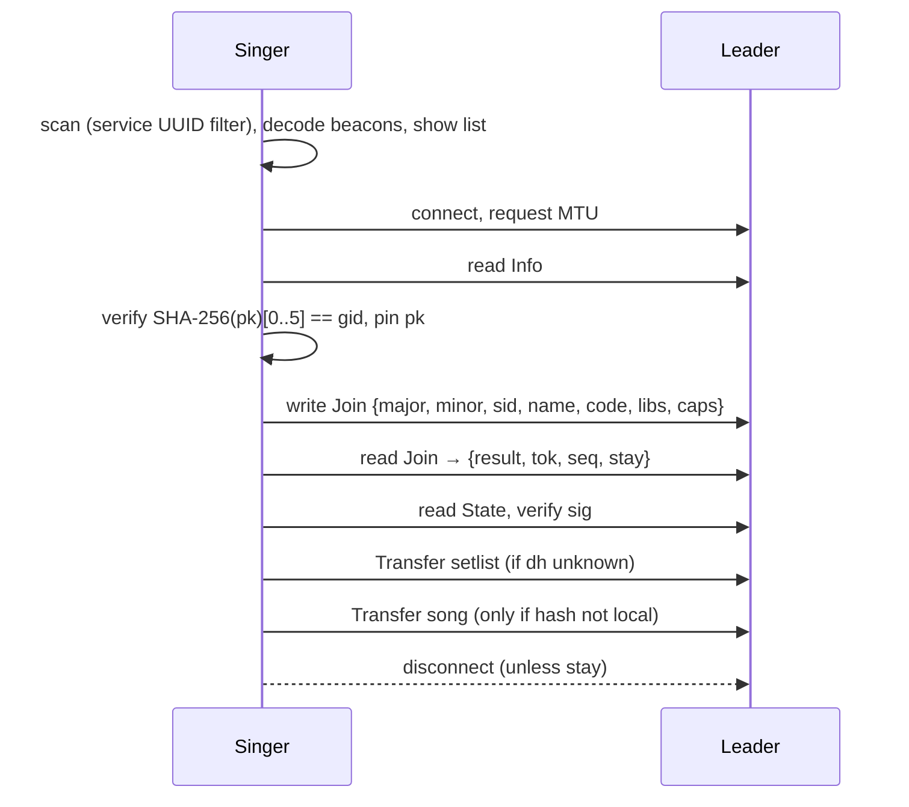
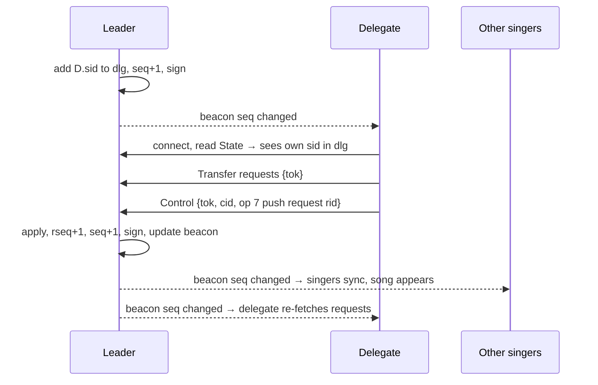

# Zangbundel – BLE Protocol Design

| Field | Value |
|---|---|
| Document | BLE protocol design |
| Project | Zangbundel – campfire songbook app |
| Protocol version | 1.0 (draft) |
| Document version | 0.1 (draft) |
| Date | 2026-10-18 |
| Author | Remko Welling |
| Status | Draft for review |
| Depends on | `design/functional-requirements.md` v0.2 |

---

## 1. Introduction

### 1.1 Purpose

This document specifies how the leader and the singers of a Zangbundel gathering communicate over Bluetooth Low Energy (BLE). It covers discovery (the beacon), joining, distribution of the current song and other gathering state, song requests, reconnection, the end of a gathering, versioning and security. It is written so that an Android and an iOS implementation built from it interoperate in either role (FR-BLE-08).

### 1.2 Scope

In scope: everything that travels over the air during a gathering. Out of scope: the song file format (see `design/song-format.md`), library import over the internet, the UI, and the on-device storage model. Phase 2 (karaoke clock synchronisation) and phase 3 (notation) are only reserved for, not designed.

### 1.3 Conventions

- "Leader" and "singer" are the roles from the FRD. In BLE terms the leader is the **advertiser and GATT server** (peripheral role); a singer is the **scanner and GATT client** (central role).
- Byte orders are big-endian unless stated otherwise. `u8`, `u16`, `u32` are unsigned integers of that width. `bstr`/`tstr` are CBOR byte and text strings.
- Requirement IDs in brackets, e.g. [FR-BLE-12], point to the FRD requirement a design element satisfies.
- MUST / SHOULD / MAY follow RFC 2119 and bind implementations of this protocol.

---

## 2. Design goals and constraints

### 2.1 Goals taken from the FRD

| Goal | Source |
|---|---|
| Work with BLE only; no internet, Wi-Fi or hotspot | FR-BLE-01, FR-GEN-03 |
| No system pairing; join by tapping a gathering | FR-BLE-02 |
| New song visible on every singer within 5 s (25 singers, 10 m); 2 s when singers have the song locally | FR-BLE-03, NFR-PERF-01 |
| Complete-or-nothing delivery of lyrics; resend possible | FR-BLE-04, FR-LEAD-06 |
| Compact transfer of songs up to about 4 kB | FR-BLE-05 |
| At least 25, ideally 50 singers; graceful refusal beyond capacity | FR-BLE-10 |
| Optional relay through singer devices | FR-BLE-11 |
| Send identifier first, lyrics only to singers that lack the song | FR-BLE-12 |
| Leader text messages, download instructions, setlist, requests and their status | FR-BLE-06, FR-BLE-13, FR-LEAD-30, section 11 FRD |
| Leader position for "follow the leader" | FR-LEAD-05, FR-SING-12 |
| Automatic reconnection; gathering treated as ended after a timeout | FR-GATH-10, FR-GATH-11 |
| Leader can resume a gathering after an app restart | FR-GATH-13 |
| No second gathering can be started within range of a running one; warn when one appears | FR-GATH-16, FR-GATH-17 |
| Delegates handle requests and push songs through the leader's device; leader-only actions stay leader-only | FR-LEAD-40 to FR-LEAD-46 |
| Nobody can impersonate the leader of a running gathering | NFR-SEC-02 |
| Versioned, platform-neutral protocol | FR-BLE-07, FR-BLE-08 |
| Only gathering data and the display name on the air | FR-BLE-14, NFR-PRIV-01 |
| Testable with a simulated transport | NFR-TEST-01 |

### 2.2 Platform facts that shape the design

| Fact | Consequence |
|---|---|
| Legacy BLE advertising carries 31 bytes of advertisement data plus 31 bytes of scan response. Extended advertising (BLE 5) is not available on all Android devices and cannot be sent by an iOS app. | The beacon is designed for legacy advertising. Extended advertising is an optional optimisation (section 16). |
| Android cannot put an app-chosen local name in an advertisement without renaming the user's Bluetooth adapter. It can send manufacturer-specific data. | Android leaders carry the gathering name and beacon fields in manufacturer data (beacon encoding A). |
| An iOS app can advertise only a local name and service UUIDs, and only while in the foreground. | iOS leaders carry the beacon fields in the local name (beacon encoding B). Singers MUST parse both encodings. |
| The number of simultaneous GATT connections an Android device accepts as a server is set by its Bluetooth stack and is not exposed to apps. In practice it ranges from about 4 to 15 and sometimes more. | The protocol MUST NOT depend on every singer being connected at the same time. Connections are short-lived; the beacon drives synchronisation. |
| A GATT characteristic value is at most 512 bytes. Notifications carry at most MTU − 3 bytes; the negotiated MTU is typically 247 (Android to Android) or 185 (iOS involved), minimum 23. | Anything larger than a few hundred bytes goes through a chunked transfer procedure. |
| BLE device addresses on modern phones are random and rotate roughly every 15 minutes. | The gathering identity cannot be the leader's address. It is derived from a cryptographic key. |
| iOS in the background drops the local name from advertisements and moves service UUIDs to an "overflow area" only other iOS devices can read. | An iOS leader must keep the app in the foreground (already required by FR-GATH-15). |

---

## 3. Architecture overview

### 3.1 Roles

```
            scan / connect               scan / connect
 Singer  <────────────────>  LEADER  <────────────────>  Singer
 (central)   GATT client     (peripheral,  GATT client   (central)
                             advertiser,
                             GATT server)
```

The leader advertises continuously. Singers scan continuously while in a gathering and connect only when they need something. Relays (section 10) are singers that additionally advertise and serve read-only copies.

### 3.2 Key ideas

1. **The beacon is the synchronisation signal.** It carries a 16-bit state sequence number (`seq`) and the leader's current line position. Every singer sees every change in the beacon within a second without a connection. Singers connect only when `seq` changes [FR-BLE-03].
2. **Connect, fetch, disconnect.** A singer connects, reads the small signed *state* record, fetches whatever documents changed, and disconnects, typically within one second. This keeps connection slots free so 25–50 singers can share a handful of slots. The leader MAY let a few singers stay connected when it has capacity.
3. **Content-addressed songs.** A song is identified over the air by the hash of its file content. A singer that already has a file with that hash, from any library revision, uses its local copy and transfers nothing [FR-BLE-12]. Only singers without the file fetch it, compressed, in chunks.
4. **Signed state.** The leader generates a key pair per gathering. The gathering identifier is a fingerprint of the public key, and every state record is signed. A singer that joined gathering `X` ignores any state not signed by the key behind `X`, so nobody can impersonate the leader [NFR-SEC-02]. Signed state also makes relays trustless.
5. **Documents.** Everything larger than the state record is a *document*: the setlist, the current song, the leader's message, a download instruction, a singer's own request statuses. The state record lists a hash per document so singers fetch only what changed.
6. **One encoding, CBOR.** All structured payloads are CBOR maps with small integer keys. Unknown keys are ignored, which gives minor-version extensibility for free [FR-BLE-07].
7. **Delegates act through the leader.** A delegate is an ordinary singer whose ID the leader has listed in the signed state. It sends *control* commands (push song, accept request, …) to the leader's device, which applies them, re-signs the state and distributes it as usual. The leader's device stays the single authority and the only signer [FR-LEAD-43].
8. **One gathering per area.** A device scans before it starts a gathering and refuses to start while another running gathering is in range [FR-GATH-16].

### 3.3 Singer state machine

```
 IDLE ──scan──▶ DISCOVERED ──tap/join──▶ JOINING ──ok──▶ SYNCED
                                            │              │ ▲
                                        reject           seq │ │ fetched
                                            ▼            changed│ │
                                          IDLE              ▼ │
                                                        FETCHING ─┘
 SYNCED/FETCHING ──no beacon 10 s──▶ RECONNECTING ──beacon──▶ SYNCED
 RECONNECTING ──no beacon 5 min──▶ ENDED
 any ──beacon flag ENDED or state status ENDED──▶ ENDED
 any ──user leaves──▶ IDLE
```

---

## 4. Reaching 25–50 singers: options and recommendation

| Option | How it works | Pros | Cons |
|---|---|---|---|
| **A. Persistent GATT connections only** | Every singer stays connected; leader notifies all. | Simple; instant push. | Hard limit of 4–15 connections on many Android leaders; fails FR-BLE-10 on most phones. |
| **B. Connectionless only (extended advertising)** | Leader puts song reference and position in extended advertisements; singers never connect for the current song. | Unlimited singers for the "have it locally" case; near-zero latency. | Not on all Android devices; impossible for an iOS leader; no channel for requests or lyric text; no delivery confirmation. |
| **C. Beacon-driven short-lived connections** (this design) | Beacon carries `seq` and position; singers connect briefly when `seq` changes. | Works on every device with legacy advertising; a few slots serve dozens of singers; requests and lyric text use the same connections. | Latency depends on slot contention; needs backoff and a busy flag; ~0.5–1 s per connect cycle. |
| **D. Relay mesh** | Singers that have the data re-advertise and serve it. | Scales beyond the leader's radio range and slots. | Needs peripheral mode on singer phones; more battery on relays; more complex testing. |

**Recommendation:** **C as the mandatory baseline**, with **D as an optional extension** (section 10) switched on when field tests show that C alone does not meet NFR-PERF-01 at the target group size, and **B as an optional optimisation** on Android leaders whose chip supports extended advertising (section 16, Q2). This satisfies FR-BLE-10 on the widest range of devices and keeps iOS leaders possible. The performance budget in section 11 shows that C meets the 5-second target for 25 singers with 6 connection slots.

---

## 5. Identifiers, keys and hashes

| Name | Size | Definition |
|---|---|---|
| **Gathering key pair** | Ed25519 | Generated by the leader when a gathering starts; stored in app-private storage until the gathering ends, so the gathering can be resumed [FR-GATH-13]. Never reused. |
| **Gathering ID** `gid` | 5 bytes | First 5 bytes of SHA-256 of the 32-byte public key. Appears in the beacon and in every state record. |
| **Public key** `pk` | 32 bytes | Read by the singer at join time and pinned for the gathering. |
| **State sequence** `seq` | u16 | Incremented by the leader on every change to state or documents except the line position. Wraps around; singers compare for inequality only. |
| **Position** `pos` | u8 | 0 = no position; 1–254 = 1-based line index into the current song's canonical line list; 255 = line 255 or beyond. |
| **Singer ID** `sid` | 8 bytes | Random, generated by the singer app per gathering. Lets the leader recognise a singer that reconnects. Not persistent across gatherings [NFR-PRIV-01]. |
| **Session token** `tok` | 16 bytes | Random, issued by the leader at join. Authenticates requests and the fetch of the singer's own request statuses. |
| **Song content hash** `hash` | 16 bytes | First 16 bytes of SHA-256 over the song file bytes exactly as stored in the library (UTF-8, LF line endings as canonicalised by the song-format spec). |
| **Document hash** `dh` | 8 bytes | First 8 bytes of SHA-256 over the uncompressed CBOR encoding of a document. |
| **Song reference** `ref` | CBOR map | `{1: lib (tstr library id), 2: song (tstr song id), 3: hash (bstr 16), 4: rev (tstr, optional library revision, informational)}`. Matching between leader and singer is by `hash` alone; `lib`, `song` and `rev` help the singer locate the file and show provenance [FR-LIB-17]. |

Hashing by content rather than by library revision is a deliberate deviation from the literal text of FR-BLE-12 ("exact song version"): two library revisions that did not touch a song still match, so fewer transfers are needed and the FRD's intent is met more often.

---

## 6. The beacon

### 6.1 Content

The beacon carries 10 bytes of fields plus the gathering name:

| Offset | Field | Type | Meaning |
|---|---|---|---|
| 0 | `ver` | u8 | Protocol major version. `1` for this document. |
| 1–5 | `gid` | 5 bytes | Gathering ID. |
| 6–7 | `seq` | u16 | State sequence number. |
| 8 | `flags` | u8 | Bit 0 `CODE` join code required · bit 1 `REQ_OPEN` requests accepted · bit 2 `BUSY` no free connection slot · bit 3 `ENDED` gathering has ended · bit 4 `RELAY` sender is a relay, not the leader · bit 5 `KARAOKE` reserved for P2 · bits 6–7 reserved, 0. |
| 9 | `pos` | u8 | Leader line position (section 5). |
| 10… | `name` | UTF-8 | Gathering name, truncated at a character boundary to fit. The full name is available from the Info characteristic. |

### 6.2 Encoding A – Android leader (binary)

- **Advertisement (≤ 31 bytes):** Flags AD structure (3 bytes, set by the stack; connectable, general discoverable) + *Complete List of 128-bit Service UUIDs* containing the Zangbundel service UUID (18 bytes). Optionally *TX Power Level* (3 bytes). Device name MUST NOT be included.
- **Scan response (≤ 31 bytes):** one *Manufacturer Specific Data* AD structure: length, type `0xFF`, company identifier `0xFFFF` (little-endian), then the 10 field bytes, then up to 17 bytes of `name`.

Company identifier `0xFFFF` is reserved by the Bluetooth SIG for internal use and testing; see open question Q1 about obtaining a proper identifier before public release.

### 6.3 Encoding B – iOS leader (text)

- **Advertisement:** the Zangbundel service UUID as the only advertised service (`CBAdvertisementDataServiceUUIDsKey`).
- **Scan response:** local name (`CBAdvertisementDataLocalNameKey`) = `"ZB"` + Base32 (RFC 4648, no padding, upper case) of the 10 field bytes (16 characters) + `" "` + up to 10 bytes of `name`. Total ≤ 29 bytes.

iOS places the service UUID in the advertisement and the name in the scan response automatically. Because the fields live in the name, an iOS leader MUST restart advertising whenever `seq`, `flags` or `pos` change; CoreBluetooth permits this.

### 6.4 Rules

- Singers MUST scan with a filter on the Zangbundel service UUID and MUST accept both encodings. A scan result carrying both is decoded from the manufacturer data.
- Leaders MUST advertise connectable, with an advertising interval of 100–250 ms (Android `ADVERTISE_MODE_BALANCED` or `LOW_LATENCY`), at high TX power, and MUST update the beacon within 100 ms of a state change.
- Singers MUST request duplicate reports (Android `CALLBACK_TYPE_ALL_MATCHES` in `SCAN_MODE_LOW_LATENCY`; iOS `CBCentralManagerScanOptionAllowDuplicatesKey`) while in a gathering so `seq` and `pos` changes are seen promptly. Outside a gathering a lower duty cycle MAY be used.
- A change of `pos` alone MUST NOT increment `seq`. Singers apply `pos` directly from the beacon [FR-LEAD-05].
- A singer treats the beacon as *lost* when no advertisement from the gathering has been received for 10 s, and the gathering as *ended* after a configurable 5 minutes [FR-GATH-10, FR-GATH-11]. A relay beacon (bit `RELAY`) counts as a beacon for these timers.
- The gathering list shown to the user [FR-GATH-03, FR-GATH-04] is built from beacons with `ENDED` = 0 and `RELAY` = 0, grouped by `gid`, with RSSI as the distance hint.

---

## 7. GATT service

### 7.1 UUIDs

Base UUID `7e2bXXXX-9f1c-4a7d-b2d4-5a4e47424c45` (provisional; the last group spells "ZNGBLE"). `XXXX` identifies the attribute:

| XXXX | Attribute | Properties | Max value | Purpose |
|---|---|---|---|---|
| `0001` | **Zangbundel service** | primary | | Advertised in the beacon. |
| `0002` | **Info** | read | 512 | Gathering information and public key. No token needed. |
| `0003` | **Join** | write (with response), read | 512 | Singer writes a join request, then reads the join response. |
| `0004` | **State** | read, notify | 512 | Signed state record (section 8.4). |
| `0005` | **Transfer** | write (with response) | 64 | Starts or resumes a document transfer (section 8.6). |
| `0006` | **Data** | notify | MTU − 3 | Chunks of the document being transferred. |
| `0007` | **Request** | write (with response) | 256 | Add or withdraw a song request. |
| `0008` | *Time* | reserved | | Phase 2 clock synchronisation. Not present in 1.0. |
| `0009` | **Control** | write (with response) | 512 | Delegate commands: push song, accept or decline requests, setlist changes (section 8.8). |

Clients MUST tolerate additional characteristics they do not know. Servers MUST implement all of `0002`–`0007` and `0009`.

### 7.2 Connection parameters

- The singer (central) MUST request the largest MTU it supports (Android: `requestMtu(517)`; iOS negotiates automatically) immediately after connecting and MUST wait for the result before using Transfer. Implementations MUST work at MTU 23.
- The singer SHOULD request a high connection priority (Android `CONNECTION_PRIORITY_HIGH`, 11.25–15 ms interval) for the duration of a transfer and release it afterwards. 2M PHY SHOULD be used when both sides support it.
- The singer MUST disconnect as soon as it has finished unless the join response granted `stay` (section 8.3). Idle connections without `stay` MAY be dropped by the leader after 3 s.
- The leader MUST treat any connection as untrusted until a valid token is presented; Info, State and Transfer of public documents (setlist, song, message, download) need no token so that late joiners and relays work.

### 7.3 Application error codes

Writes that the leader rejects return an ATT application error (range `0x80`–`0x9F`):

| Code | Meaning |
|---|---|
| `0x80` | Unknown or expired token |
| `0x81` | Requests are closed [FR-LEAD-13] |
| `0x82` | Too many pending requests for this singer [FR-REQ-06] |
| `0x83` | Malformed payload |
| `0x84` | Busy; retry later |
| `0x85` | Not served here (relay); go to the leader |
| `0x86` | Unknown document or hash |
| `0x87` | Protocol version not supported |
| `0x88` | Gathering has ended |
| `0x89` | Not a delegate (Control written by a singer whose `sid` is not in `dlg`) |
| `0x8A` | Leader does not have this song; upload it first (section 8.8) |
| `0x8B` | Upload rejected (hash mismatch or size limit) |

---

## 8. Payloads

### 8.1 CBOR conventions

- Every payload is a CBOR map with unsigned-integer keys unless stated otherwise. Encoders MUST use definite lengths and the shortest integer encodings (RFC 8949 "preferred serialization"). Decoders MUST ignore unknown keys and MUST reject a payload missing a key marked *required*.
- Text is UTF-8. Lengths given for text are in characters; implementations truncate at character boundaries.
- Booleans are CBOR `true`/`false`. Absent optional keys mean "unchanged" or "none" as described per message.

### 8.2 Info (read `0002`)

| Key | Name | Type | Req. | Meaning |
|---|---|---|---|---|
| 1 | `major` | uint | yes | Protocol major version (1). |
| 2 | `minor` | uint | yes | Protocol minor version (0). |
| 3 | `gid` | bstr 5 | yes | Gathering ID. |
| 4 | `name` | tstr ≤ 40 | yes | Full gathering name. |
| 5 | `flags` | uint | yes | Same bits as the beacon. |
| 6 | `singers` | uint | yes | Number of joined singers (relays report the leader's last known value). |
| 7 | `pk` | bstr 32 | yes | Gathering public key. |
| 8 | `relay` | bool | no | `true` on a relay. Default `false`. |
| 9 | `hops` | uint | no | Distance from the leader; 0 on the leader. |
| 10 | `app` | tstr | no | Leader app name and version, informational [FR-GEN-07]. |
| 11 | `libs` | array | no | Libraries the leader has: `[{1: lib, 2: rev, 3: url}]`. Lets a singer show "same version as leader" [FR-LEAD-31]. |

A singer MUST verify that the first 5 bytes of SHA-256(`pk`) equal the `gid` it selected from the beacon; otherwise it MUST abort the join.

### 8.3 Join (write then read `0003`)

**Join request (written by the singer):**

| Key | Name | Type | Req. | Meaning |
|---|---|---|---|---|
| 1 | `major` | uint | yes | Singer's protocol major version. |
| 2 | `minor` | uint | yes | Singer's protocol minor version. |
| 3 | `sid` | bstr 8 | yes | Singer ID for this gathering. |
| 4 | `name` | tstr ≤ 24 | no | Display name [FR-SING-01]. |
| 5 | `code` | tstr ≤ 8 | no | Join code if `CODE` flag is set [FR-GATH-05]. |
| 6 | `libs` | array | no | Libraries the singer has: `[{1: lib, 2: rev}]` [FR-LEAD-31]. |
| 7 | `caps` | uint | no | Capability bits: bit 0 can act as relay; bit 1 supports extended-advertising reception. |
| 8 | `app` | tstr | no | Singer app version. |

**Join response (read by the singer on the same connection, within 2 s):**

| Key | Name | Type | Req. | Meaning |
|---|---|---|---|---|
| 1 | `result` | uint | yes | 0 accepted · 1 wrong join code · 2 gathering full [FR-BLE-10] · 3 protocol version not supported [FR-BLE-07] · 4 gathering ended · 5 try again later. |
| 2 | `tok` | bstr 16 | if 0 | Session token. |
| 3 | `seq` | uint | if 0 | Current state sequence; the singer reads State next. |
| 4 | `stay` | bool | no | `true`: the singer may keep this connection and will receive State notifications. Default `false`. |
| 5 | `relay` | bool | no | `true`: the leader asks this singer to act as a relay (section 10). |
| 6 | `max_pending` | uint | no | Maximum pending requests per singer; default 3 [FR-REQ-06]. |
| 7 | `msg` | tstr | no | Human-readable reason, e.g. for result 3 "Update the app to join this gathering". |
| 8 | `role` | uint | no | 0 singer (default) · 1 delegate. Set on a rejoin so a delegate that reconnects gets its role back at once [FR-LEAD-46]; the signed `dlg` list in State remains authoritative. |

If a singer with a known `sid` joins again (reconnection), the leader MUST return the same token and MUST NOT count it twice. The leader maps a pending join response to the connection on which the request was written; a read without a preceding write returns `result` 5.

### 8.4 State (read/notify `0004`)

The characteristic value is a CBOR array `[body (bstr), sig (bstr 64)]`. `sig` is the Ed25519 signature over `body` with the gathering key. `body` is the CBOR encoding of:

| Key | Name | Type | Req. | Meaning |
|---|---|---|---|---|
| 1 | `gid` | bstr 5 | yes | Gathering ID (binds the signature to this gathering). |
| 2 | `seq` | uint | yes | State sequence number. |
| 3 | `ts` | uint | yes | Milliseconds since the gathering started, per the leader's monotonic clock. MUST increase with every new state; used against replay and reserved for P2 timing. |
| 4 | `status` | uint | yes | 0 running · 1 ended [FR-GATH-09]. |
| 5 | `flags` | uint | yes | Same bits as the beacon. |
| 6 | `cur` | ref | no | Current song reference. Absent = no current song [FR-LEAD-06]. |
| 7 | `title` | tstr ≤ 60 | no | Title of the current song, so a singer without the song can show it while fetching. |
| 8 | `pos` | uint | no | Leader line position; the beacon value takes precedence when newer. |
| 9 | `singers` | uint | no | Number of joined singers. |
| 10 | `docs` | map | yes | Document hashes: `{1: setlist dh, 2: message dh, 3: download dh}`. A missing entry means the document does not exist (e.g. no message). |
| 11 | `rseq` | uint | yes | Request sequence; increments whenever any request status changes. Singers with pending requests re-fetch `myreq` when it changes [FR-REQ-05]. |
| 12 | `cur_dh` | bstr 8 | no | Document hash of the current song document, for cache validation. |
| 13 | `dlg` | array of bstr 8 | no | Singer IDs of the current delegates [FR-LEAD-40]. Absent or empty = none. A singer that finds its own `sid` here shows the delegate UI; one that no longer finds it hides it [FR-LEAD-45]. At most 8 entries. |

The signed body MUST stay ≤ 440 bytes so the whole value fits in 512 bytes. Singers MUST verify `sig` with the pinned `pk`, MUST verify `gid`, and MUST discard a state whose `ts` is not greater than the last accepted one unless `status` is 1.

### 8.5 Documents

Documents are fetched with the Transfer procedure. Each is a CBOR map; the document hash `dh` is over this encoding before compression.

**`setlist`** [FR-LEAD-03, FR-SING-03]

| Key | Name | Type | Meaning |
|---|---|---|---|
| 1 | `items` | array | `[{1: ref, 2: title (tstr ≤ 60), 3: status (0 upcoming · 1 current · 2 sung · 3 skipped), 4: votes (uint, optional)}]` in setlist order. The leader MAY omit upcoming items if it does not want to share them (FRD Q2). |

**`song`** (identified by content `hash`) [FR-BLE-12, FR-BLE-05]

| Key | Name | Type | Meaning |
|---|---|---|---|
| 1 | `ref` | ref | Song reference (includes `hash`). |
| 2 | `file` | bstr | The song file bytes exactly as in the library. The singer MUST verify SHA-256 of `file` against `ref.hash` before showing the song [FR-BLE-04]. |
| 3 | `lic` | tstr ≤ 200 | Licence/attribution summary from the library, for display when the singer does not have the library [FR-LIB-20]. |

A song marked "do not redistribute" in the library [FR-LIB-22] is never served as a document; the leader answers `0x86` and singers show "available only with library X installed".

**`message`** [FR-BLE-13]

| Key | Name | Type | Meaning |
|---|---|---|---|
| 1 | `text` | tstr ≤ 200 | The leader's message. |
| 2 | `ts` | uint | Leader time (ms since gathering start) when sent. |

**`download`** [FR-LEAD-30]

| Key | Name | Type | Meaning |
|---|---|---|---|
| 1 | `lib` | tstr | Library id. |
| 2 | `url` | tstr | HTTPS repository URL. |
| 3 | `branch` | tstr | Branch or tag. |
| 4 | `rev` | tstr | Revision (commit hash). |
| 5 | `size` | uint | Approximate download size in bytes, if known [FR-NET-04]. |

**`myreq`** (requires token) [FR-REQ-05]

| Key | Name | Type | Meaning |
|---|---|---|---|
| 1 | `items` | array | `[{1: rid (bstr 4), 2: status (0 pending · 1 accepted · 2 declined · 3 sung · 4 withdrawn), 3: setpos (uint, optional position in setlist)}]`. Only this singer's requests. |
| 2 | `rseq` | uint | The `rseq` this snapshot corresponds to. |

**`requests`** (requires a delegate's token) [FR-LEAD-41]

| Key | Name | Type | Meaning |
|---|---|---|---|
| 1 | `items` | array | `[{1: rid (bstr 4), 2: sid (bstr 8), 3: name (tstr, requester's display name), 4: ref (ref, optional), 5: text (tstr, optional), 6: status (as in myreq), 7: ts (uint), 8: count (uint, identical requests grouped, optional)}]`, pending first, then the rest, newest first. |
| 2 | `rseq` | uint | The `rseq` this snapshot corresponds to. |
| 3 | `open` | bool | Whether requests are currently accepted [FR-LEAD-13]. |

This is the leader's full request queue. Only singers listed in `dlg` may fetch it; others get `0x89`.

### 8.6 Transfer procedure (write `0005`, notifications on `0006`)

The singer MUST subscribe to Data notifications before writing to Transfer. One transfer at a time per connection.

**Transfer request (written):**

| Key | Name | Type | Req. | Meaning |
|---|---|---|---|---|
| 1 | `doc` | uint | yes | 1 setlist · 2 message · 3 download · 4 song · 5 myreq · 6 requests (delegates only). |
| 2 | `hash` | bstr 16 | doc 4 | Song content hash. |
| 3 | `off` | uint | no | Byte offset into the compressed stream to resume from; default 0. |
| 4 | `tok` | bstr 16 | doc 5, 6 | Session token. |
| 5 | `dh` | bstr 8 | no | Document hash the singer expects; the leader answers `0x86` if it no longer matches, saving a wasted transfer. |

**Data notifications** (first byte is the frame type):

| Type | Layout | Meaning |
|---|---|---|
| `0x01` HEADER | `0x01` + CBOR `{1: len (uint, compressed length), 2: enc (0 raw · 1 DEFLATE), 3: dh (bstr 8), 4: ulen (uint, uncompressed length)}` | Sent once per transfer, before any data. |
| `0x02` DATA | `0x02` + `u16 index` + bytes | `index` counts chunks from 0 for this transfer; the chunk size is MTU − 6. Chunks are sent in order without waiting for acknowledgement. |
| `0x03` END | `0x03` + `u16 count` | `count` = number of DATA frames sent. The singer verifies `count`, total length and `dh`. |
| `0x7F` ERROR | `0x7F` + `u8 code` | Codes as in section 7.3. Ends the transfer. |

- `enc` = 1 means raw DEFLATE (RFC 1951) of the CBOR document. The leader SHOULD compress when it saves at least 10 %; a 4 kB song typically shrinks to 1.5–2 kB [FR-BLE-05].
- The leader MUST pace notifications to the connection (wait for the stack's "notification sent" callback on Android before sending the next) so none are dropped.
- If the connection drops, the singer keeps the chunks received so far and resumes with `off` = bytes received on the next connection. The leader MUST support resumption from any offset for the current document hash.
- A document MUST be shown only after `dh` (and, for songs, `ref.hash`) verifies [FR-BLE-04].

### 8.7 Request (write `0007`)

| Key | Name | Type | Req. | Meaning |
|---|---|---|---|---|
| 1 | `tok` | bstr 16 | yes | Session token. |
| 2 | `op` | uint | yes | 1 add · 2 withdraw [FR-REQ-04]. |
| 3 | `rid` | bstr 4 | yes | Request ID chosen by the singer; a repeated `rid` is idempotent. |
| 4 | `ref` | ref | op 1, one of 4/5 | Song from the singer's library [FR-REQ-01]. |
| 5 | `text` | tstr ≤ 100 | op 1, one of 4/5 | Free-text title [FR-REQ-02]. |

Success is the GATT write response; failures use the codes in section 7.3. The leader increments `rseq` when it accepts, declines, marks sung or sees a withdrawal, and singers learn the status through `myreq`.

### 8.8 Control (write `0009`, delegates only)

Every Control write carries the delegate's token. The leader checks that the token belongs to a singer whose `sid` is in `dlg`; otherwise it answers `0x89`. On success the leader applies the command exactly as if the leader had done it in its own UI, increments `seq`, re-signs the state and distributes it (section 9.4). Commands are idempotent per `cid`.

| Key | Name | Type | Req. | Meaning |
|---|---|---|---|---|
| 1 | `tok` | bstr 16 | yes | Delegate's session token. |
| 2 | `cid` | bstr 4 | yes | Command ID chosen by the delegate; a repeated `cid` is ignored with success. |
| 3 | `op` | uint | yes | See table below. |
| 4 | `ref` | ref | op 1, 4 | Song reference. |
| 5 | `rid` | bstr 4 | op 5, 6, 7 | Request ID from the `requests` document. |
| 6 | `idx` | uint | op 8 | Upload chunk index, from 0. |
| 7 | `data` | bstr | op 8 | Upload chunk bytes (compressed stream, see below). |
| 8 | `len` | uint | op 8, idx 0 | Total compressed length of the upload. |

| `op` | Command | Effect on the leader | FRD |
|---|---|---|---|
| 1 | Push song | `ref` becomes the current song. Answers `0x8A` if the leader has no file with `ref.hash` and no completed upload of it. | FR-LEAD-42 |
| 2 | Clear current song | `cur` removed. | FR-LEAD-06 |
| 3 | Next in setlist | The next upcoming setlist item becomes current; the previous one is marked sung. | FR-LEAD-03 |
| 4 | Add to setlist | `ref` appended as upcoming. Same `0x8A` rule as op 1. | FR-LEAD-03, 42 |
| 5 | Accept request | Request `rid` → accepted and appended to the setlist. | FR-LEAD-41 |
| 6 | Decline request | Request `rid` → declined. | FR-LEAD-41 |
| 7 | Push request now | Request `rid` → accepted and its song becomes the current song. | FR-LEAD-41 |
| 8 | Upload song chunk | Transfers a song file the leader lacks, delegate → leader, as a sequence of writes of at most 480 bytes of `data` each, in order. The stream is the `song` document (section 8.5) DEFLATE-compressed, so the leader can serve the same bytes onward. The leader verifies `ref.hash` over the decompressed `file` after the last chunk and answers `0x8B` on mismatch or when `len` exceeds 64 kB. After a successful upload the delegate sends op 1 or 4. | FR-LEAD-42 (SHOULD) |

Op 8 is optional for 1.0 implementations; a leader that does not implement it answers `0x8A` and the delegate shows "the leader does not have this song". Leader-only actions (end, join code, delegates, download instruction, hand-over) have no Control op by design [FR-LEAD-44].

---

## 9. Procedures

### 9.1 Start a gathering (leader)

1. **Pre-start scan** [FR-GATH-16]. Scan with the service UUID filter for at least 5 s. If any beacon with `ENDED` = 0 and `RELAY` = 0 is received, regardless of its `gid`, do not start: show the gathering name(s) found and offer to join. A beacon with `ENDED` = 1 (the 60-second end announcement, section 9.9) does not block. A device that cannot scan (permission refused) MUST NOT start a gathering.
2. Generate the Ed25519 key pair, derive `gid`, set `seq` = random u16, `ts` = 0, `status` = 0; persist key, `gid`, name, join code, `seq` and the singer table until the gathering ends [FR-GATH-13].
3. Build the initial state and documents (an empty setlist or a prepared one [FR-LEAD-02]).
4. Start the GATT server and start advertising (encoding A or B) [FR-GATH-02].
5. **Keep scanning while leading** [FR-GATH-17], at a low duty cycle (e.g. 2 s every 30 s). A beacon with another `gid`, `ENDED` = 0 and `RELAY` = 0 triggers a one-time warning per `gid` naming the other gathering. Nothing else changes; both gatherings continue. Resuming a gathering (section 9.8) repeats step 1 but ignores beacons carrying the resumed `gid` (a relay of the leader's own gathering).

Advertising and scanning at the same time is supported on Android and iOS; the scan window is kept small so it does not disturb singers' connections.

### 9.2 Discover and join (singer)



- If `result` ≠ 0 the singer shows the reason and returns to the list [FR-GATH-05, FR-BLE-07, FR-BLE-10].
- After the join, the singer immediately has the current song and setlist [FR-GATH-06].
- If Info reports a protocol `major` higher than the singer supports, the singer MUST NOT attempt Join and MUST show the update message [FR-BLE-07].

### 9.3 Synchronise on a state change (singer)

Triggered when the beacon's `seq` differs from the last synchronised `seq`, or when a State notification arrives on a `stay` connection.

1. Wait a random delay of 0–400 ms (spreads 25 singers over the available slots). If the beacon shows `BUSY`, keep waiting until it clears, up to 3 s, then try anyway.
2. Connect, request MTU, read State, verify signature, `gid` and `ts`.
3. Compare `docs` and `cur_dh` with the cache; fetch changed documents. For the current song: use a local library file whose content hash equals `cur.hash`; else a cached document from this gathering; else Transfer `song`. If `rseq` changed and the singer has requests, Transfer `myreq`.
4. Disconnect unless `stay`. Record `seq` as synchronised.
5. On a connection failure (Android status 133, timeout, immediate disconnect), retry with exponential backoff starting at 300 ms, doubling, capped at 2 s, with ±25 % jitter, until synchronised or the beacon is lost. The lyric view shows "receiving…" while the current song is not yet available [FR-BLE-04].

### 9.4 Push a song, message, setlist or download instruction (leader)

1. Update the document(s) and recompute their `dh`.
2. Build the new state body with `seq` + 1 and a larger `ts`, sign it.
3. Update the beacon (encoding A: new manufacturer data; encoding B: restart advertising with the new name) [FR-BLE-03].
4. Notify State on every `stay` connection.
5. For FR-LEAD-06 "re-push", the leader increments `seq` without changing the song; singers that already have the song do nothing more than read State.

### 9.5 Leader position (follow the leader)

The leader writes the new `pos` into the beacon only; `seq` is unchanged. Singers in follow mode scroll to the line on the next beacon they see, normally within 250–500 ms [FR-LEAD-05, FR-SING-12]. Singers on a `stay` connection MAY additionally receive a State notification with the new `pos`, but implementations MUST NOT depend on it.

### 9.6 Send a request (singer)

Connect (or use the `stay` connection), write Request, handle the response, disconnect. If the singer is not able to connect (beacon lost), the request is queued locally and sent on the next successful connection, or dropped with a message when the gathering ends [FR-REQ-03]. The singer learns the outcome through `rseq` → `myreq` (section 9.3).

### 9.7 Capacity management (leader)

- The leader keeps `max_conn`, initially 6. It raises `max_conn` by 1 after 10 consecutive successful connection cycles at the current maximum and lowers it by 1 whenever the stack reports a connection failure that looks like exhaustion. The value is remembered per device across gatherings.
- When the number of open connections ≥ `max_conn` − 1 the leader sets `BUSY` in the beacon; it clears the flag when a slot frees up.
- A connection arriving while at `max_conn` is disconnected by the leader immediately; the singer treats this as a retry (section 9.3 step 5).
- `stay` is granted only while open connections ≤ `max_conn` / 2, preferring singers that have asked for follow mode. The leader MAY revoke `stay` by disconnecting; the singer silently returns to beacon-driven mode.
- A connection that has been idle for 3 s without `stay`, or 60 s with `stay`, MAY be dropped.

### 9.8 Loss of contact and reconnection

- **Singer side.** No beacon for 10 s → show "reconnecting", keep the current lyrics [FR-GATH-10]. Beacon returns with the same `gid` → compare `seq`, synchronise if needed; nothing is shown to the user if nothing changed. No beacon for 5 min (configurable) → treat as ended (section 9.10) [FR-GATH-11].
- **Leader side.** Singers that have not connected or been seen for 10 min are removed from the count [FR-GATH-12]. A singer that reconnects with its `sid` gets its token back and is not counted twice.
- **Leader app restart.** On start, the app finds a persisted running gathering younger than the configured resume window (default 10 min) and offers to resume [FR-GATH-13]. Resuming reuses key, `gid`, name, tokens and `seq` (+1, so singers refresh). Declining ends the gathering (section 9.9).

### 9.9 End a gathering (leader)

1. Set `status` = 1 and the `ENDED` flag, `seq` + 1, sign, notify `stay` connections.
2. Keep advertising the `ENDED` beacon for 60 s so singers that were out of range for a moment still learn of it, then stop advertising and the GATT server, and delete the key pair and singer table.
3. Reject all writes with `0x88` during the 60 s.

### 9.10 Ended, on the singer

On `ENDED` in the beacon, `status` 1 in a verified state, or the 5-minute timeout: show "gathering ended", delete all documents received during the gathering (songs, setlist, message, download, requests) [FR-DATA-01, FR-DATA-06], and write the gathering memory (name, date, leader's display name is not available over the air in 1.0, titles sung from the last setlist) [FR-DATA-03]. The user leaving voluntarily [FR-GATH-07] has the same effect locally, after an optional best-effort write of a *leave* request (not specified in 1.0; the leader's 10-minute inactivity rule handles it).

### 9.11 Delegates

**Appoint** [FR-LEAD-40]. The leader picks a joined singer; its `sid` is added to `dlg`, `seq` is incremented and the new state is signed and distributed (section 9.4). The delegate learns of its role on its next synchronisation (within the normal beacon-driven latency), shows the delegate UI and fetches the `requests` document [FR-LEAD-45]. **Revoke** is the reverse: the `sid` leaves `dlg`; any later Control write with that token gets `0x89`. Leaving the gathering, or the 10-minute inactivity rule, also removes the `sid` from `dlg`.

**Act.** A delegate connects (or uses a `stay` connection, which the leader SHOULD grant to delegates first), writes Control, handles the response and disconnects. The leader's own screen updates from the same state change, so the leader sees the delegate's actions as they happen [FR-LEAD-45]. If the delegate cannot reach the leader (beacon lost, `BUSY` for more than 3 s, connection failures), the delegate UI reports that the action could not be sent and does not queue it [FR-LEAD-43].

**Request queue.** The `requests` document changes whenever `rseq` changes. A delegate re-fetches it on every `rseq` change it observes in State; with a `stay` connection this is immediate, otherwise it follows the next beacon `seq` change (the leader increments `seq` together with `rseq` so delegates do not need a separate trigger).

**Songs the leader lacks** [FR-LEAD-42]. Op 1 or 4 answers `0x8A`; the delegate then uploads the song with op 8 and retries. The upload is bounded (64 kB compressed) and the leader verifies the content hash, so a delegate cannot plant a song under a false identity. The leader keeps uploaded songs for the duration of the gathering only, like any other gathering document.



---

## 10. Relay extension (optional, protocol 1.x)

Relays implement FR-BLE-11. The extension is optional for both leaders and singers and is negotiated through `caps` bit 0 and the `relay` field of the join response.

- A singer that has peripheral support, the current song document and a battery level above 30 % MAY accept the leader's relay request. It then advertises with the same encoding rules, copying `ver`, `gid`, `seq`, `flags` and `pos` from the most recent leader beacon it has seen and setting the `RELAY` bit. A relay that has not seen the leader beacon for 10 s MUST stop relaying.
- A relay serves **Info** (`relay` = true, `hops` = 1), **State** (the leader's exact bytes, signature included), and **Transfer** for `setlist`, `message`, `download` and `song` documents it holds and has verified. It answers Join, Request and `myreq` with `0x85`.
- Singers prefer the leader. They use a relay when the leader beacon shows `BUSY` or has not been received for 3 s while a relay beacon with the same `gid` and `seq` is present. Because State is signed and documents are hashed, a singer verifies relayed data exactly as it verifies the leader's; a relay cannot inject content [NFR-SEC-02].
- A relay accepts at most 3 connections and never offers `stay`.
- The leader limits the number of relays (default 4) and chooses singers with the strongest RSSI history and Android devices first (iOS relays would need the app in the foreground).
- Relays are a 1.x minor-version feature: a 1.0 singer simply ignores beacons with the `RELAY` bit and `0x85` never reaches it because it never connects to a relay.

---

## 11. Reliability and performance budget

### 11.1 Target: NFR-PERF-01 (25 singers, 10 m, open air)

Assumptions: 6 connection slots on the leader, connection establishment 300–600 ms (scanning singer to advertising leader at 100–250 ms interval), MTU 247, connection interval 15 ms, effective notification throughput ≥ 5 kB/s.

| Step | Singers with the song locally | Singers without the song |
|---|---|---|
| Beacon change seen | ≤ 0.5 s | ≤ 0.5 s |
| Random delay + connect + MTU | 0.4–1.0 s | 0.4–1.0 s |
| Read State (one read) | ~0.05 s | ~0.05 s |
| Transfer song (2 kB compressed, 9 chunks) | – | 0.3–0.5 s |
| Disconnect | ~0.05 s | ~0.05 s |
| **Per singer, per slot** | **≈ 1.0 s** | **≈ 1.5 s** |
| **25 singers over 6 slots** (5 rounds) | **≈ 2–3 s** (target 2 s is met when ≥ 12 slots or `stay` covers followers; see note) | **≈ 4–5 s** (target 5 s) |

Note: the 2-second target for singers who have the song is met only with more slots, with `stay` connections, or with extended advertising (Q2). Field measurement is required before fixing `max_conn` defaults; this is the single biggest risk in the design.

### 11.2 Loss handling

| Failure | Handling |
|---|---|
| Notification lost (connection dropped mid-transfer) | Resume from `off`; the HEADER `dh` guarantees the stream is the same document. |
| Corrupt or truncated document | `dh`/`hash` mismatch → discard, retry once, then show "reception failed, tap to retry" [FR-BLE-04]. |
| State older than current (relay lag or replay) | `ts` check → ignore. |
| Beacon from an impostor with the same `gid` | Its State does not verify → ignore, log, keep the last good state. |
| Leader stack exhausted | `BUSY` flag + immediate disconnect + singer backoff. |
| Singer app in background (Android Doze, iOS) | Scanning continues at the platform's reduced rate; synchronisation resumes when foregrounded. The lyric view keeps the screen on [FR-DISP-07], so this is rare at the fire. |

---

## 12. Security considerations

| Threat | Mitigation | Residual risk |
|---|---|---|
| Impersonating the leader (fake song, fake "ended") | `gid` is a fingerprint of the gathering public key; State is signed; singers pin `pk` at join. | A 5-byte fingerprint means an attacker needs about 2^40 key generations to forge a matching key: hours on a desktop, not feasible on the spot. Open question Q4 considers 6 bytes. |
| Replaying an old state | `seq` and strictly increasing `ts` inside the signed body. | None of note. |
| Forged requests in another singer's name | Token required; tokens are random 16 bytes. | Tokens travel unencrypted and can be sniffed; impact is a prank request. Accepted. |
| Stolen delegate token used to push songs or handle requests | Only `sid`s the leader listed in the signed `dlg` are accepted; the leader sees every delegate action and can revoke at once; uploads are hash-verified and size-bounded. | A sniffer within range during a delegate's write could replay its token until revoked. Impact is a wrong song being pushed, visible to the leader. Accepted for 1.0; per-singer signing keys are a possible 1.x hardening. |
| A second gathering started in range to confuse singers | Pre-start scan refuses to start [FR-GATH-16]; singers pick by name and signal strength. | A modified app can ignore the rule; the leader is warned [FR-GATH-17]. Not a security control, a courtesy rule. |
| Flooding the leader with joins or requests | Per-connection rate limit (1 Join per 2 s, 5 Requests per minute), `max_pending`, `0x84`. | Radio-level jamming is out of scope. |
| Reading lyrics without joining | Lyrics are not confidential; documents are public to anyone in range, except "do not redistribute" songs which are never sent. | By design. |
| Tracking a person across gatherings | `sid` and token are per gathering; the OS randomises the BLE address; no persistent identifier is sent [NFR-PRIV-01]. | The display name is chosen by the user and sent in clear. |
| Join code | Sent in clear in the Join request. | The code separates fires, it is not a secret. Documented in the FRD (FR-GATH-05). |

Link-layer encryption (LE Secure Connections) is deliberately not used: it would require system pairing, which FR-BLE-02 forbids.

---

## 13. Versioning and extensibility

- **Major version** (`ver` in the beacon, `major` in Info/Join): changes that a 1.x implementation cannot handle (new characteristic semantics, new encodings). A singer MUST NOT join a gathering whose `ver` it does not implement and MUST show the update message [FR-BLE-07]. A leader MAY support more than one major version by advertising the highest and accepting lower in Join.
- **Minor version** (`minor`): additive changes only: new CBOR keys, new document types, new flags bits, new characteristics, new `caps` bits. Both sides ignore what they do not know.
- Reserved for **phase 2**: beacon flag bit 5 `KARAOKE`; `ts` in State as the leader clock; characteristic `0008` Time for round-trip clock offset measurement; song documents may carry timing data inside the song file without protocol change (the file is opaque to the protocol).
- Reserved for **phase 3**: a `variant` field in `ref` (e.g. chords vs. lyrics-only) and a per-gathering key signature in State; the song file again carries the content.
- The protocol version this document specifies is **1.0**. The relay extension is planned as **1.1**.

---

## 14. Platform notes

### 14.1 Android

- Permissions: Android 12+ `BLUETOOTH_SCAN` (with `neverForLocation`, so no location permission), `BLUETOOTH_ADVERTISE`, `BLUETOOTH_CONNECT`; Android 6–11 `ACCESS_FINE_LOCATION` for scanning plus legacy `BLUETOOTH`/`BLUETOOTH_ADMIN` [FR-GEN-05].
- Leader capability check: `BluetoothAdapter.getBluetoothLeAdvertiser()` non-null and `isMultipleAdvertisementSupported()`; otherwise the device can only be a singer (FRD constraint 1).
- Advertising: `AdvertiseData` with `addServiceUuid` for the advertisement and a second `AdvertiseData` with `addManufacturerData(0xFFFF, …)` as scan response; `setIncludeDeviceName(false)` on both; `setConnectable(true)`.
- GATT server: `BluetoothManager.openGattServer`; notifications must be serialised on `onNotificationSent`; use `BluetoothGattServer.cancelConnection` to shed load. Expect connection status 133 on singers when the leader is saturated.
- Scanning: `ScanFilter` on the service UUID, `SCAN_MODE_LOW_LATENCY` in the foreground, `CALLBACK_TYPE_ALL_MATCHES`. Android throttles apps that start and stop scans more than 5 times in 30 s; keep one scan running.
- Keep the leader in a foreground service with the "connected device" type so the OS does not stop advertising when the screen is off [FR-GATH-15]; warn when battery saver is active.
- Libraries: CBOR via `jackson-dataformat-cbor` or `cbor-java`; Ed25519 via Bouncy Castle, Tink or libsodium (the platform JCA has Ed25519 only on recent Android versions); DEFLATE via `java.util.zip`.

### 14.2 iOS (future)

- Leader: `CBPeripheralManager`, encoding B, foreground only; advertising stops producing a readable beacon for Android in the background.
- Singer: `CBCentralManager` with service UUID filter works in the background at reduced rate; duplicates are only reported in the foreground.
- MTU typically 185; iOS negotiates automatically; use `maximumWriteValueLength(for:)`.
- Ed25519 via CryptoKit (`Curve25519.Signing`), DEFLATE via the `Compression` framework (`COMPRESSION_ZLIB` produces raw DEFLATE), CBOR via SwiftCBOR or similar.

### 14.3 Simulated transport (NFR-TEST-01)

All payloads and procedures above are defined on byte arrays and three primitives: *advertise(bytes)*, *connect/disconnect*, *read/write/notify(uuid, bytes)*. The protocol layer MUST be implemented against an interface with these primitives so that a simulated transport can run 50 virtual singers against one leader in unit tests, including slot exhaustion, dropped connections and corrupted chunks.

---

## 15. Requirements traceability

| Requirement | Where satisfied |
|---|---|
| FR-GATH-02, 03, 04 | Beacon (6), gathering list rules (6.4) |
| FR-GATH-05 | `CODE` flag, Join `code` (8.3) |
| FR-GATH-06 | Join procedure (9.2) |
| FR-GATH-07 | Singer leave (9.10) |
| FR-GATH-08, 09 | End procedure (9.9), `ENDED` flag |
| FR-GATH-10, 11 | Beacon timers (6.4), reconnection (9.8) |
| FR-GATH-12 | `singers` in Info/State, inactivity rule (9.8) |
| FR-GATH-13 | Persisted key and resume (9.1, 9.8) |
| FR-GATH-15 | Foreground service note (14.1), iOS limits (14.2) |
| FR-GATH-16, 17 | Pre-start scan and scanning while leading (9.1) |
| FR-LEAD-40, 45, 46 | `dlg` in State (8.4), `role` in Join (8.3), appoint/revoke (9.11) |
| FR-LEAD-41 | `requests` document (8.5), Control ops 5–7 (8.8) |
| FR-LEAD-42 | Control ops 1, 3, 4 and upload op 8 (8.8) |
| FR-LEAD-43, 44 | Leader as single authority (3.2, 8.8, 9.11); no Control op for leader-only actions |
| FR-BLE-01, 02 | Architecture (3), no pairing (12) |
| FR-BLE-03 | Beacon-driven sync (3.2, 9.3, 9.4), budget (11.1) |
| FR-BLE-04 | Hash verification, transfer END, resume (8.6, 11.2) |
| FR-BLE-05 | DEFLATE, chunking (8.6) |
| FR-BLE-06 | Documents and Request (8.5, 8.7) |
| FR-BLE-07 | Versioning (13), Join result 3, error `0x87` |
| FR-BLE-08 | Two beacon encodings (6.2, 6.3), platform-neutral CBOR |
| FR-BLE-10 | Short-lived connections, `BUSY`, capacity (4, 9.7), Join result 2 |
| FR-BLE-11 | Relay extension (10) |
| FR-BLE-12 | Content hash matching (5, 9.3) |
| FR-BLE-13 | `message` document |
| FR-BLE-14, NFR-PRIV-01 | Payload inventory (8), privacy row (12) |
| FR-LEAD-05, FR-SING-12 | `pos` in beacon (6.1, 9.5) |
| FR-LEAD-06 | Re-push via `seq` (9.4), `cur` absent |
| FR-LEAD-30, 31, 32 | `download` document, `libs` in Info/Join |
| FR-LIB-22 | Song never served, `0x86` (8.5) |
| FR-REQ-01…06 | Request (8.7), `myreq` (8.5), `rseq` (8.4) |
| FR-DATA-01, 03, 06 | Ended on singer (9.10) |
| NFR-PERF-01 | Budget (11.1) |
| NFR-SEC-02 | Signed state, key fingerprint (5, 8.4, 12) |
| NFR-TEST-01 | Simulated transport (14.3) |

---

## 16. Open questions

| # | Question | Impact |
|---|---|---|
| Q1 | Company identifier `0xFFFF` is for testing only. Register a Bluetooth SIG company identifier (free Adopter membership) before public release, or use a Service Data AD type with a 16-bit UUID? | Beacon encoding A, store compliance |
| Q2 | Should Android leaders with BLE 5 extended advertising also broadcast the current song `ref` and `cur_dh` in the advertisement, so singers with the library never connect for the current song? iOS 13+ singers can receive extended advertisements. | Meets the 2-second target for local songs; adds a third beacon form |
| Q3 | What are the real connection limits of the Android devices scouting groups actually own? Field test with 25–50 phones needed before fixing `max_conn` and deciding whether relays are required in P1. | Section 9.7, 10, 11 |
| Q4 | Use a 6-byte `gid` (2^48 forgery work) and drop `pos` from the beacon in favour of State notifications, or keep 5 bytes + `pos`? | Beacon layout, security margin, follow-the-leader latency |
| Q5 | CBOR versus Protocol Buffers. CBOR needs no schema compiler and tolerates unknown keys; Protobuf has stronger tooling. | Encoding, tooling on both platforms |
| Q6 | Should the leader's display name travel in Info so the gathering memory can record it (FR-DATA-03), or keep the leader anonymous? | Info payload, privacy |
| Q7 | Should a singer send an explicit *leave* so the count drops immediately, instead of relying on the 10-minute inactivity rule? | FR-GATH-07, FR-GATH-12 |
| Q8 | A shared static DEFLATE dictionary of common Dutch/English lyric words could cut song transfers by 20–30 %. Worth the versioning cost? | Section 8.6, song transfer time |
| Q9 | Resume window after a leader app restart (10 min proposed) and the inactivity rule (10 min) are guesses; confirm with field use. | 9.8 |
| Q10 | Is the delegate upload (Control op 8) worth implementing in 1.0, or is "delegate pushes only songs the leader has" acceptable for the first release? | 8.8, FR-LEAD-42 |
| Q11 | The pre-start scan blocks on any running gathering in range, including one from a different scouting group at a neighbouring site. Is 5 s long enough, and is a stronger RSSI threshold wanted so a faint gathering far away does not block? | 9.1, FR-GATH-16 |
